<!-- id: LC-MBS-0001-ZH theme: 修行修炼 type: 导航 direction: 修行修炼 lang: zh -->

# 男性以刚为美

男性以刚为美，是生命禅院关于男性德性与美学的核心理念。阳刚并不是蛮横粗暴，而是一种内在的力量与担当——气魄非凡、稳如泰山、勇于探险，以柔美为基，刚柔相济方能充分展现阳刚之美。

> "男性以刚为美，女性以柔为美。男性过柔，则丑；女性过刚，则丑。"
>
> *（新时代人类八百理念）*

---

## 视频版

<iframe style="width:100%;aspect-ratio:4/3;border:0" src="https://www.youtube-nocookie.com/embed/iG0zSEE7pNY" title="男性以刚为美（生命禅院百科·视频版）" allowfullscreen></iframe>

??? info "📖 图文幻灯（14 张，点击展开）"

    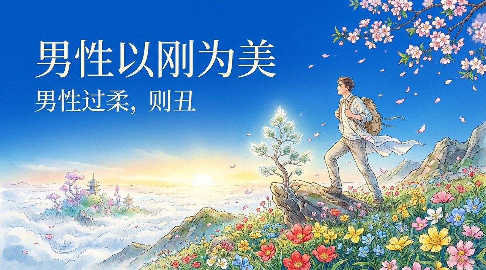
    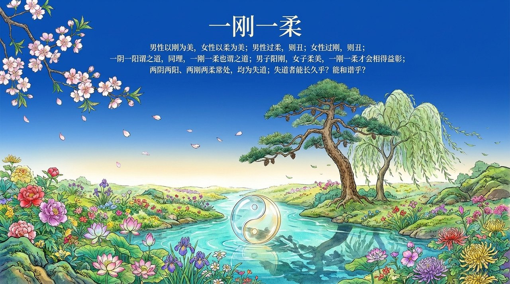
    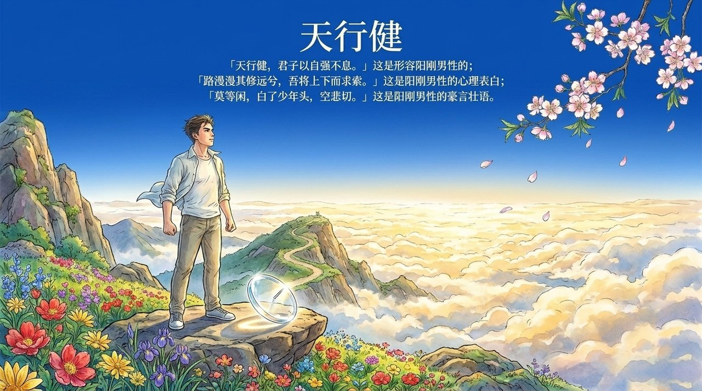
    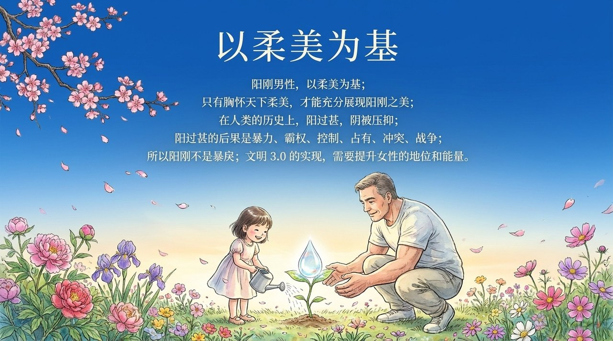
    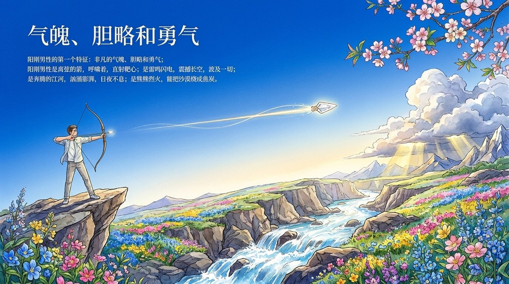
    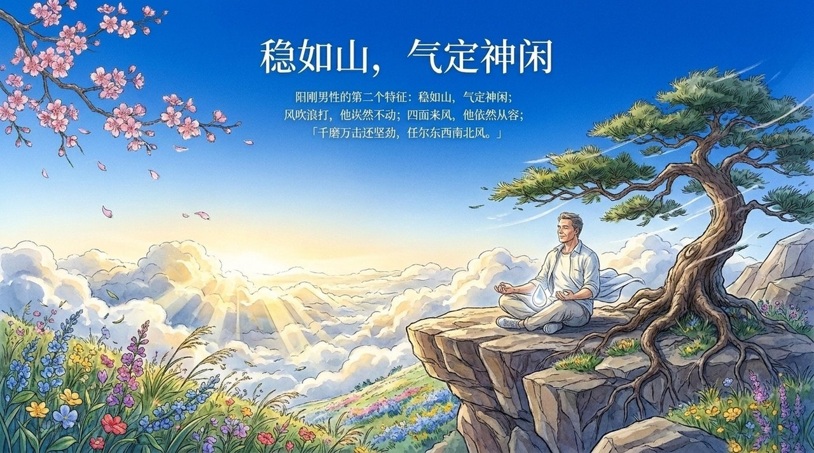
    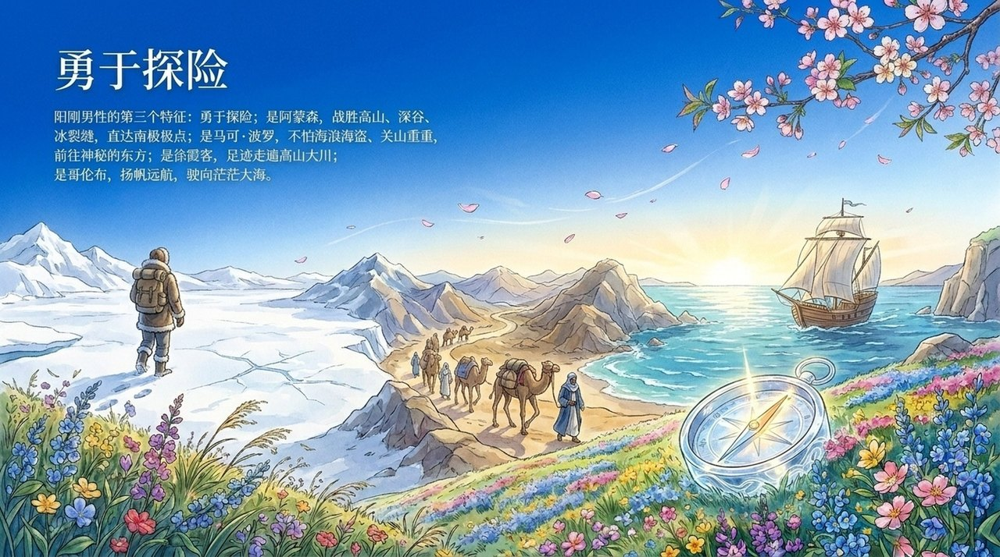
    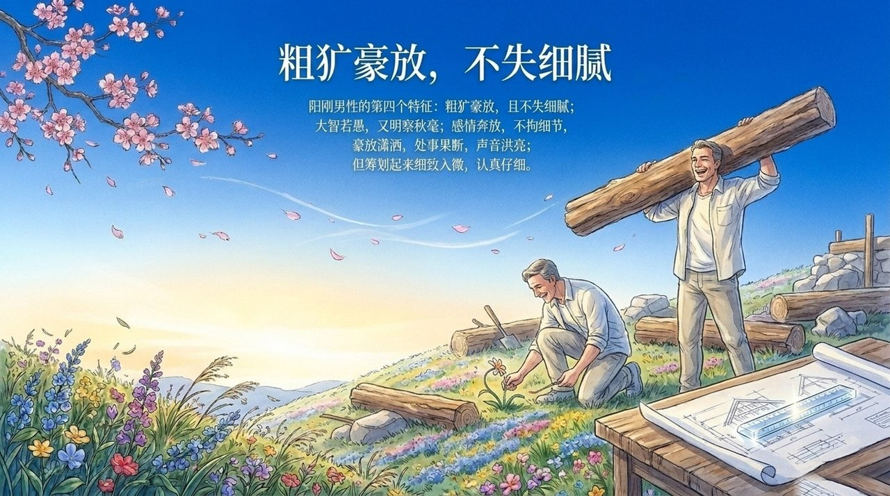
    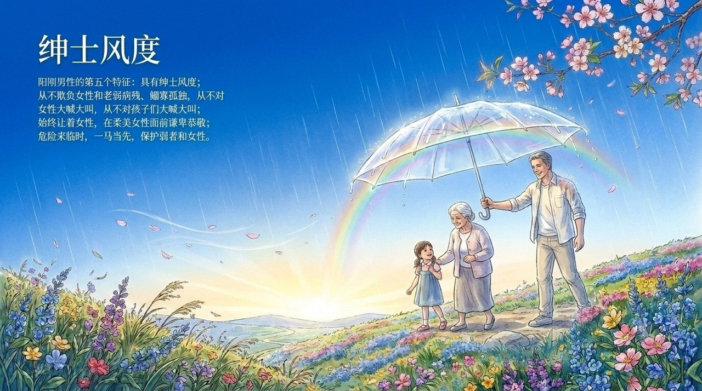
    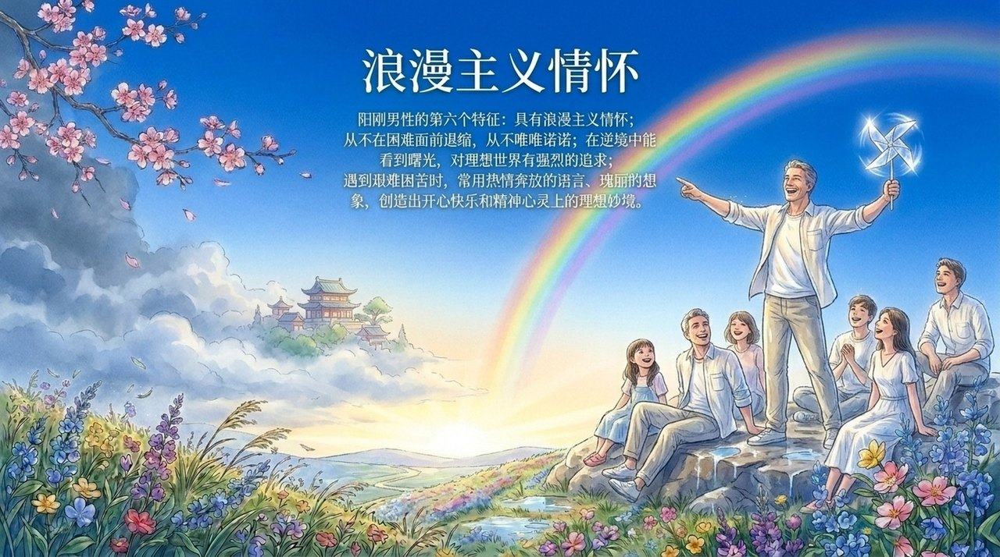
    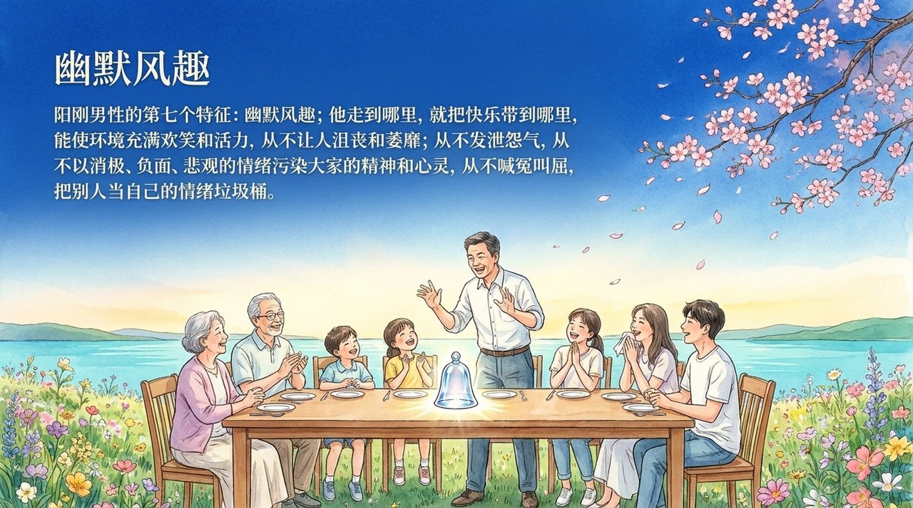
    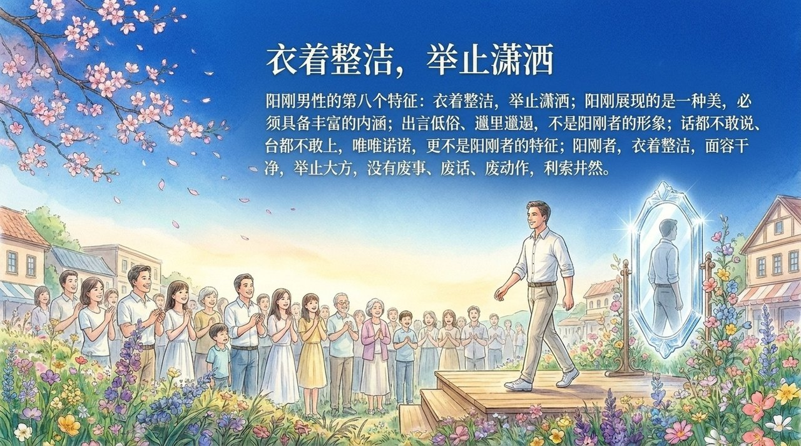
    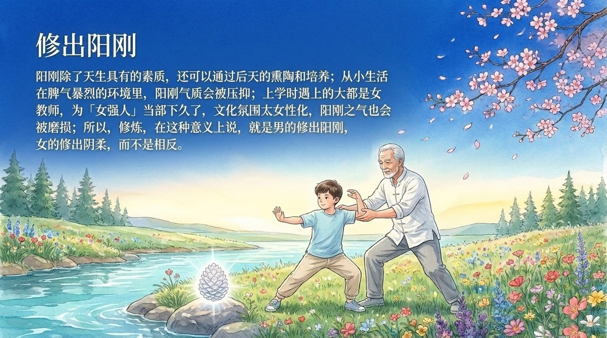
    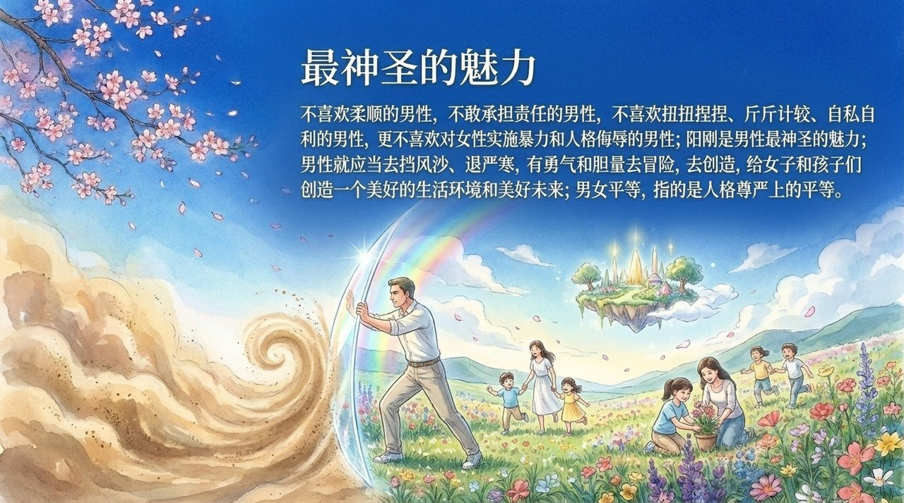

---

## 版本导航

| 版本 | 适合 | 核心角度 |
|------|------|----------|
| [友好版](friendly.md) | 初次了解 | 生活体验·阳刚真谛·修炼视角 |
| [学术版](academic.md) | 研究者 | 概念辨析·体系定位·与外部概念比较 |
| [内部版](internal.md) | 深度研修 | 完整引文·文集汇编·修炼实践 |

---

## 相关词条

[女性以柔为美](/zh/feminine-beauty-in-softness/) · [仙风道骨](/zh/xianfengdaogu/) · [完美人性的标准](/zh/perfect-human-nature/) · [教养·修养·涵养](/zh/jiaoyang-xiuyang-hanyang/) · [天性·秉性·习性](/zh/tianxing-bingxing-xixing/) · [超凡脱俗](/zh/chaofantuosu/) · [灵性人生](/zh/spiritual-life/) · [真善美爱信诚](/zh/six-qualities/)

> 注：本页引用的《新时代人类八百理念》条号，均为第四版的编号。第五版已重新编排，条号与第四版不再一一对应。
