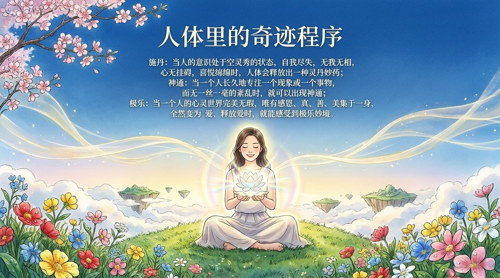

<!-- id: LC-MC-0001-ZH theme: 修行 type: 导航 direction: 生活修炼 lang: zh -->

# 奇迹

奇迹，在生命禅院体系中，是指"认为不可能发生的事发生了，或最美好的愿望实现了"。奇迹并非神秘的偶然恩赐，而是宇宙程序在条件具备时自动运行的结果；通过专注与坚持、心灵净化与信仰，人人皆可触动程序，让奇迹在不知不觉中自然降临。

> "追求奇迹的永远得不到奇迹，坚守平常的最终将有奇迹降临。"
>
> *（禅院文集·传道篇·不要祈祷奇迹的发生）*

---

## 视频版

<iframe style="width:100%;aspect-ratio:4/3;border:0" src="https://www.youtube-nocookie.com/embed/Ipk9QqY79NM" title="奇迹（生命禅院百科·视频版）" allowfullscreen></iframe>

??? info "📖 图文幻灯（14 张，点击展开）"

    
    
    
    
    
    
    
    
    
    
    
    
    
    

---

## 版本导航

| 版本 | 适合 | 核心角度 |
|------|------|----------|
| [友好版](friendly.md) | 初次了解 | 生活类比·获得奇迹的方法·小奇迹训练 |
| [学术版](academic.md) | 研究者 | 概念辨析·人体八大奇迹程序·体系定位 |
| [内部版](internal.md) | 深度研修 | 完整引文·八节框架·修炼实践指南 |

---

## 相关词条

[人体——奇迹程序和奥秘](/zh/human-body-miracle/) · [极乐妙境](/zh/jilemiaojing/) · [祈祷](/zh/prayer/) · [八无境界](/zh/eight-no-realms/) · [同频共振](/zh/resonance/) · [专注与坚持（见净化心灵）](/zh/jinghuaxinling/) · [神通（见成仙成佛）](/zh/becoming-celestial-buddha/) · [生命禅院的合作之道](/zh/way-of-cooperation/)
