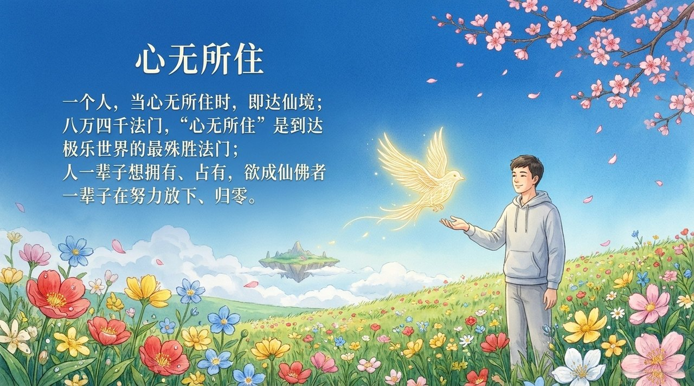

<!-- id: LC-NFT-0001 theme: 思维修炼 type: 入口页 direction: 意识升华路径 lang: zh -->

# 无相思维

【入口页】

**无相思维**是八大思维阶梯中的**第七级**，是太极思维之上、浑沌思维之下的倒数第二梯，是"减法阶段"中最接近宇宙本源的灵性境界。无相思维的核心：**让一切归零**——离开一切相状，直指宇宙本源、万象运作原理和生命本如。佛陀释迦牟尼的思维是无相思维，整部《金刚经》是专为引导人类进入无相思维而建造的法船。

> 无相思维，顾名思义，就是离开了一切相状后对宇宙本源、万象运作原理、生命本如的认识和思考方式。
>
> ——禅院文集·修行修炼篇·无相思维（一）

---

## 核心定位

在生命禅院修行路线图中，无相思维是减法阶段的第三级（心像→太极→**无相**→浑沌）。到了无相层级，已经基本不需要"动脑子"——归零了，就是佛了。神仙的主体思维是无相思维；"达到了无相思维的境界，就可以成佛了，这是毫无疑问的。"

---

## 视频版

<iframe style="width:100%;aspect-ratio:4/3;border:0" src="https://www.youtube-nocookie.com/embed/_fqyMp98VzU" title="无相思维（生命禅院百科·视频版）" allowfullscreen></iframe>

??? info "📖 图文幻灯（14 张，点击展开）"

    
    
    
    
    
    
    
    
    
    
    
    
    
    

---

## 版本导航

| 版本 | 适合读者 | 链接 |
|------|---------|------|
| **友好版** | 初次接触生命禅院的朋友 | [阅读友好版](./friendly) |
| **学术版** | 哲学/宗教研究背景的读者 | [阅读学术版](./academic) |
| **内部版** | 禅院草和深度修炼者 | [阅读内部版](./internal) |

---

## 相关词条

- [八大思维阶梯](/zh/eight-thinking-ladders/)——无相思维在整体体系中的坐标
- [太极思维](/zh/taiji-thinking/)——第六梯，无相思维的前一级
- [浑沌管理](/zh/hundun-management/)——浑沌思维（第八梯）的实践层面
- [极乐界](/zh/elysium-world/)——无相思维通往的生命空间
