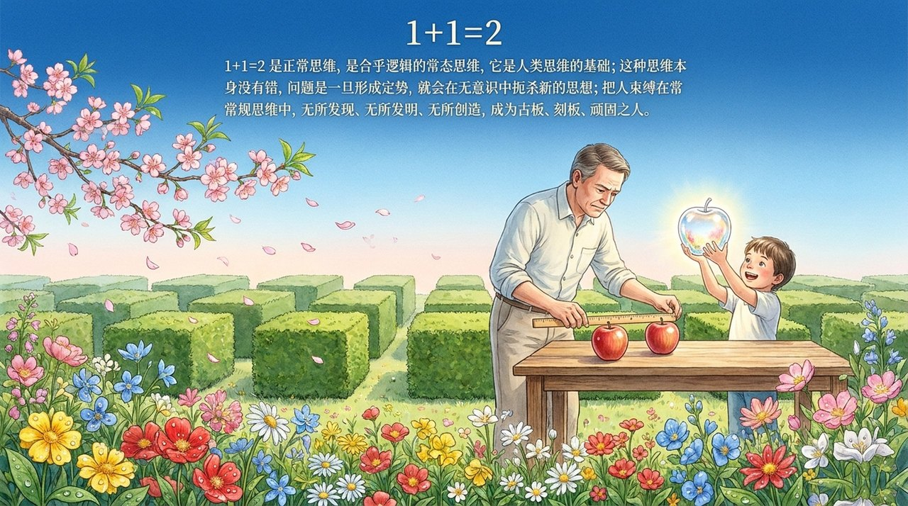
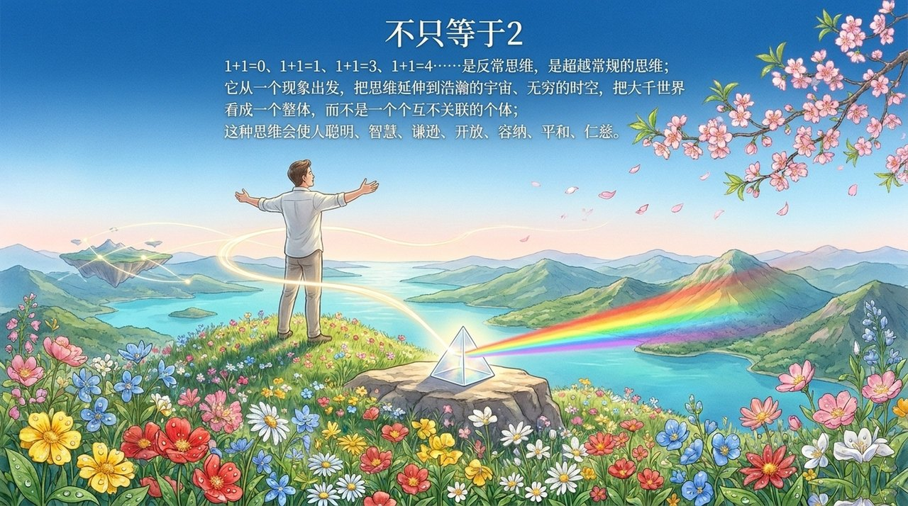
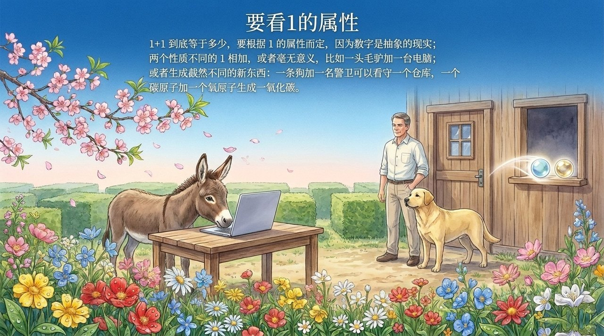
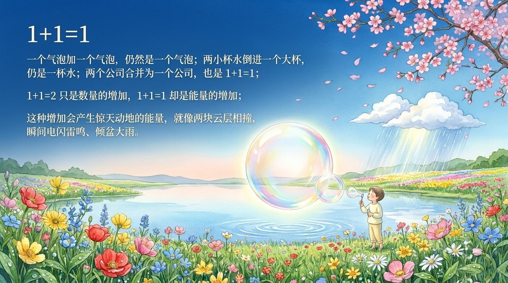
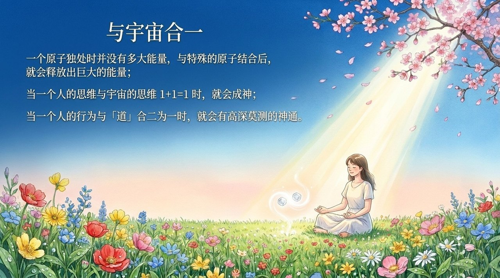
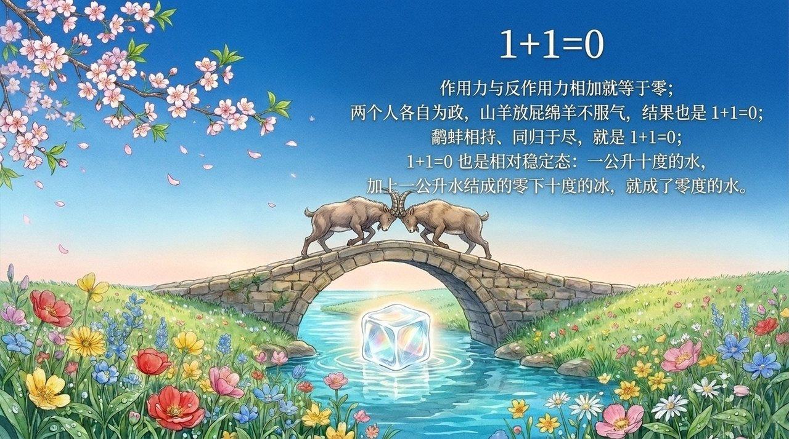
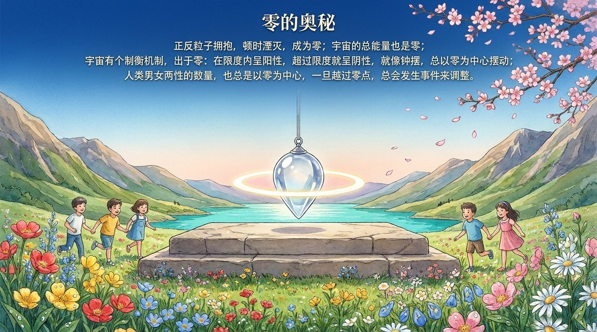
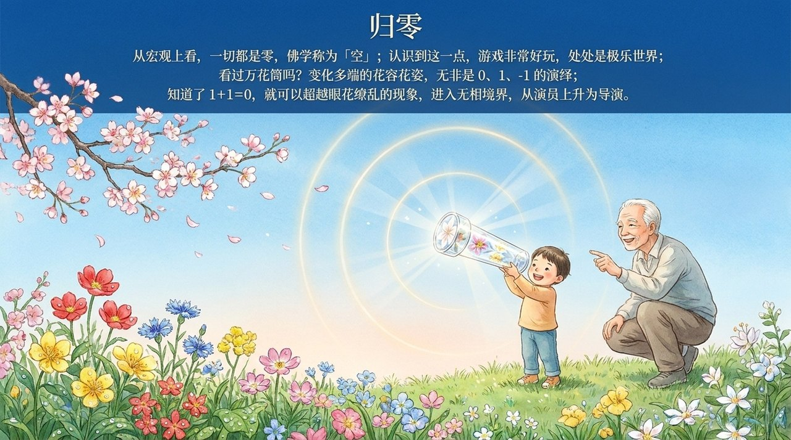
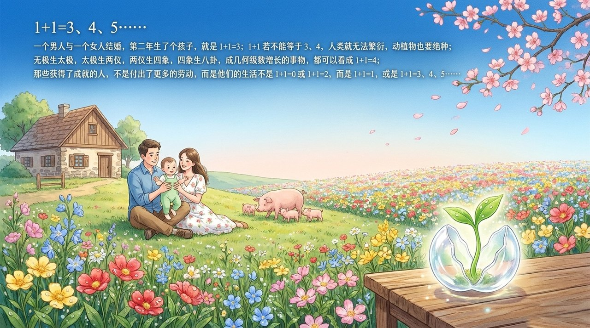

<!-- id: LC-OPO-0001 theme: 思维修炼 type: 入口页 direction: 意识跃升路径 lang: zh -->

# 1+1思维

> 1+1=2是数量的增加，1+1=1是能量的增加。圣人抱一为天下式。
>
> ——《新时代人类八百理念》

> 1+（-1）=1是知晓宇宙奥妙的一把钥匙。
>
> ——《新时代人类八百理念》

**1+1思维**是《禅院文集·反常思维篇》中最精准、最可操作的反常思维工具，通过对最基础的数学等式"1+1"的全面解构，揭示宇宙运行的深层规律：数字的结果不是固定的，而是由相加事物的**属性**决定的。宇宙不是线性的1+1=2的世界，而是浑沌的、全息的、阴阳对立统一的世界。

从1+1=2（物质思维）到1+1=1（能量思维/与道合一），到1+1=0（归零/无相境界），到1+（-1）=宇宙（对立统一/全息认知），再到10-9="道"（入道法门）和1+0=无穷大（融入负宇宙）——1+1思维以最简洁的数学符号，构成了一张完整的意识升华路线图。

---

## 各版本

| 版本 | 适合人群 | 核心内容 |
|------|----------|----------|
| [友好版](/zh/one-plus-one-thinking/friendly/) | 初次接触者 | 1+1为什么不一定等于2？七种结果的白话解读 |
| [学术版](/zh/one-plus-one-thinking/academic/) | 研究者 | 与量子论、辩证法、老子"抱一"、数论哲学的比较研究 |
| [内部版](/zh/one-plus-one-thinking/internal/) | 禅院草 | 文集完整原文，13个板块全量照引 |

---

## 视频版

<iframe style="width:100%;aspect-ratio:4/3;border:0" src="https://www.youtube-nocookie.com/embed/KVHTotTwGDQ" title="1+1思维（生命禅院百科·视频版）" allowfullscreen></iframe>

??? info "📖 图文幻灯（14 张，点击展开）"

    
    
    
    
    
    
    
    
    
    
    
    
    
    

---

## 相关词条

- [反常思维](/zh/abnormal-thinking/)
- [颠倒思维](/zh/inverted-thinking/)
- [无相思维](/zh/non-form-thinking/)
- [定势思维](/zh/fixed-mindset/)

> 注：本页引用的《新时代人类八百理念》条号，均为第四版的编号。第五版已重新编排，条号与第四版不再一一对应。
