<!-- id: LC-OTM-0001-ZH theme: 修行修炼 type: 导航 direction: 修行修炼 lang: zh -->

# 一对一特殊关系·夫妻关系

**一对一特殊关系**是指男女两人之间相互牵挂、相互爱慕、相互操心、相互维护，有过性生活且喜欢在一起的固定情感依附模式；**夫妻关系**是其制度化形式。生命禅院认为，二者在本质上相同——均属于相互占有的私有制，是自私的根源，与天国"不娶不嫁"的生命状态背道而驰，是修行者走向仙佛境界的最大障碍之一。

> "夫妻关系标志着男女两人相互拥有，相互占有，相互依存，相互牵制，与外界形成了一种隔膜。走进夫妻关系里的人，没有一个是不自私的，没有一个能到达天国。"
>
> *（雪峰文集·禅院篇·男女一对一是一种丑陋现象）*

---

## 视频版

<iframe style="width:100%;aspect-ratio:4/3;border:0" src="https://www.youtube-nocookie.com/embed/Xv04Pk2bo-E" title="一对一特殊关系·夫妻关系（生命禅院百科·视频版）" allowfullscreen></iframe>

??? info "📖 图文幻灯（14 张，点击展开）"

    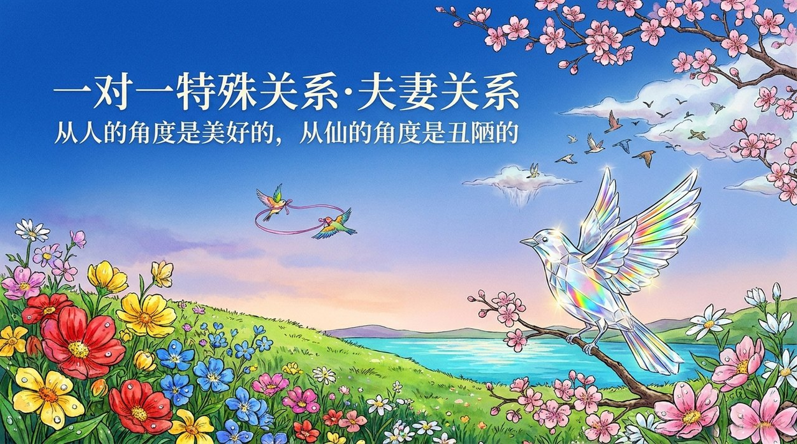
    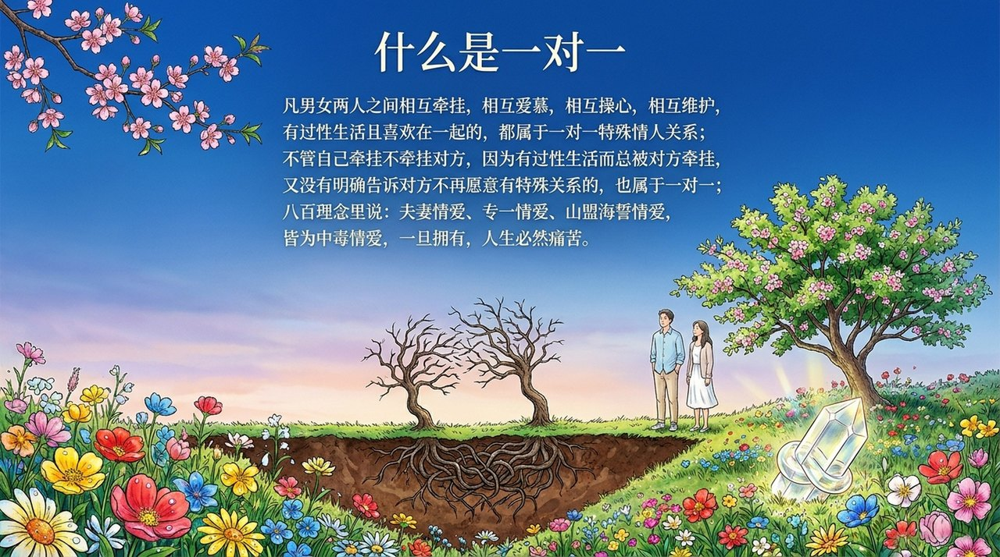
    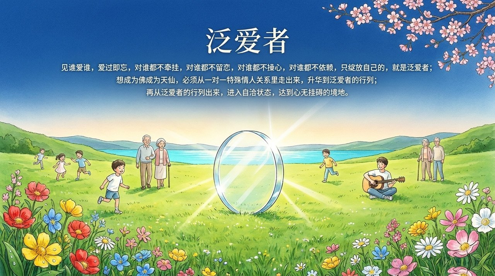
    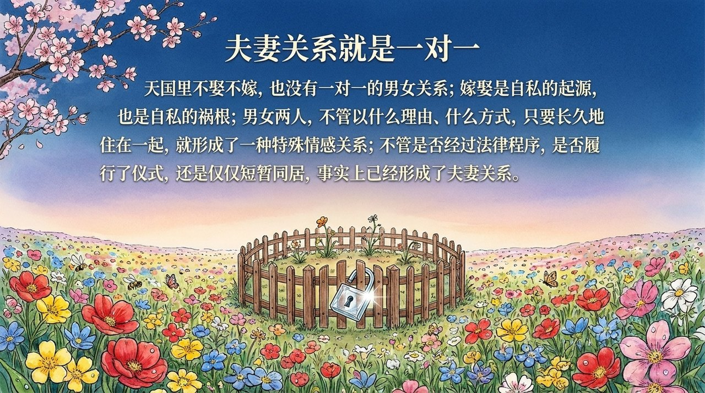
    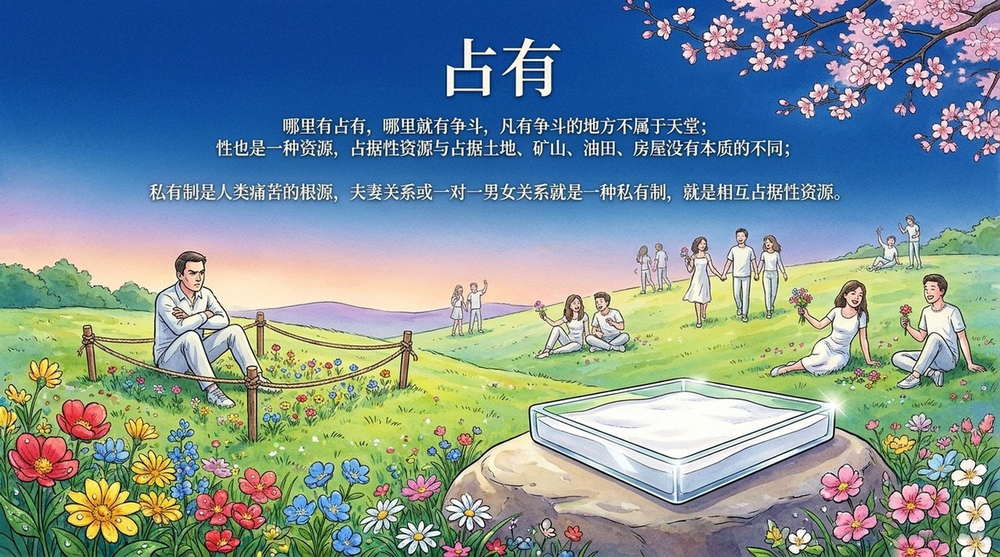
    
    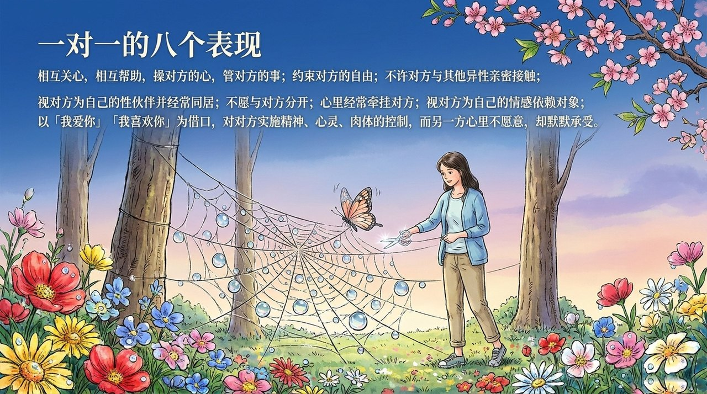
    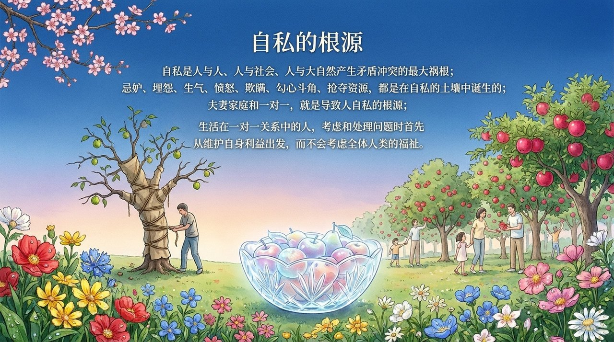
    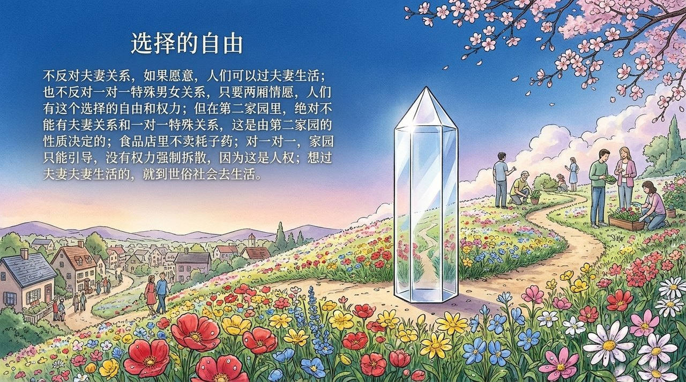
    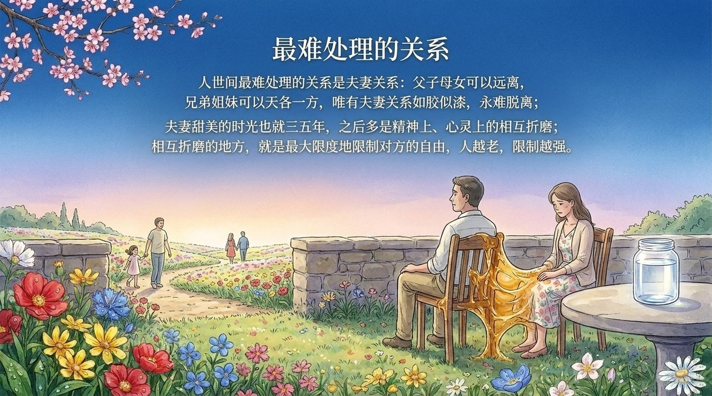
    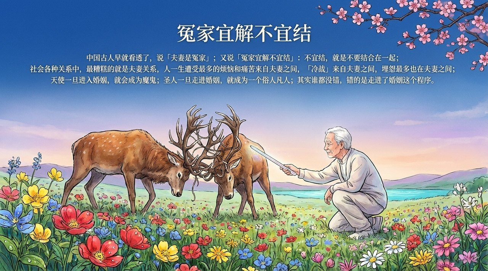
    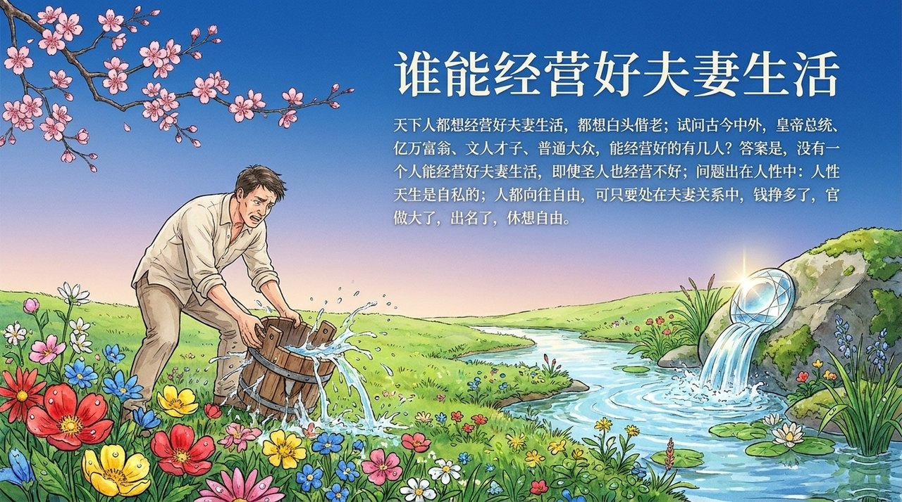
    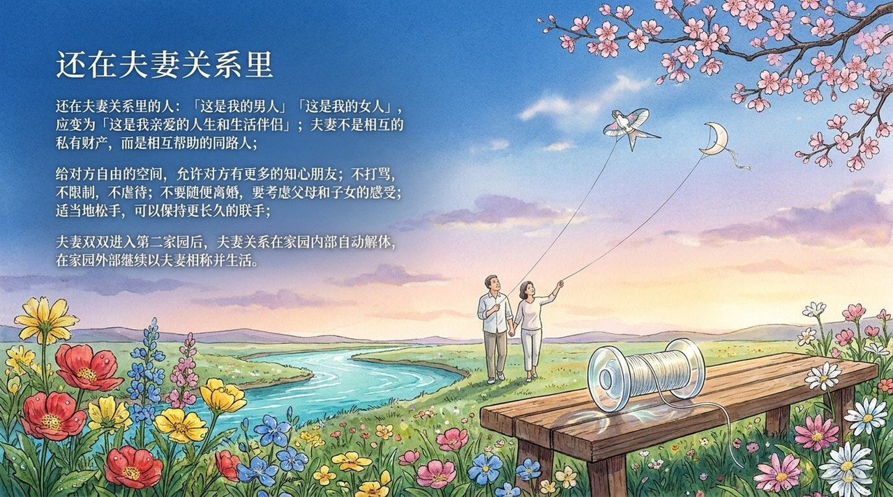
    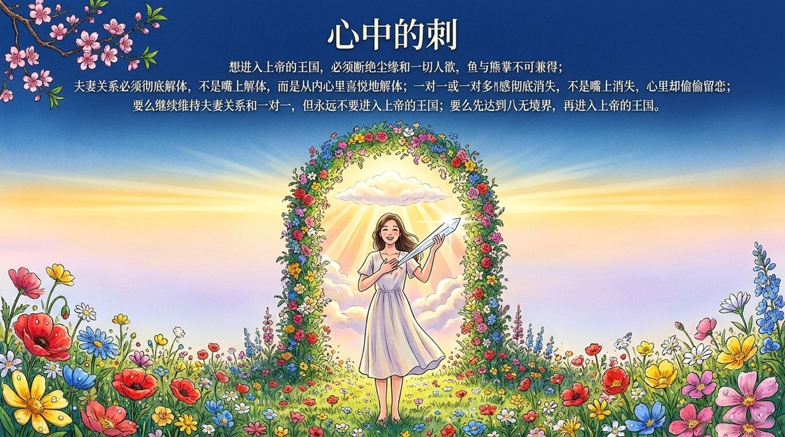

---

## 版本导航

| 版本 | 适合 | 核心角度 |
|------|------|----------|
| [友好版](friendly.md) | 初次了解 | 生活实例·体验感悟·出路指引 |
| [学术版](academic.md) | 研究者 | 概念辨析·体系定位·比较分析 |
| [内部版](internal.md) | 深度研修 | 完整引文·文集汇编·修炼实践 |

---

## 相关词条

[情爱·性爱](/zh/love-and-sexuality/) · [量子纠缠和"另一半"](/zh/quantum-entanglement-and-the-other-half/) · [家里人都是仇人](/zh/family-as-foes/) · [了却尘缘](/zh/releasing-worldly-bonds/) · [自洽](/zh/self-consistency/) · [心无所住·心无挂碍](/zh/xinwu-suozhu-guaai/) · [八无境界](/zh/eight-none-realm/) · [生命绿洲](/zh/life-oasis/) · [第二家园](/zh/second-home/) · [成仙成佛](/zh/becoming-celestial-buddha/)
