<!-- id: LC-TXYJ-0001-ZH theme: 社会 type: 导航 direction: 文明愿景 lang: zh -->

# 天下一家

> 共产主义是人类所向往的最理想的社会状态，其主要特征是：“贤不遗野，天下一家”，既然是天下一家，那就说明没有国家，也没有婚姻家庭，没有私有财产，一切资源共享。
>
> ——雪峰文集·警世篇·共产主义旗帜依然在这里飘扬

**天下一家**，是导游雪峰为人类开创的生命禅院时代的核心标志，语出诸葛亮《马前课》第十三课“贤不遗野，天下一家”，文集中常与“道不拾遗，夜不闭户”并举。既然是天下一家，就没有国家、政党、宗教、婚姻家庭，没有私有财产，一切资源共享；人人都是地球公民，可以在全世界自由迁徙。

它的条件是“贤不遗野”：贤人不被埋没，各地方由全人类中最文明最优秀的人来管理。它的样板是第二家园：三年换一处家园，将来256处家园走到哪里都一样，“你会体验到那是‘天下一家’的感受”。它的时代是文明3.0。导游说，这件事靠人做不到，靠道能做到；禅院草只管升华为仙。

---

## 视频版

<iframe style="width:100%;aspect-ratio:4/3;border:0" src="https://www.youtube-nocookie.com/embed/GbDDkti9BPk" title="天下一家（生命禅院百科·视频版）" allowfullscreen></iframe>

??? info "📖 图文幻灯（14 张，点击展开）"

    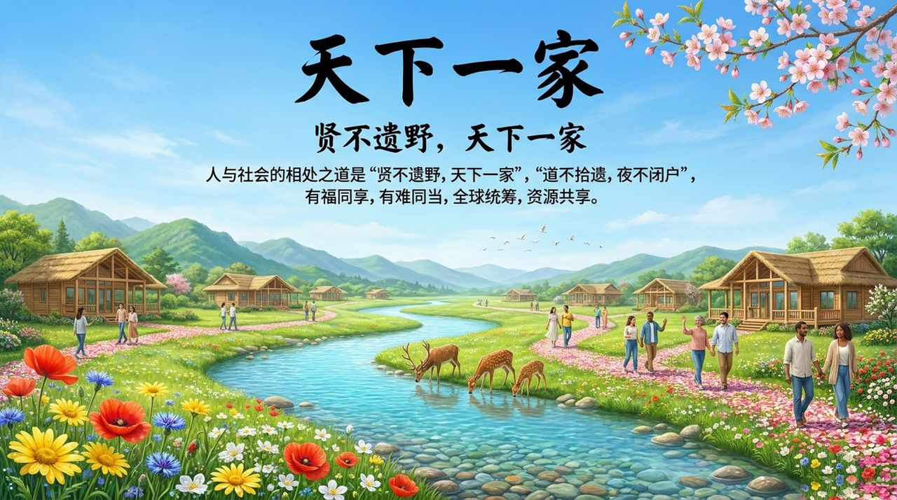
    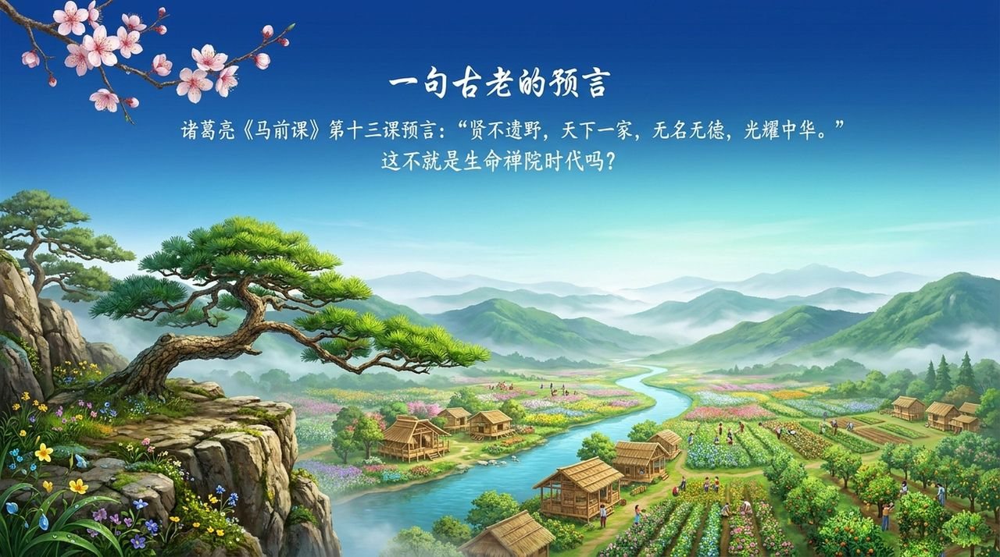
    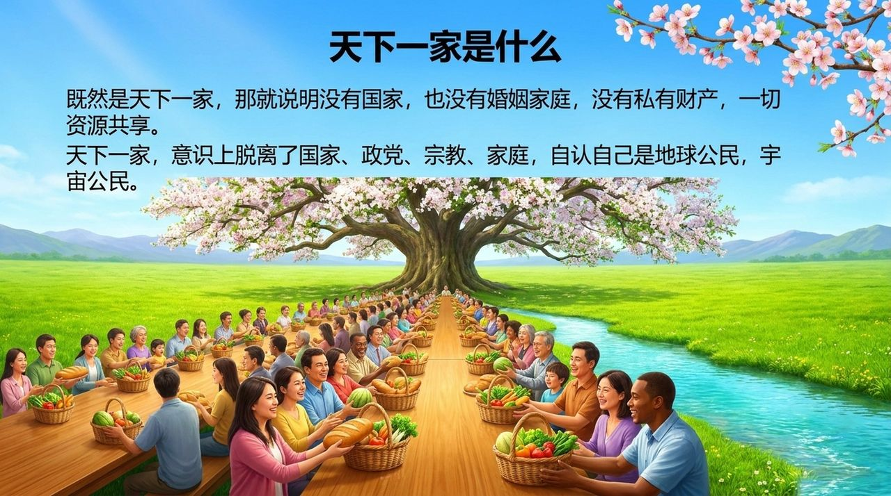
    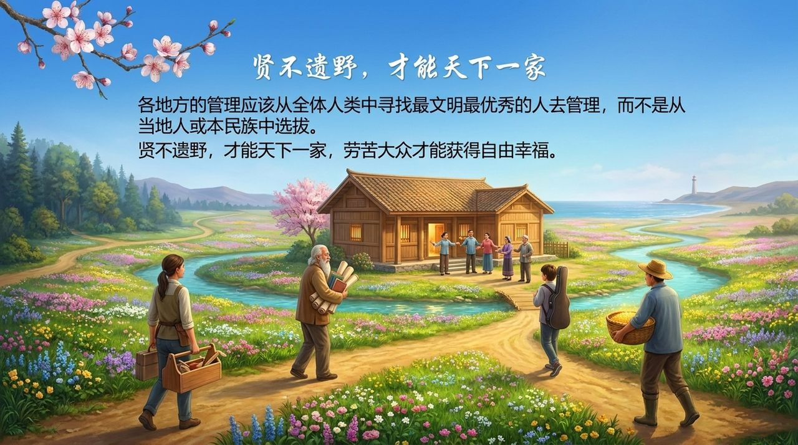
    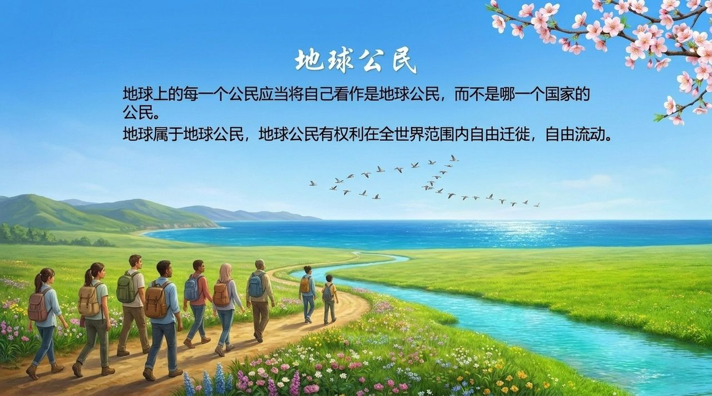
    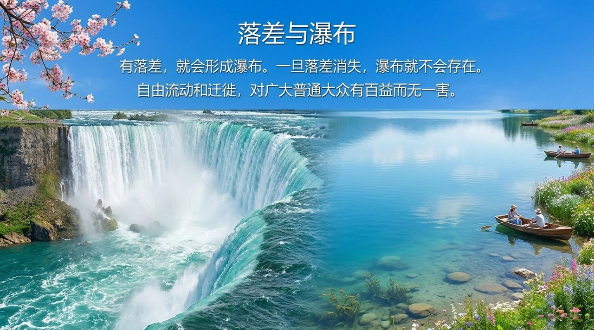
    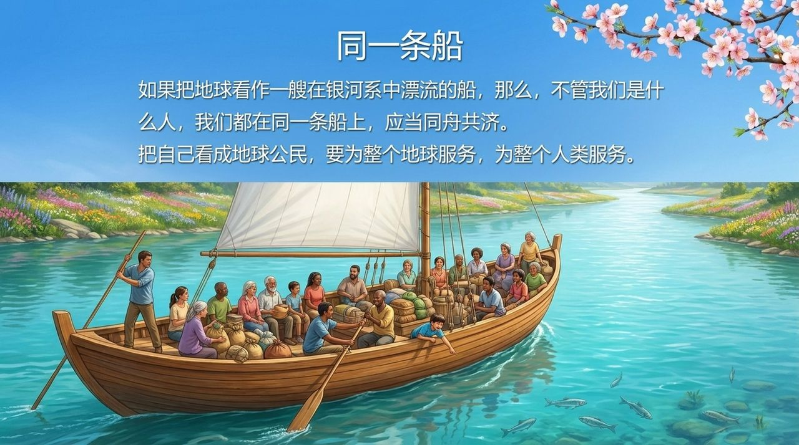
    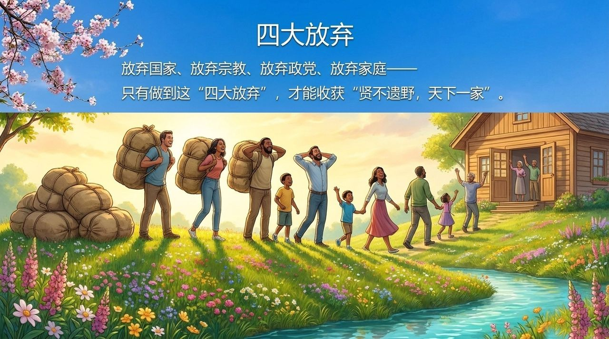
    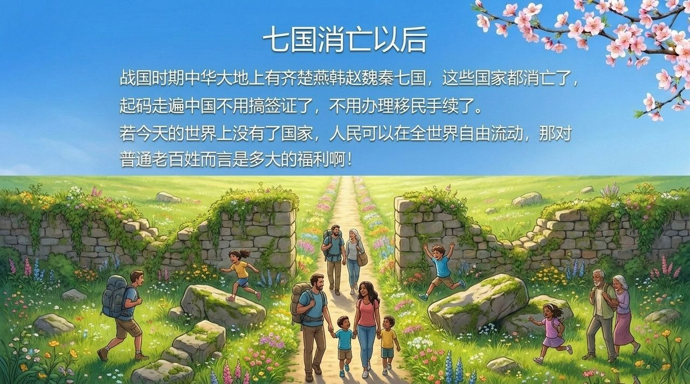
    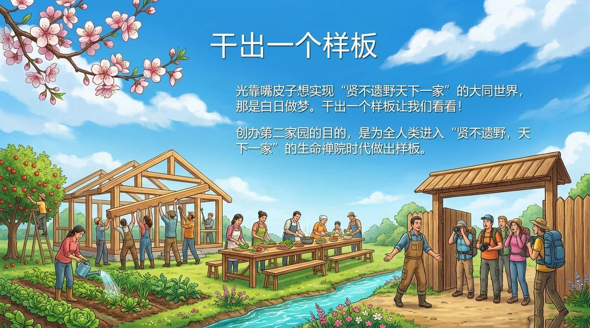
    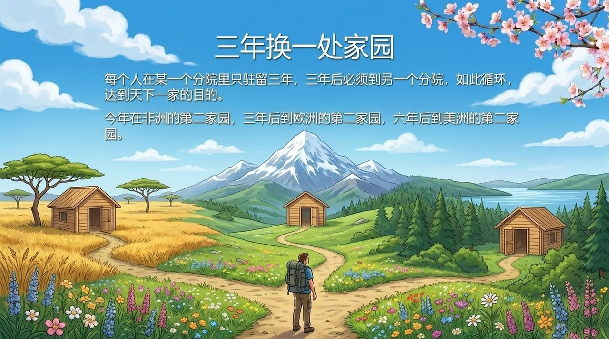
    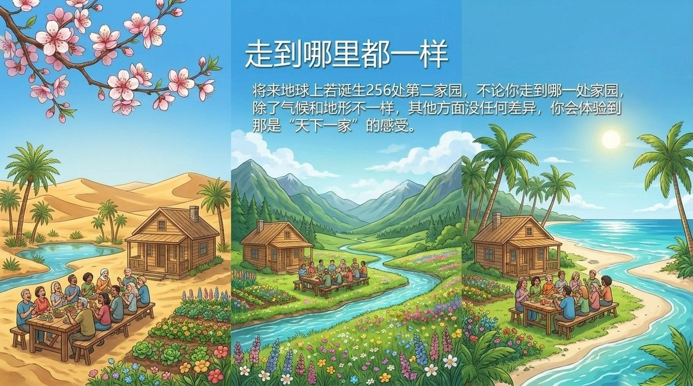
    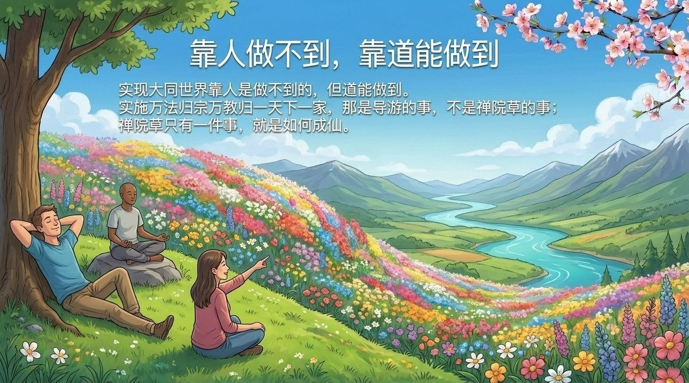
    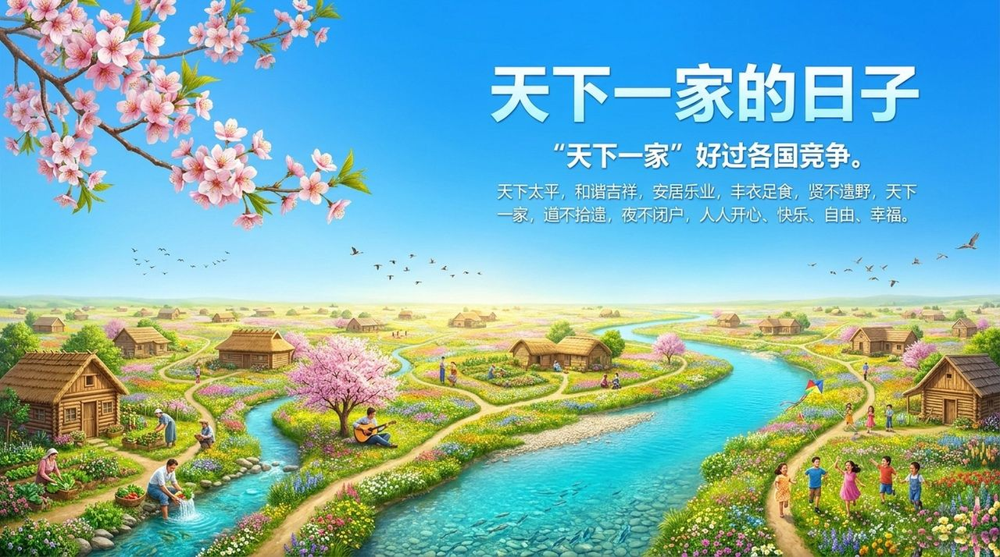

---

## 版本导航

| 版本 | 适合读者 | 特点 |
|------|---------|------|
| [通俗版](friendly.md) | 初次了解者 | 天下一家是什么样·没有国家会不会更乱·第二家园怎么过成一家人 |
| [学术版](academic.md) | 研究者 | 语源与定义·“贤不遗野”的条件关系·地球公民论·与大同、世界主义、世界政府论的对照 |
| [内部版](internal.md) | 修行者·研究者 | 完整文集引文·只收导游雪峰本人的论述·表述演进 |

---

## 相关词条

[国际大家庭](/zh/guoji-dajiating/) · [第二家园](/zh/second-home/) · [生命禅院时代（新时代）](/zh/lifechanyuan-new-era/) · [文明（总论）](/zh/civilization-overview/) · [文明3.0](/zh/civilization-3-0/) · [人类文明跃升](/zh/civilizational-leap/) · [全球政府](/zh/global-government/) · [雪峰式共产主义](/zh/xuefeng-communism/) · [抱一](/zh/embrace-the-one/) · [民主](/zh/democracy/) · [圣人·贤人](/zh/sages-and-worthies/) · [夫妻·婚姻·家庭](/zh/marriage-and-family/) · [千年界](/zh/thousand-year-world/) · [乌托邦](/zh/utopia/)
