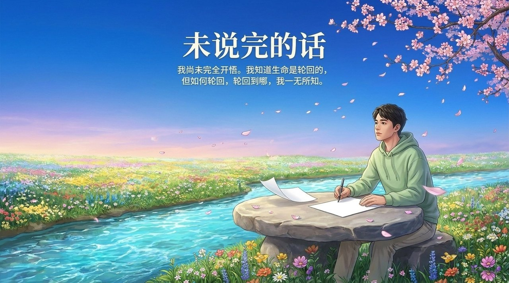
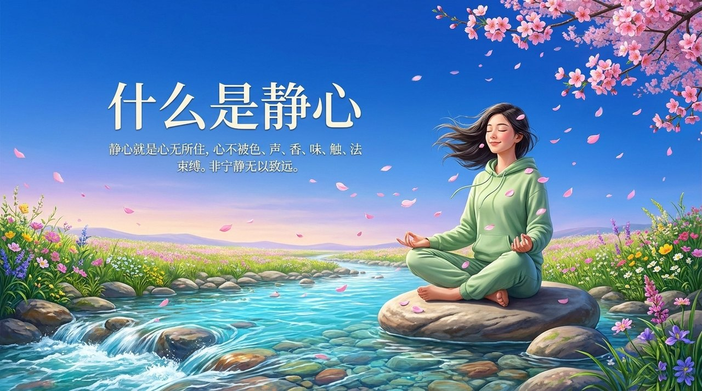

<!-- id: LC-OSH-0001-ZH theme: 修行修炼 type: index direction: 修行修炼 lang: zh -->

# 奥修

**奥修**（Osho，1931—1990），印度思想家，在生命禅院体系中被定位为"知音"与"先驱"。导游雪峰高度认同奥修的反宗教组织、倡导真正自由的思想，并将其列为生命禅院配套读物之一；但雪峰明确指出，奥修缺乏生命观，不明白生命的原理和奥妙，"只来到了雪峰山下"，其静心法门不是究竟的、不是终极的——生命禅院的道路在奥修之上。

---

## 视频版

<iframe style="width:100%;aspect-ratio:4/3;border:0" src="https://www.youtube-nocookie.com/embed/9nh_gegqD8U" title="奥修（生命禅院百科·视频版）" allowfullscreen></iframe>

??? info "📖 图文幻灯（14 张，点击展开）"

    
    
    
    
    
    
    
    
    
    
    
    
    
    

---

## 版本导航

| 版本 | 适合读者 | 核心角度 |
|------|---------|---------|
| [友好版](friendly.md) | 初次了解者 | 奥修说了什么？雪峰为什么说他是知音，又为什么说他不够？ |
| [学术版](academic.md) | 研究者 | 奥修在生命禅院体系中的定位、静心法批判、与禅院道路的比较 |
| [内部版](internal.md) | 深度研修 | 完整文集引文，奥修语录、雪峰评述与超越论述 |

---

## 相关词条

[修行修炼](/zh/cultivation-practice/) · [觉悟](/zh/juewu/) · [明心见性](/zh/mingxinjianxing/) · [宗教](/zh/religion/) · [心无所住·心无挂碍](/zh/xinwu-suozhu-guaai/) · [灵性](/zh/lingness/) · [第二家园](/zh/second-home/) · [生命禅院](/zh/lifechanyuan/) · [千百年来修行者的迷区](/zh/cultivation-practitioners-blind-spots/) · [佛法](/zh/buddha-dharma/)
