# 一无所有·拥有一切

> **一无所有，才能拥有一切。**——新时代人类八百理念

"一无所有·拥有一切"是生命禅院的核心修炼理念，指个人放下私有执念、不占有任何财产，却因此得以自由享用宇宙馈赠的一切。这是天国生活的写照，是第二家园"无有制"的根本原则，是耶稣、佛陀、老子教导在人间的汇流终点，也是走向美好生命空间的最大奥秘。

---

| 版本 | 适合 | 核心角度 |
|------|------|----------|
| [友好版](friendly.md) | 初次了解 | 生活类比，感受放下执念的自由 |
| [学术版](academic.md) | 研究者 | 系统分析，对比无有制与私有/公有制 |
| [内部版](internal.md) | 深度研修 | 导游文集全文，完整引文与出处 |

---

## 视频版

<iframe style="width:100%;aspect-ratio:4/3;border:0" src="https://www.youtube-nocookie.com/embed/Y259D3fu1_g" title="一无所有·拥有一切（生命禅院百科·视频版）" allowfullscreen></iframe>

??? info "📖 图文幻灯（14 张，点击展开）"

    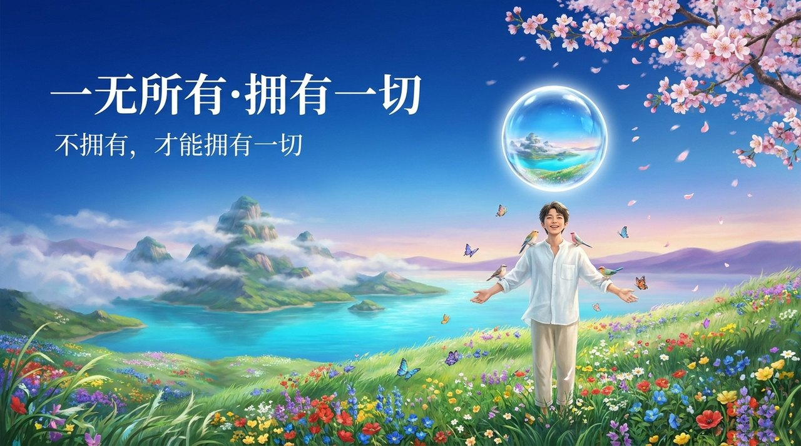
    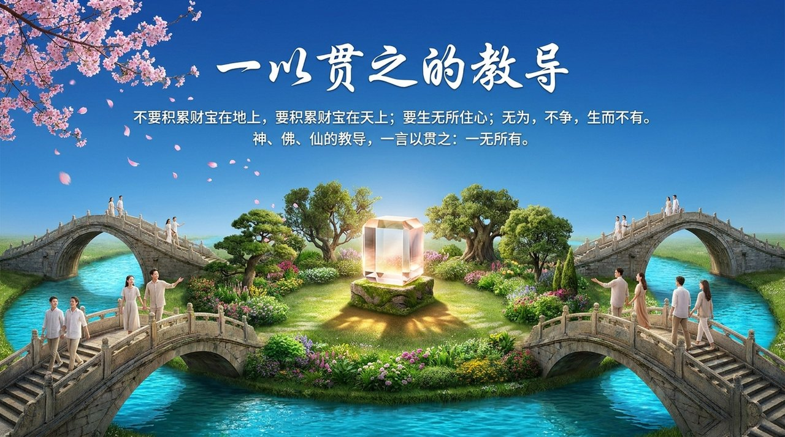
    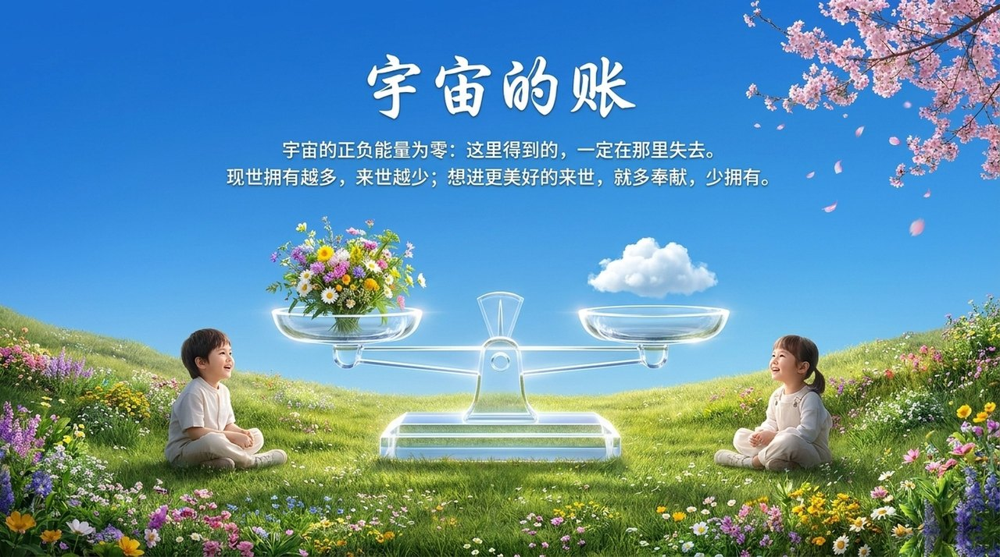
    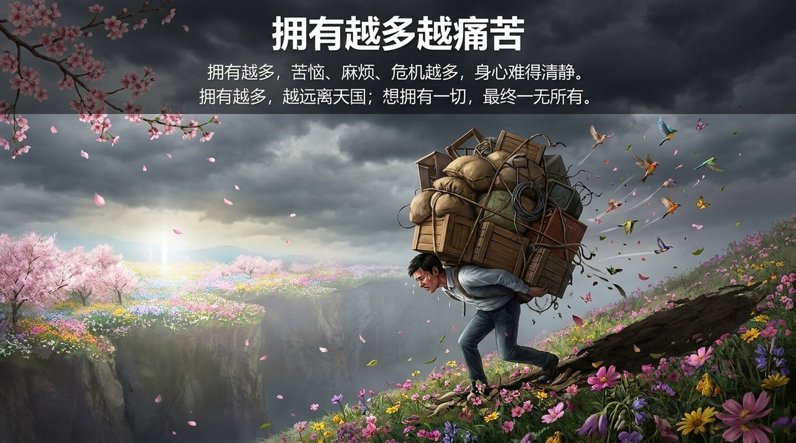
    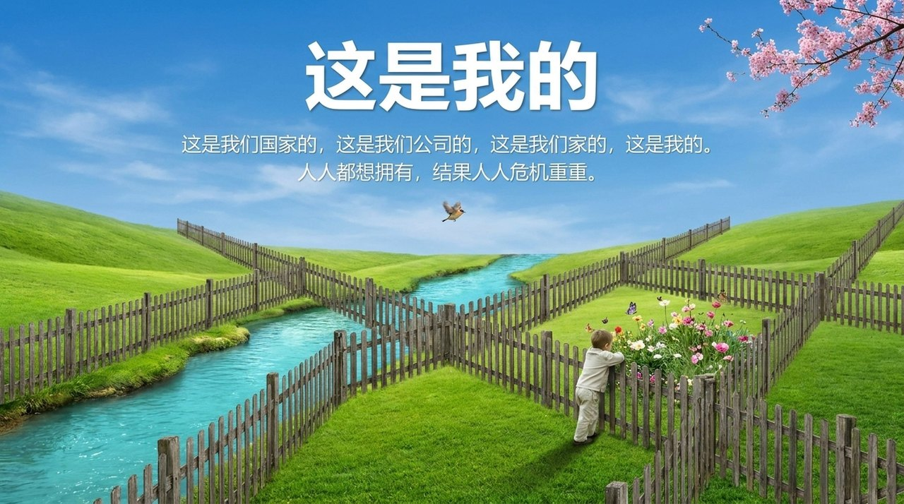
    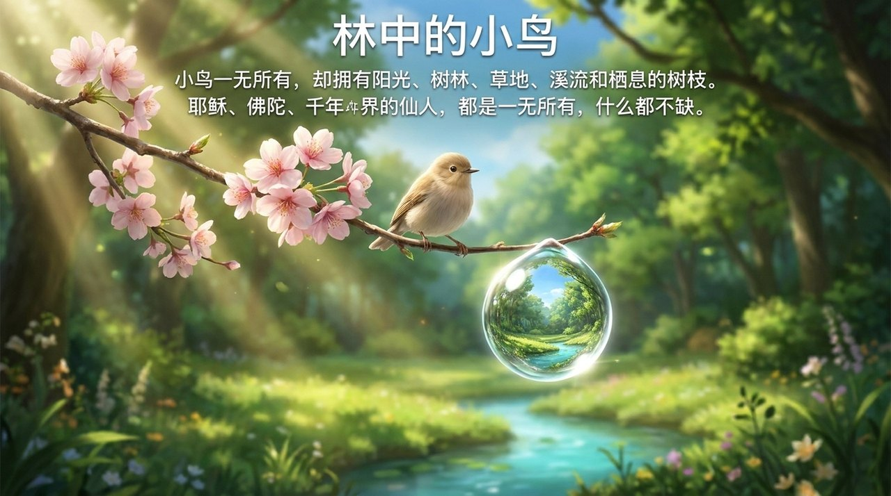
    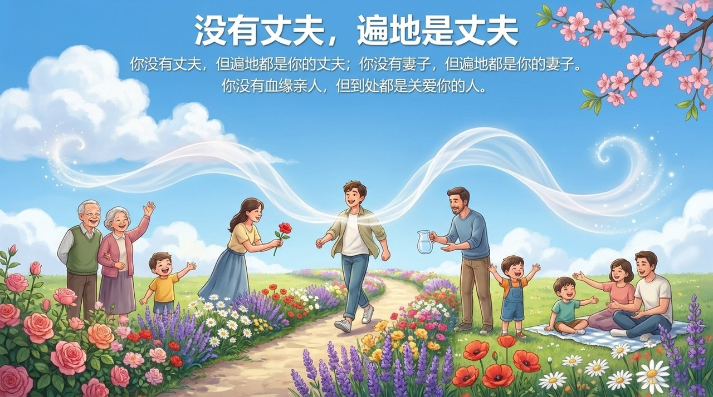
    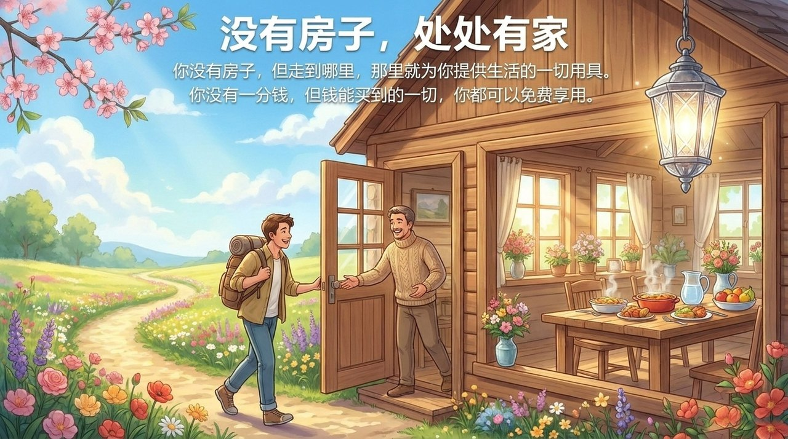
    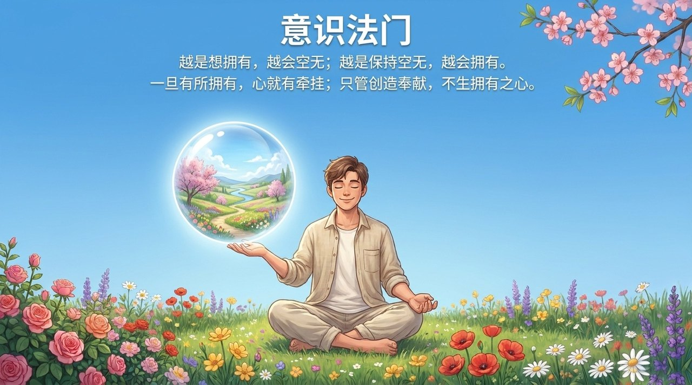
    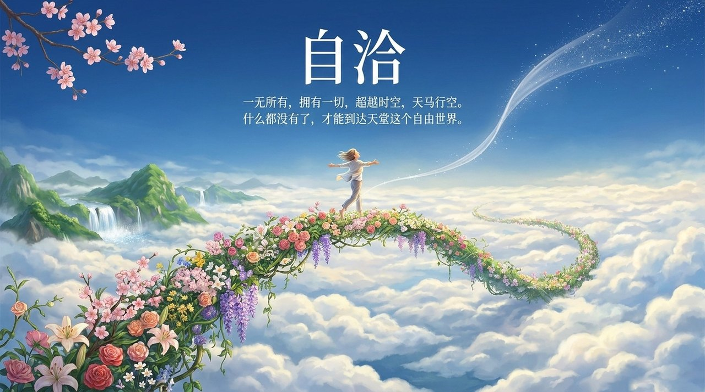
    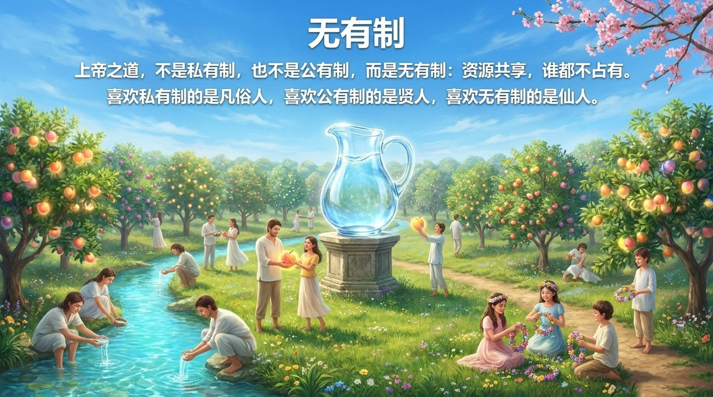
    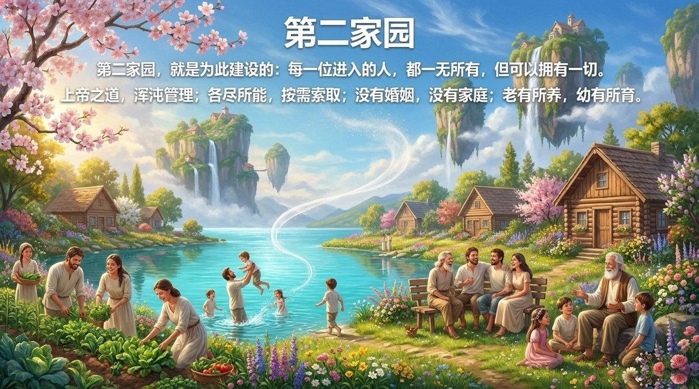
    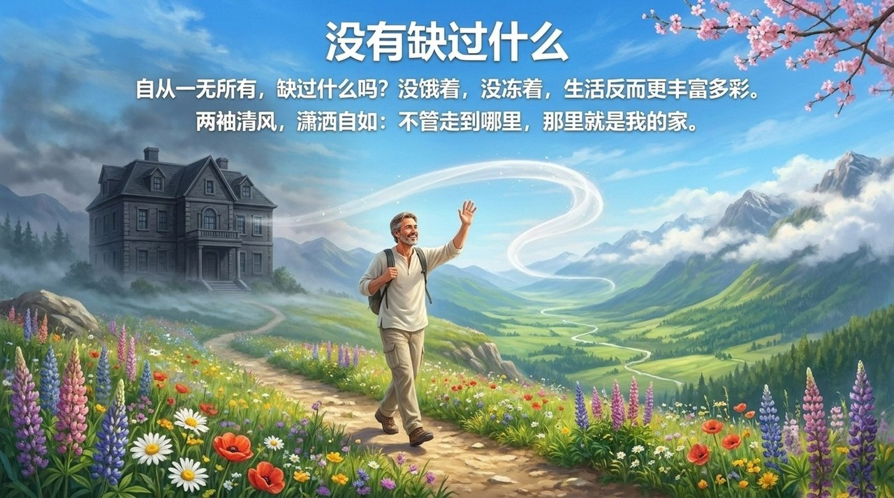
    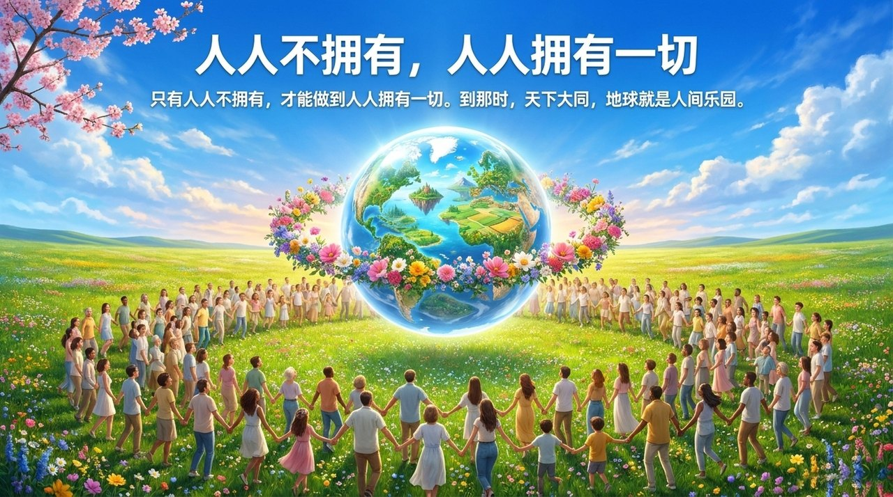

---

## 相关词条

[各尽所能·按需索取](/zh/contribute-by-ability-take-by-need/) · [无为而无不为](/zh/wu-wei/) · [无相布施](/zh/formless-giving/) · [自洽](/zh/self-coherence/) · [第二家园](/zh/second-home/) · [雪峰式共产主义](/zh/xuefeng-communism/) · [放下](/zh/letting-go/) · [归零](/zh/return-to-zero/) · [心无所住·心无挂碍](/zh/xinwu-suozhu-guaai/) · [天国财宝](/zh/heavenly-treasures/) · [颠倒梦想](/zh/diandao-mengxiang/)

> 注：本页引用的《新时代人类八百理念》条号，均为第四版的编号。第五版已重新编排，条号与第四版不再一一对应。
