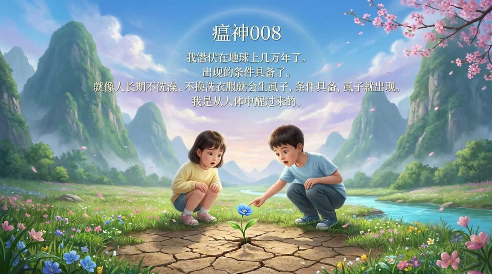

# 瘟神·瘟王·八气

**瘟神·瘟王·八气**是生命禅院体系对宇宙疾病管理机制的揭示：瘟王统领六十四尊各有编号的瘟神，专门维护地球的道德与心灵洁净；"八气"（腥气·戾气·脾气·胆气·心气·肺气·肾气·肝气）是瘟神激活的八大内在条件，与外部病原体无关，取决于人心的状态。

> "足够浓的腥气，足够烈的戾气，足够爆的脾气，足够怕的胆气，足够坏的心气，足够浊的肺气，足够弱的肾气，足够衰的肝气，八气具备，我自出现。"
>
> ——雪峰《我与武汉冠状病毒的对话》

## 视频版

<iframe style="width:100%;aspect-ratio:4/3;border:0" src="https://www.youtube-nocookie.com/embed/Mt4cGmOkt1c" title="瘟神·瘟王·八气（生命禅院百科·视频版）" allowfullscreen></iframe>

??? info "📖 图文幻灯（14 张，点击展开）"

    
    
    
    
    
    
    
    
    
    
    
    
    
    

---

| 版本 | 适合 | 核心角度 |
|------|------|----------|
| [友好版](friendly.md) | 初次了解 | 以故事与类比讲解瘟神体系与八气防护 |
| [学术版](academic.md) | 研究者 | 系统梳理瘟神理论框架与三论支撑 |
| [内部版](internal.md) | 深度研修 | 文集全文，一字不改，附出处索引 |

## 相关词条

[因果·报应·轮回](/zh/karma-retribution-reincarnation/) · [宇宙全息](/zh/cosmic-holography/) · [疾病·健康](/zh/disease-health/) · [生命禅院](/zh/lifechanyuan/) · [雪峰与上帝神佛仙对话系列](/zh/xuefeng-divine-dialogues/) · [道](/zh/dao/) · [去天国路线图](/zh/route-to-heaven/) · [归零](/zh/return-to-zero/)
