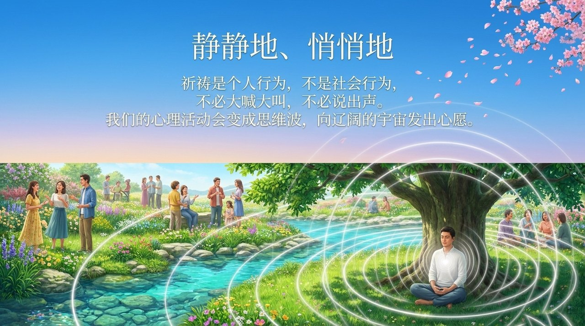

# 祈祷

**祈祷**，是人与上帝（道）建立直接联系的核心方式之一，与冥想并列。在生命禅院体系中，祈祷不是宗教仪式，而是心灵与上帝之间真实的沟通——人的内心思维化为思维波向宇宙发出，道具有瞬时感应特性，上帝必然回应。祈祷是修炼体系中不可缺失的日常意识活动；没有祈祷，就得不到神助。

> 祈祷具有不可思议的法力。当自己被环境束缚而实现不了美好理想时多祈祷吧！

---

## 视频版

<iframe style="width:100%;aspect-ratio:4/3;border:0" src="https://www.youtube-nocookie.com/embed/R37cSo_QbIg" title="祈祷（生命禅院百科·视频版）" allowfullscreen></iframe>

??? info "📖 图文幻灯（14 张，点击展开）"

    
    
    
    
    
    
    
    
    
    
    
    
    
    

---

## 版本导航

| 版本 | 适合 | 核心角度 |
|------|------|----------|
| [友好版](friendly.md) | 初次了解 | 祈祷是什么、怎么祈祷、会有什么效果 |
| [学术版](academic.md) | 研究者 | 定义、方式规范、效力机制、辨析边界 |
| [内部版](internal.md) | 深度研修 | 文集完整引文，按主题分章 |

---

## 相关词条

[忏悔](/zh/repentance/) · [冥想](/zh/settled-stillness/) · [感恩](/zh/gratitude/) · [放下](/zh/letting-go/) · [缘——奥秘和真谛](/zh/yuan/) · [天国财宝](/zh/heavenly-treasures/) · [去天国路线图](/zh/route-to-heaven/) · [道](/zh/dao/)
