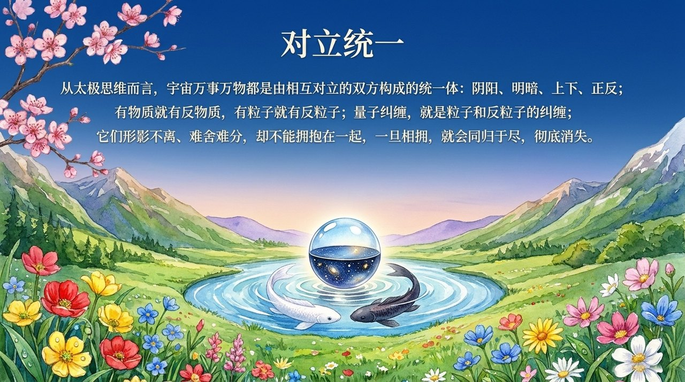
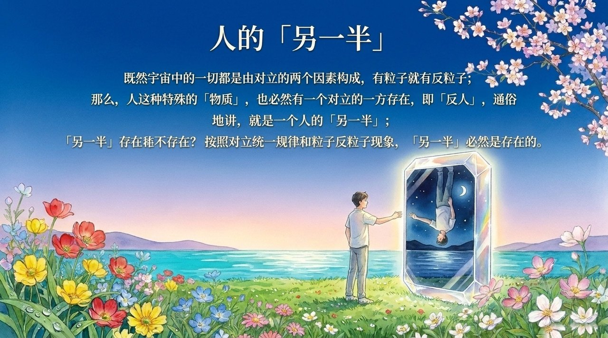
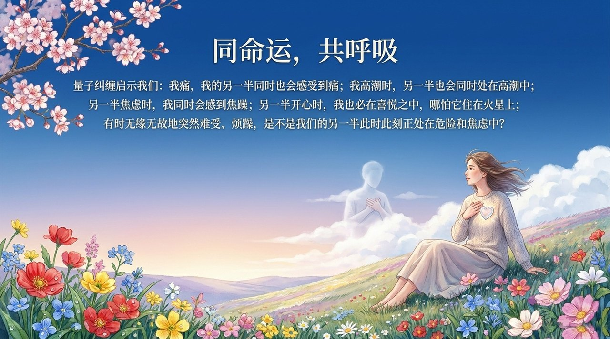
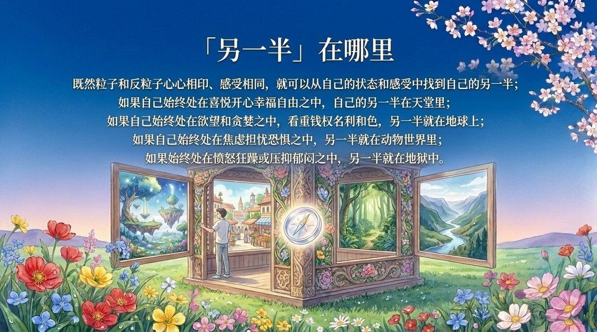
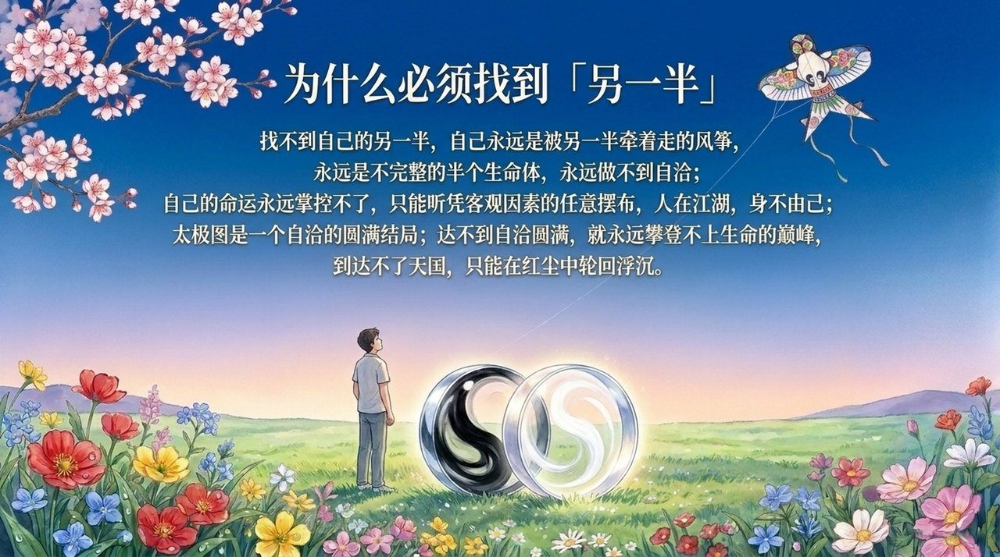
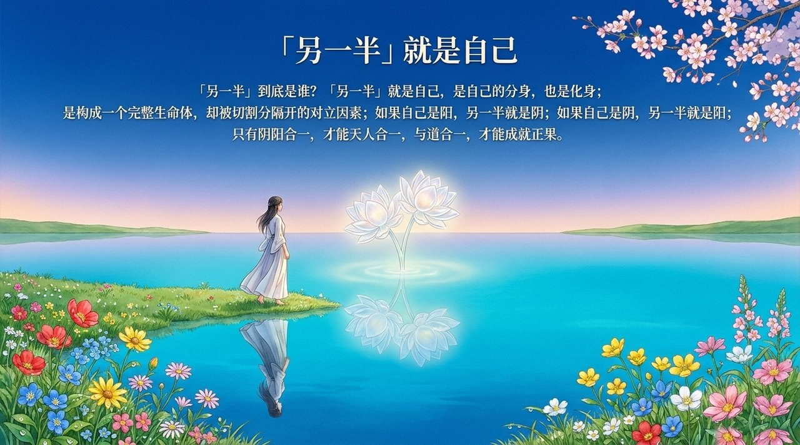
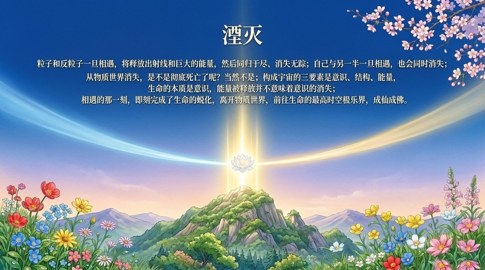
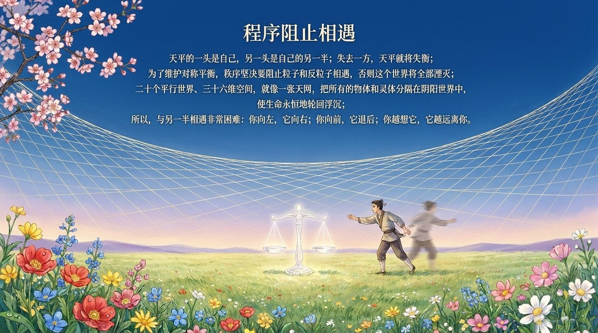
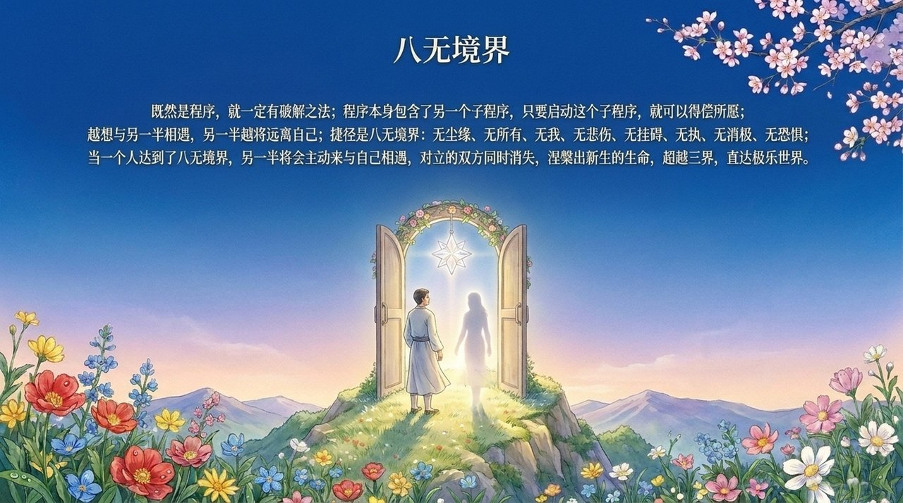

<!-- id: LC-QE-0001-ZH theme: 修行 type: 导航 direction: 生活修炼 lang: zh -->

# 量子纠缠和"另一半"

"另一半"，是生命禅院借量子纠缠现象提出的宇宙生命构想：每个人都有一个与自己对立统一的"反人"存在于宇宙某处，二者心心相印、同命运共呼吸，却被宇宙程序严格阻隔。只有通过八无境界修炼，方能让"另一半"主动前来相遇湮灭，从而得成正果、圆满成仙，直达极乐世界。

---

## 视频版

<iframe style="width:100%;aspect-ratio:4/3;border:0" src="https://www.youtube-nocookie.com/embed/QVgpV7rz0ro" title="量子纠缠和「另一半」（生命禅院百科·视频版）" allowfullscreen></iframe>

??? info "📖 图文幻灯（14 张，点击展开）"

    
    
    
    
    
    
    
    
    
    
    
    
    
    

---

## 版本导航

| 版本 | 适合 | 核心角度 |
|------|------|----------|
| [友好版](friendly.md) | 初次了解 | 生活类比·同命运感应·修炼方向 |
| [学术版](academic.md) | 研究者 | 概念辨析·物理类比·宇宙对称结构 |
| [内部版](internal.md) | 深度研修 | 完整引文·七节框架·修炼路径 |

---

## 相关词条

[缘——奥秘和真谛](/zh/yuan/) · [八无境界](/zh/eight-no-realms/) · [自洽](/zh/self-coherence/) · [正果](/zh/true-fruition/) · [成仙成佛](/zh/becoming-celestial-buddha/) · [极乐界](/zh/elysium-world/) · [太极](/zh/taiji/) · [生命的轮回](/zh/life-reincarnation/) · [三十六道八卦阵](/zh/thirty-six-bagua-formations/)
