# 宗教

**宗教**，在生命禅院体系中，是人类探索生命与自然关系的一门学问，是帮助人们建立世界观、人生观、生命观、价值观的意识形态体系，是引导人类从物质世界走向反物质世界的桥梁，其出发点是善良的。然而，宗教有八大缺憾，遮蔽了天国之路，制造了派系纷争，成为人类文明跃升的绊脚石。生命禅院时代的方向是万教归一：宗教消亡，全人类敬畏上帝、走上帝之道，获得最大限度的思想自由与生命自由。

> 宗教所起的好作用是难以估量的，宗教所起的坏作用也是无法估量的，宗教已经成了人类文明跃升的绊脚石。

---

## 视频版

<iframe style="width:100%;aspect-ratio:4/3;border:0" src="https://www.youtube-nocookie.com/embed/wGs--1zqTR4" title="宗教（生命禅院百科·视频版）" allowfullscreen></iframe>

??? info "📖 图文幻灯（14 张，点击展开）"

    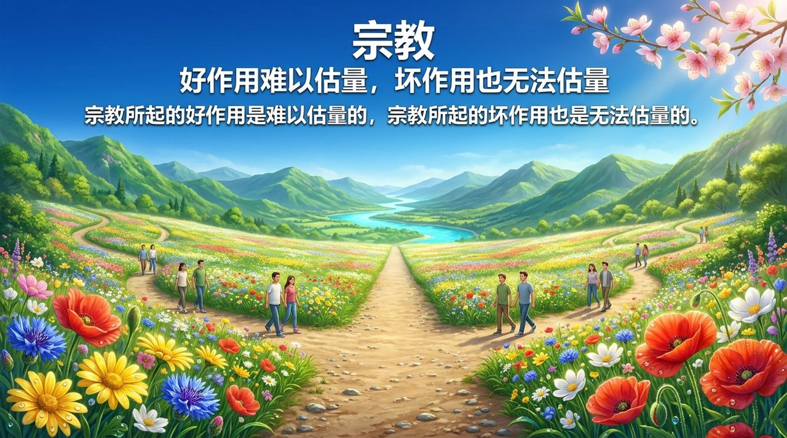
    
    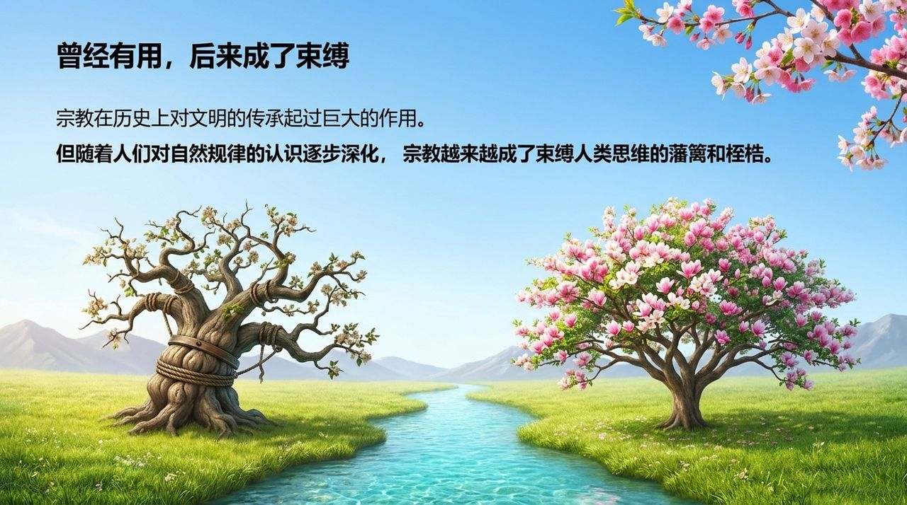
    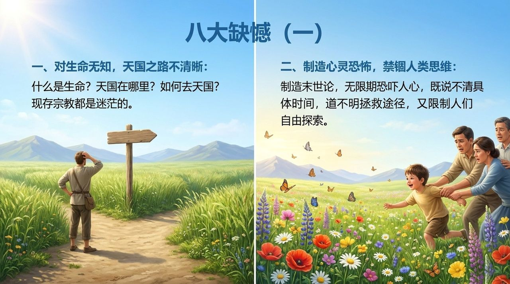
    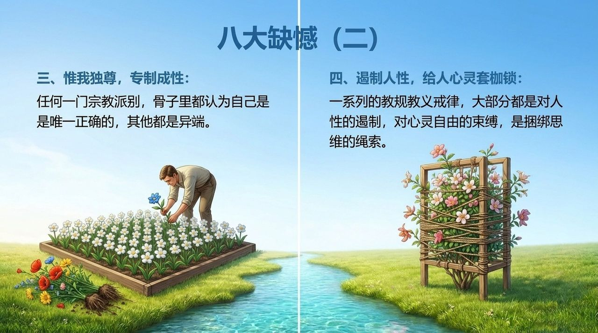
    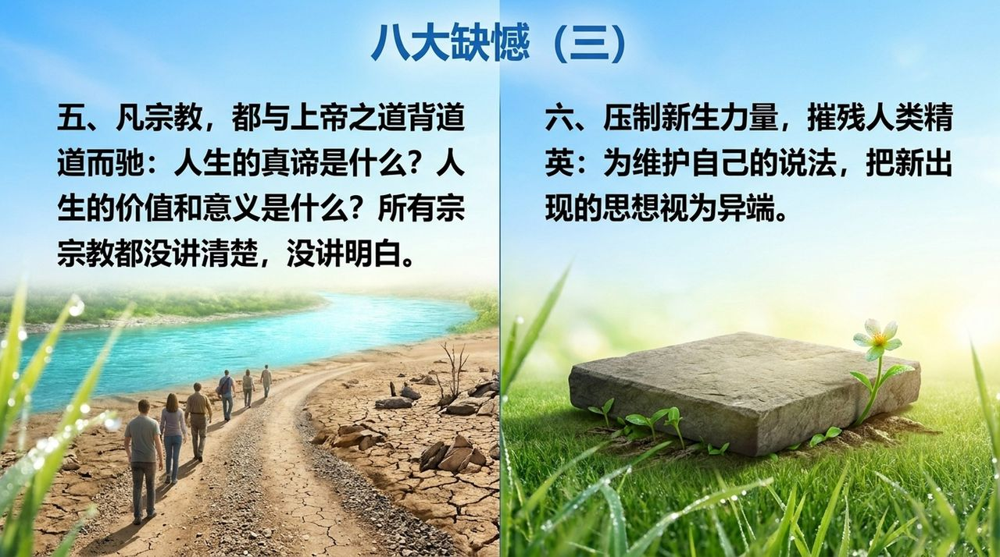
    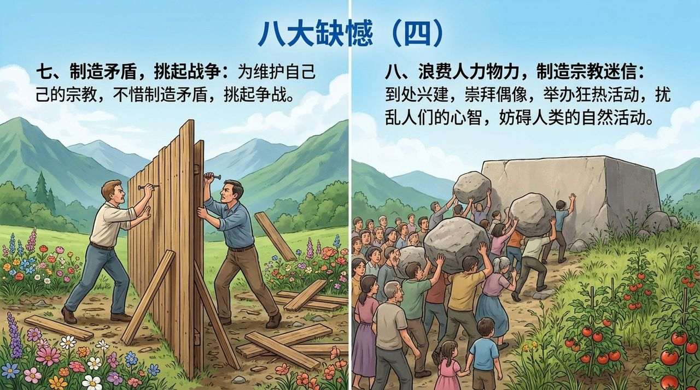
    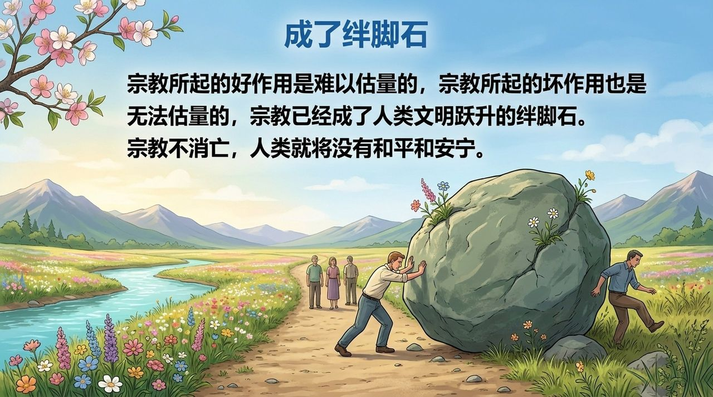
    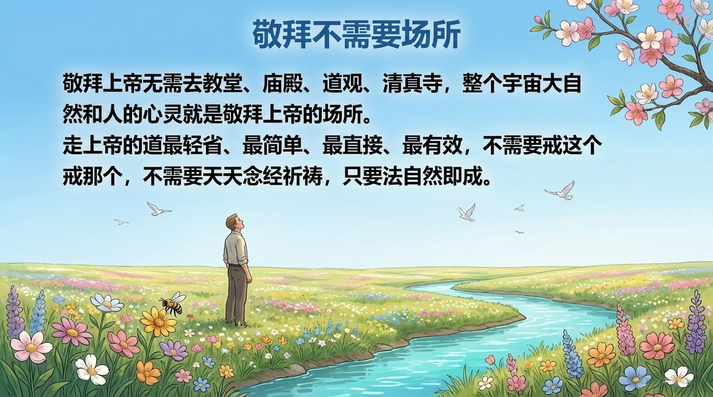
    
    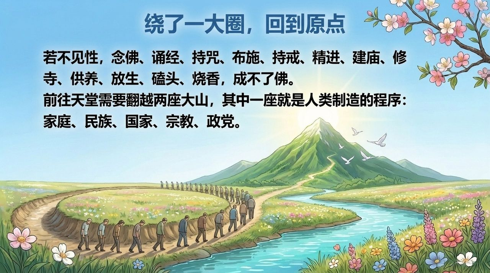
    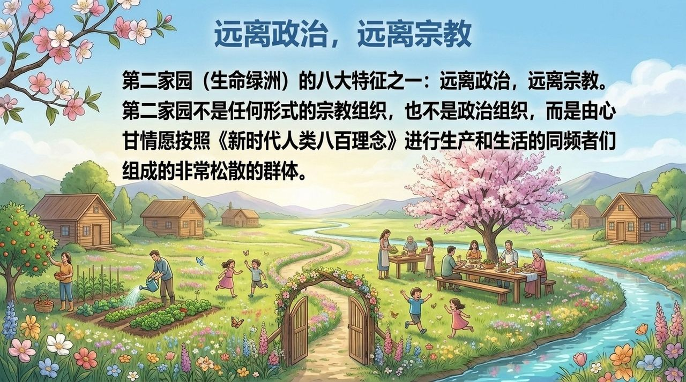
    
    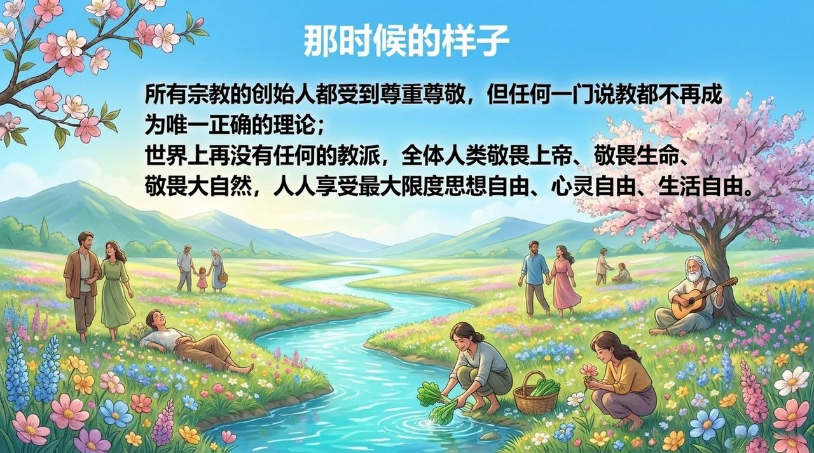

---

## 版本导航

| 版本 | 适合读者 | 入口 |
|------|----------|------|
| 友好版 | 初次接触，希望轻松理解 | [阅读友好版](/zh/religion/friendly/) |
| 学术版 | 深入研究，系统梳理 | [阅读学术版](/zh/religion/academic/) |
| 内部版 | 禅院草，研读文集 | [阅读内部版](/zh/religion/internal/) |

---

## 相关词条

[上帝之道](/zh/way-of-the-greatest-creator/) · [文明（总论）](/zh/civilization-overview/) · [文明3.0](/zh/civilization-3-0/) · [第二家园](/zh/second-home/) · [迷幻思维](/zh/illusory-thinking/) · [天国](/zh/kingdom-of-heaven/) · [觉悟](/zh/awakening/) · [新时代人类八百理念](/zh/new-era-human-800-concepts/)
