# 情爱·性爱

> **情爱是上帝赐予人类的珍贵礼品，性爱是升华人性前往生命高层空间的必然途径，情爱和性爱是两颗心灵的同频舞蹈。**
>
> ——新时代人类八百理念

在生命禅院体系中，情爱与性爱是人性最辉煌的组成部分，是上帝之道在人间的具体展现。禅院的情爱观彻底超越传统道德框架——不以婚姻拴绑，不以专一束缚，而是随缘而化、不占有、不霸占，以自由与尊重为准则。其终极方向是：超越"有执之爱"，修炼至无执之爱，成为"至爱者"，升华为天仙。

| 版本 | 适合 | 核心角度 |
|------|------|----------|
| [友好版](friendly.md) | 初次了解 | 用生活语言理解禅院情爱观的本质 |
| [学术版](academic.md) | 研究者 | 系统分析情爱的六大框架与修炼路径 |
| [内部版](internal.md) | 深度研修 | 导游文集完整呈现，逐段标注出处 |

---

## 核心定义

情爱是上帝赋予人的天性与珍贵礼品，一切纯洁的情爱都是真善美的体现。性爱是升华人性、前往生命高层空间的必然途径。两者合一，是生命最宝贵的构成因素，是能够活着的最本质动力。

禅院对情爱性爱的把握度：**随缘而化，随性而动，随机而作，情来心显，情去心空，不执着，不痴迷，不拥有，不霸占，两厢情愿就进行，无法同频不强求，以使双方开心快乐为尺度。**

---

## 视频版

<iframe style="width:100%;aspect-ratio:4/3;border:0" src="https://www.youtube-nocookie.com/embed/sHriUKEvVl8" title="情爱·性爱（生命禅院百科·视频版）" allowfullscreen></iframe>

??? info "📖 图文幻灯（14 张，点击展开）"

    
    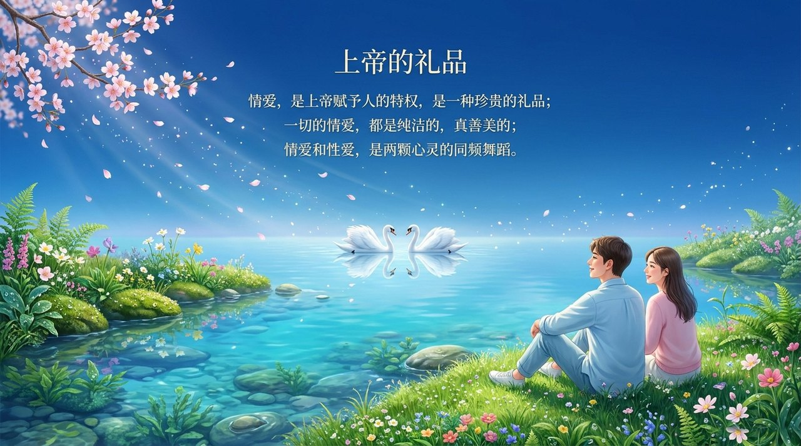
    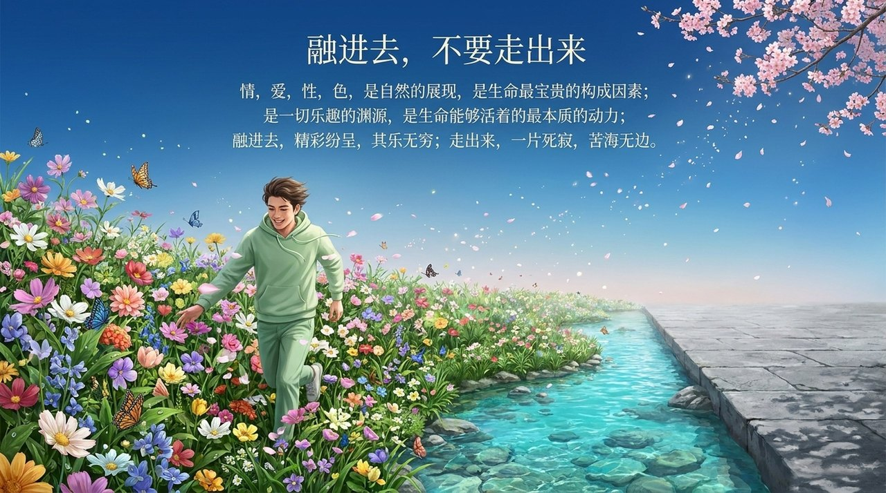
    
    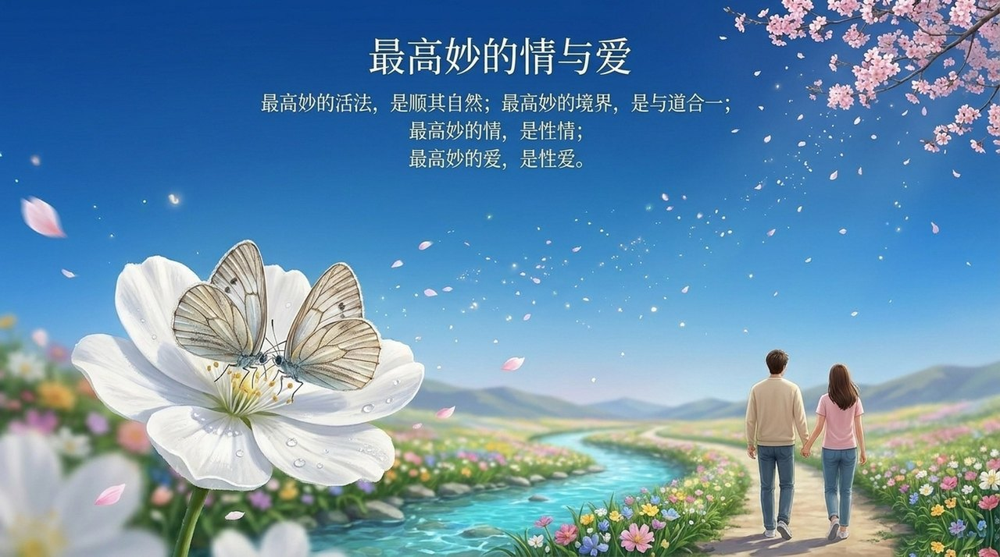
    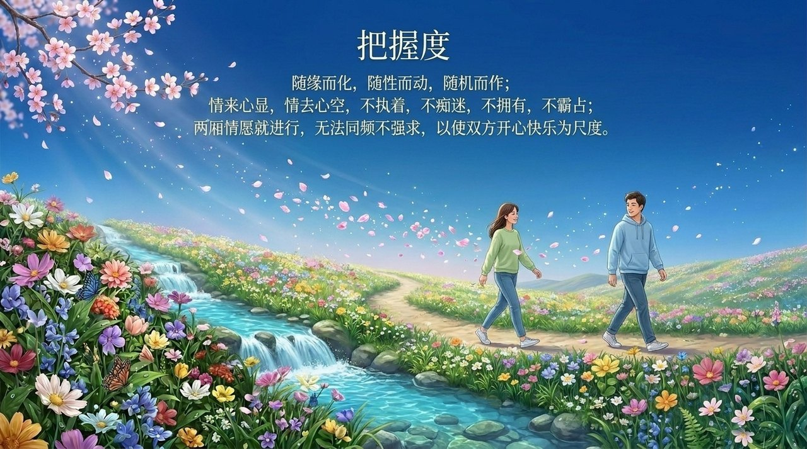
    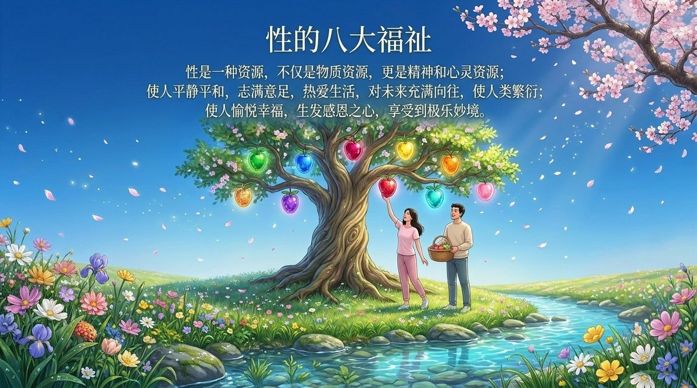
    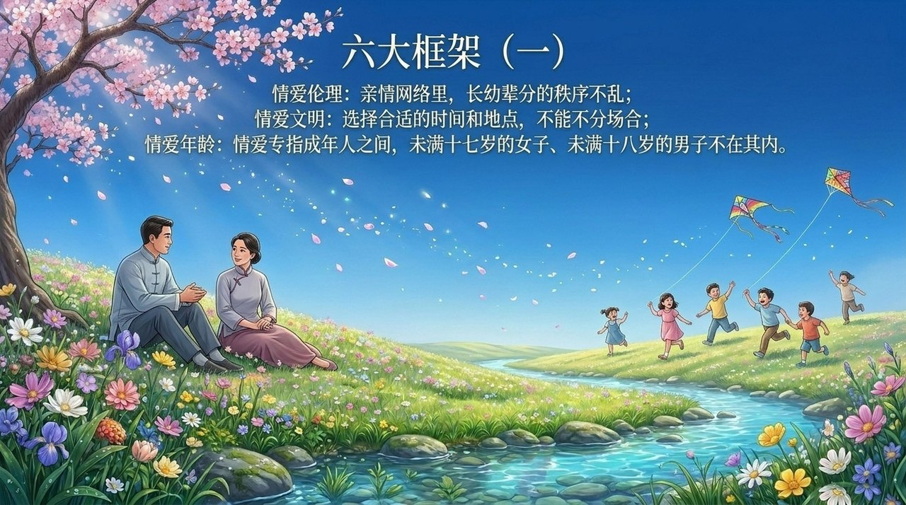
    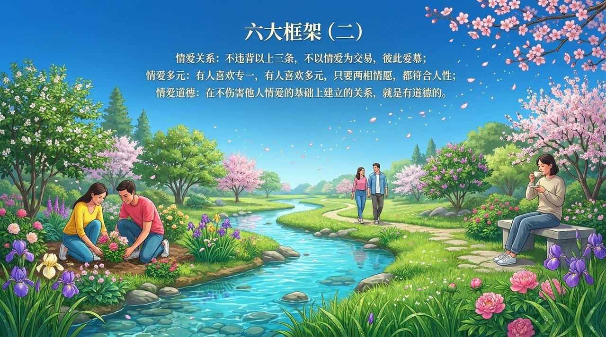
    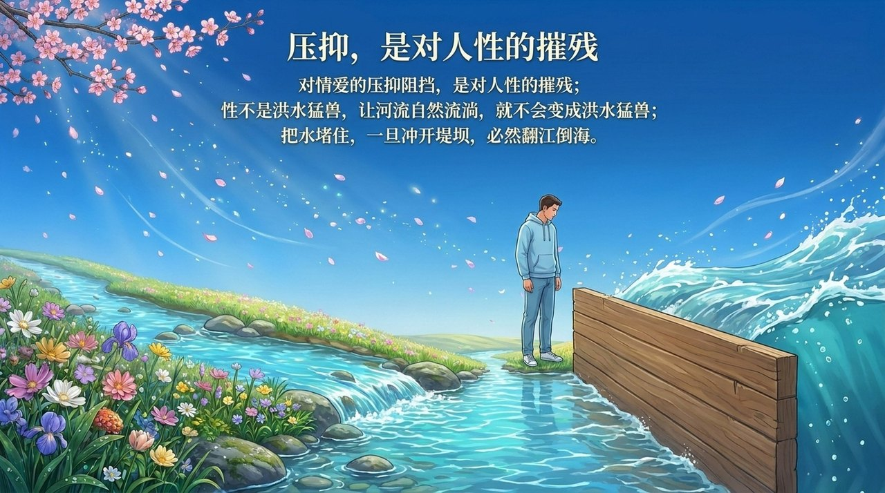
    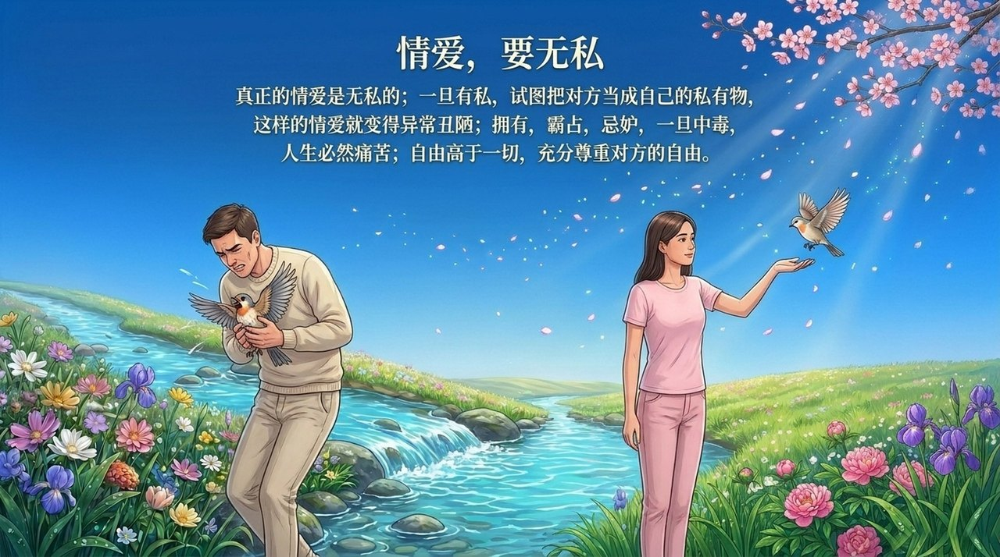
    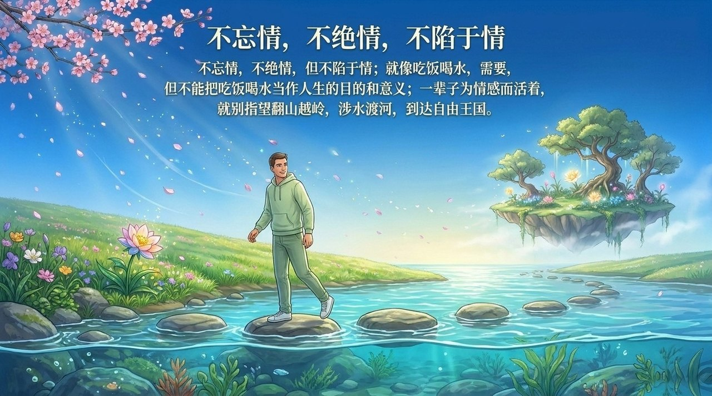
    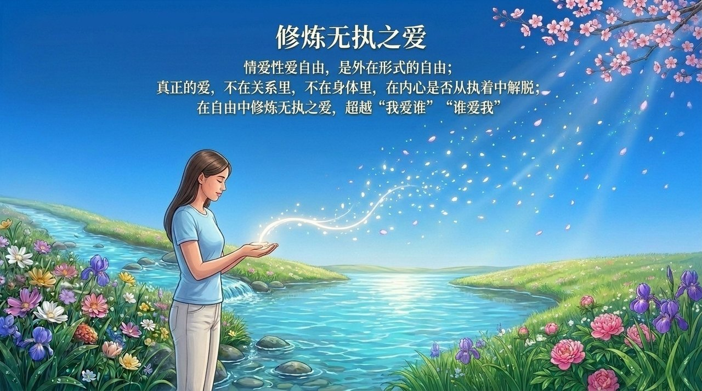
    

---

## 相关词条

- [爱](/zh/love/)
- [情](/zh/qing-affection/)
- [随性而动](/zh/suixing-er-dong/)
- [同频共振](/zh/resonance/)
- [自私与无私](/zh/zisi-wusi/)
- [心无所住·心无挂碍](/zh/xinwu-suozhu-guaai/)
- [极乐妙境](/zh/jilemiaojing/)
- [成仙成佛](/zh/becoming-celestial-buddha/)

> 注：本页引用的《新时代人类八百理念》条号，均为第四版的编号。第五版已重新编排，条号与第四版不再一一对应。
