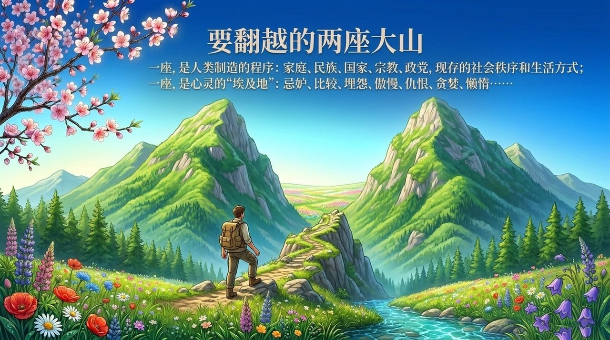
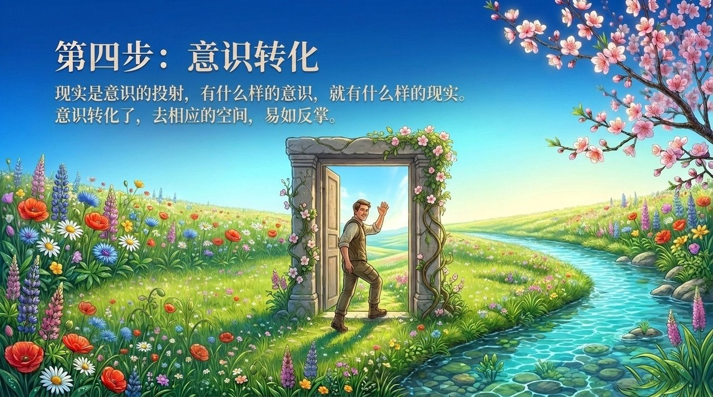

<!-- id: LC-ROL-0001-ZH theme: 修行修炼 type: 索引 lang: zh -->

# 人生和生命线路图

**人生和生命线路图，是生命禅院为修行修炼者绘制的一张从人间出发、以天国为终点的完整路线指引。** 它区分"人生"（生命在人间的短暂旅行）与"生命"（从宇宙源头延伸至无限时空的连续剧），指明人生有两大目的：一是当下活得开心、快乐、自由、幸福；二是升华生命品质，最终得道成仙抵达天国（千年界、万年界或极乐界）。核心路径是：明白道德→逃离婚姻家庭与国家→进入第二家园→偿还债务了却尘缘→积累功德→转化意识→抵达相应天国。

---

## 视频版

<iframe style="width:100%;aspect-ratio:4/3;border:0" src="https://www.youtube-nocookie.com/embed/24kW7SUlR1c" title="人生和生命线路图（生命禅院百科·视频版）" allowfullscreen></iframe>

??? info "📖 图文幻灯（14 张，点击展开）"

    
    
    
    
    
    
    
    
    
    
    
    
    
    

---

## 版本导航

| 版本 | 适合 | 核心角度 |
|------|------|----------|
| [友好版](friendly.md) | 初次了解 | 人生是旅行，线路图五站说清楚 |
| [学术版](academic.md) | 研究者 | 概念辨析、路径逻辑、与其他传统比较 |
| [内部版](internal.md) | 深度研修 | 文集全文：线路图九段完整呈现 |

---

## 相关词条

[人生的价值·意义和目的](/zh/value-meaning-purpose-of-life/) · [人生和生命的巅峰](/zh/peak-of-life-and-being/) · [去天国路线图](/zh/route-to-heaven/) · [偿还债务](/zh/debt-repayment/) · [了却尘缘](/zh/releasing-worldly-bonds/) · [天国财宝](/zh/heavenly-treasures/) · [生死](/zh/life-and-death/) · [因果·报应·轮回](/zh/karma-retribution-reincarnation/) · [千年界仙](/zh/thousand-year-world-celestials/) · [万年界仙](/zh/ten-thousand-year-world-celestials/) · [极乐界天仙](/zh/elysium-world/) · [意识](/zh/consciousness/)
