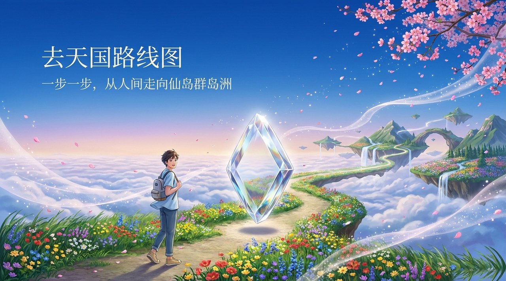
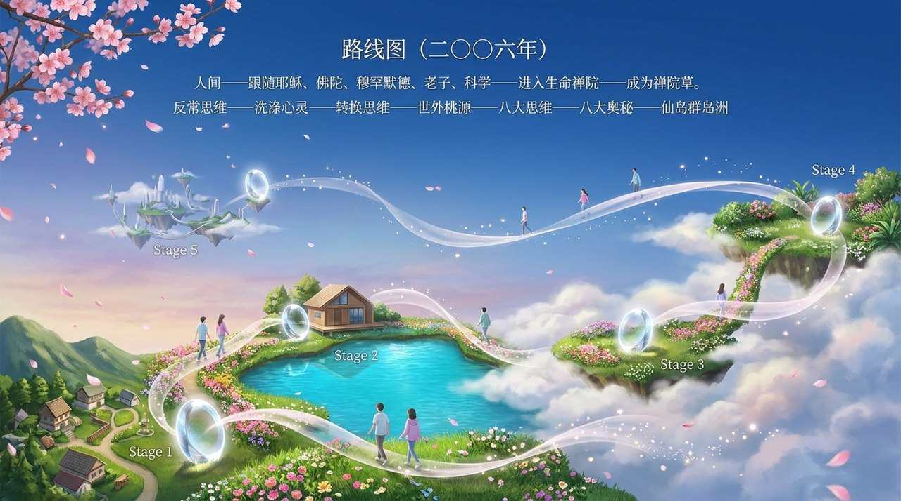
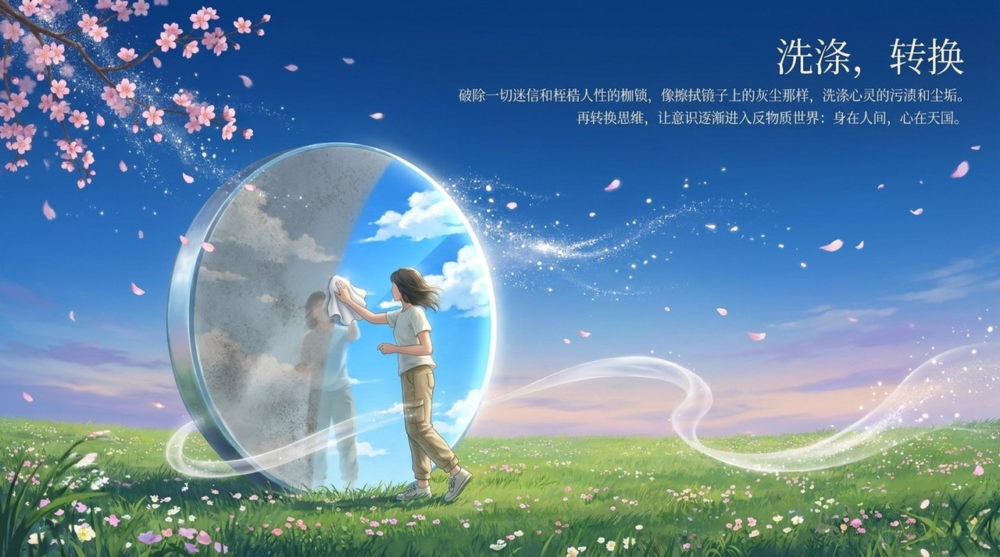
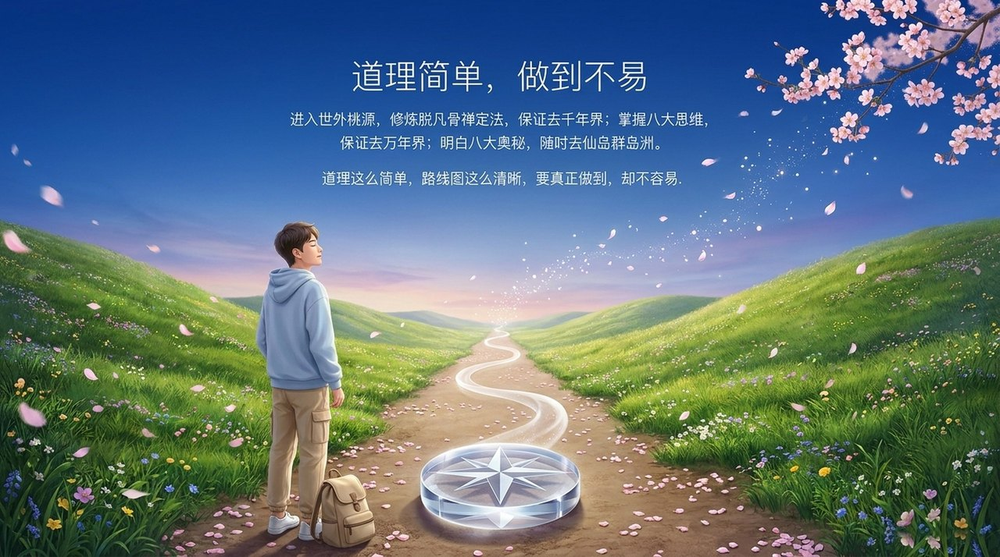
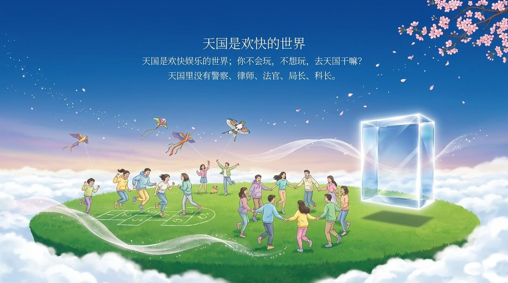
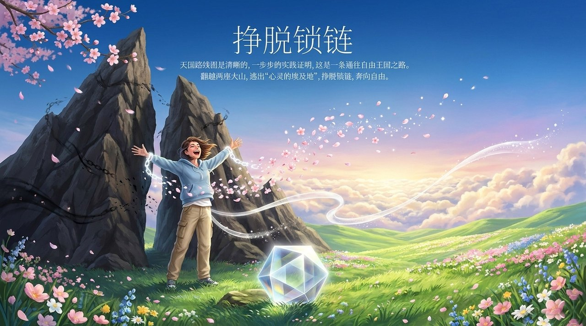
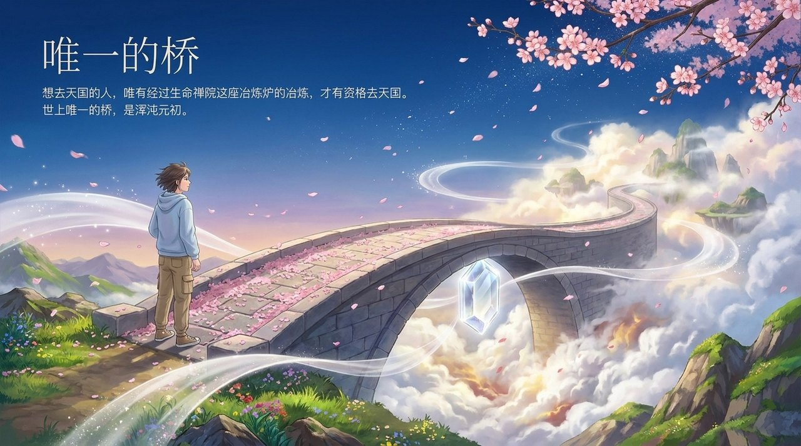

# 去天国路线图

> 人间——跟随耶稣、佛陀、穆罕默德、老子、科学——进入生命禅院——学习了解禅院内容——成为禅院草——反常思维——洗涤心灵的尘垢——转换思维，改变生命结构——进入世外桃源——去千年界——了解8大思维——去万年界——明晰生命的8大奥秘——去极乐界仙岛群岛洲。
>
> —— 雪峰，2006

**去天国路线图**是导游雪峰（浑沌元初）为生命禅院体系所绘制的、从人间出发经由修行修炼抵达天国各层高级生命空间的完整路径图。它以节点箭头的形式标明修炼进程的每一步，配有详尽说明书，是禅院草修炼方向的总纲领，亦是导游导航职责的核心体现。

---

| 版本 | 适合 | 核心角度 |
|------|------|----------|
| [友好版](friendly.md) | 初次了解 | 用旅程比喻讲清路线图的每一站 |
| [学术版](academic.md) | 研究者 | 路线图的结构分析与体系定位 |
| [内部版](internal.md) | 深度研修 | 导游文集全文，含说明书与实践要求 |

---

## 视频版

<iframe style="width:100%;aspect-ratio:4/3;border:0" src="https://www.youtube-nocookie.com/embed/aFWgGULVUDc" title="去天国路线图（生命禅院百科·视频版）" allowfullscreen></iframe>

??? info "📖 图文幻灯（14 张，点击展开）"

    
    
    
    
    
    
    
    
    
    
    
    
    
    

---

## 相关词条

- [天国](/zh/kingdom-of-heaven/)
- [天国财宝](/zh/heavenly-treasures/)
- [生命签证](/zh/life-visa/)
- [第二家园](/zh/second-home/)
- [成仙](/zh/becoming-celestial/)
- [千年界仙](/zh/thousand-year-world-celestials/)
- [万年界仙](/zh/ten-thousand-year-world-celestials/)
- [极乐界天仙](/zh/elysium-world-celestials/)
- [净化心灵](/zh/jinghuaxinling/)
- [禅院草](/zh/chanyuan-celestials/)
