# 圣人·贤人

**圣人**，在生命禅院体系中是人群五分类（浑人→俗人→凡人→贤人→圣人）的最高层，以灵性为主的生命存在形态，来自上帝的灵，是上帝在人间的代表与使者，其智慧源于与道的灵性感应而非知识学识，圣人即仙人。**贤人**是五分类的第四层，以理智为主，超越本能、欲望、情感却尚未入灵性，是文明社会的中坚力量，距真理只一步之遥。

> 人分浑人、俗人、凡人、贤人、圣人五种，以本能为主的人是浑人，以利益为主的人是俗人，以情感为主的人是凡人，以理性为主的人是贤人，以灵性为主的人是圣人。圣人即仙人。
>
> ——新时代人类八百理念第四版·第22条

---

## 视频版

<iframe style="width:100%;aspect-ratio:4/3;border:0" src="https://www.youtube-nocookie.com/embed/62nYIvdAUhM" title="圣人·贤人（生命禅院百科·视频版）" allowfullscreen></iframe>

??? info "📖 图文幻灯（14 张，点击展开）"

    
    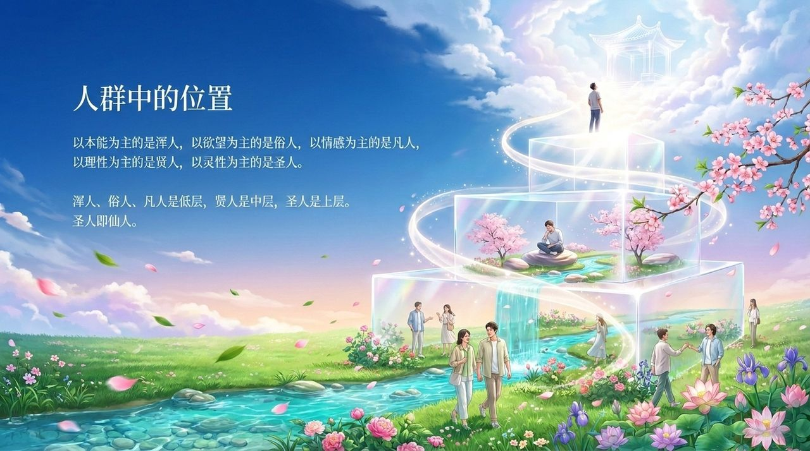
    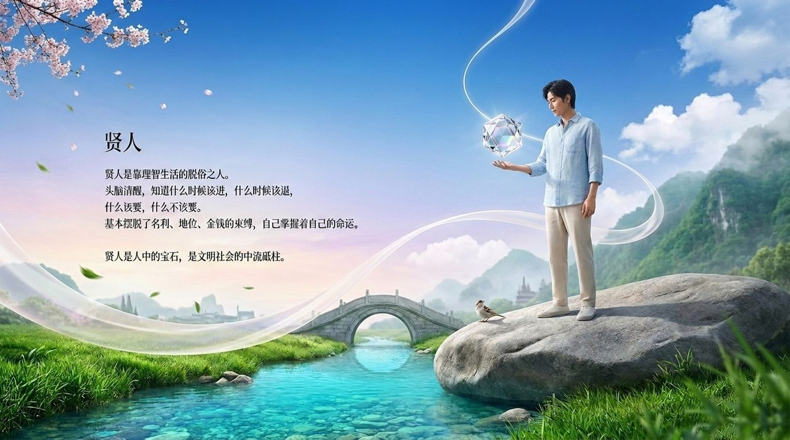
    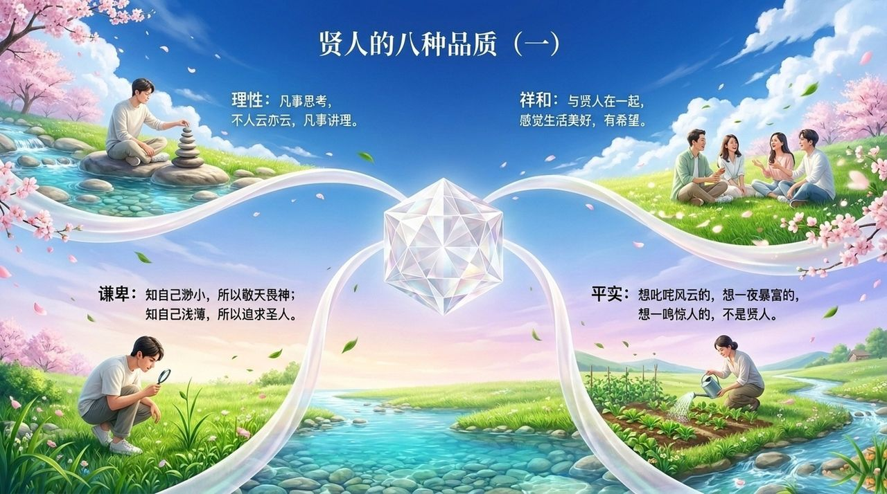
    
    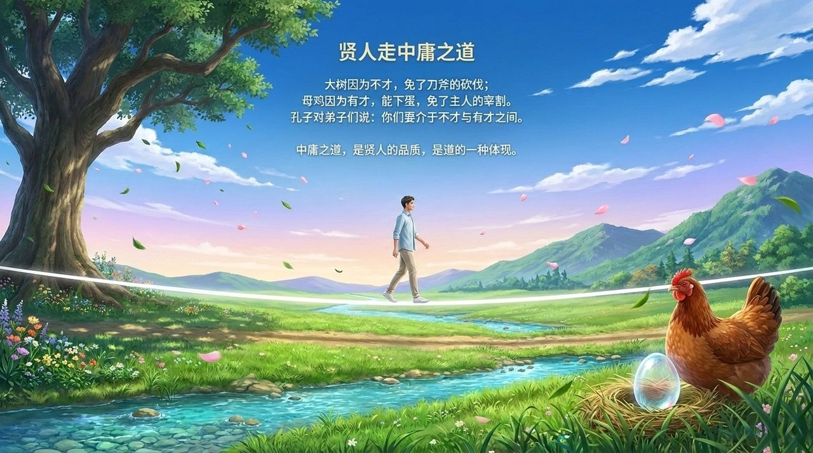
    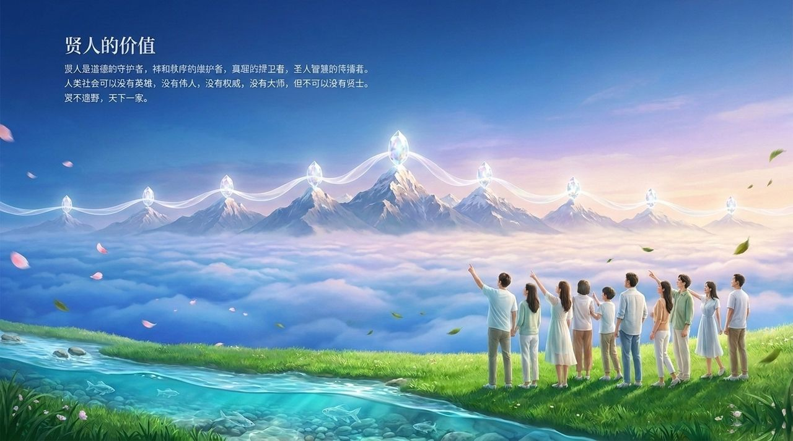
    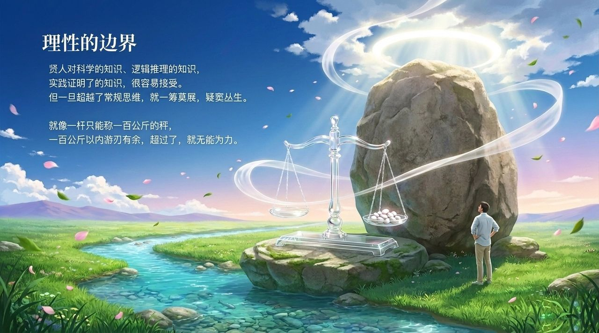
    
    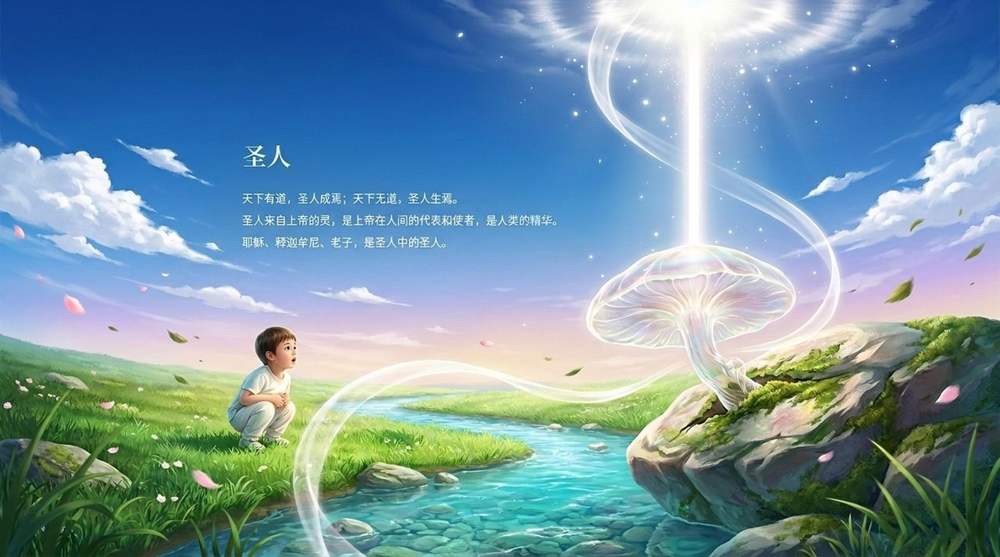
    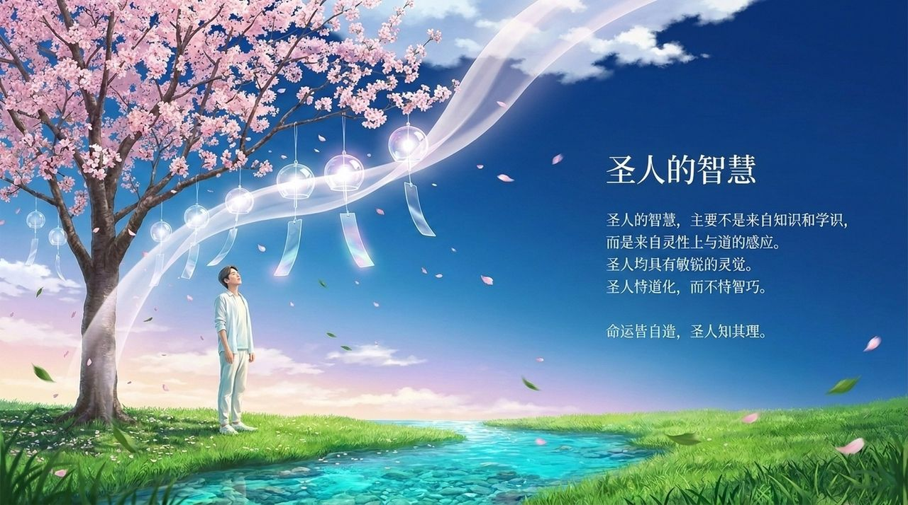
    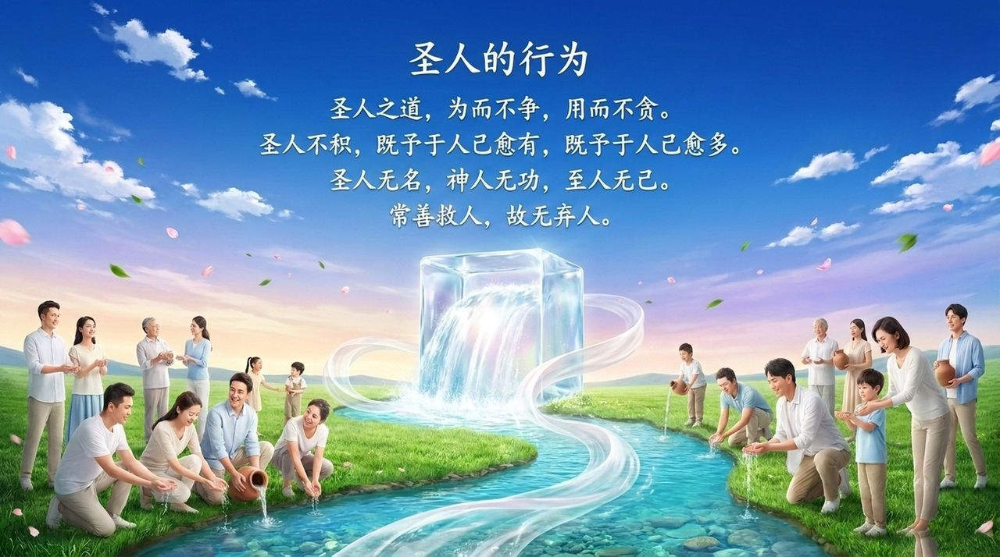
    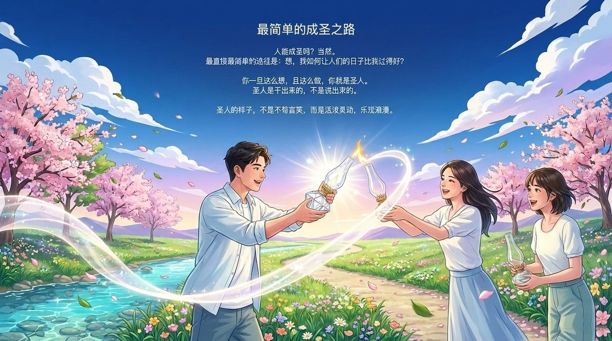
    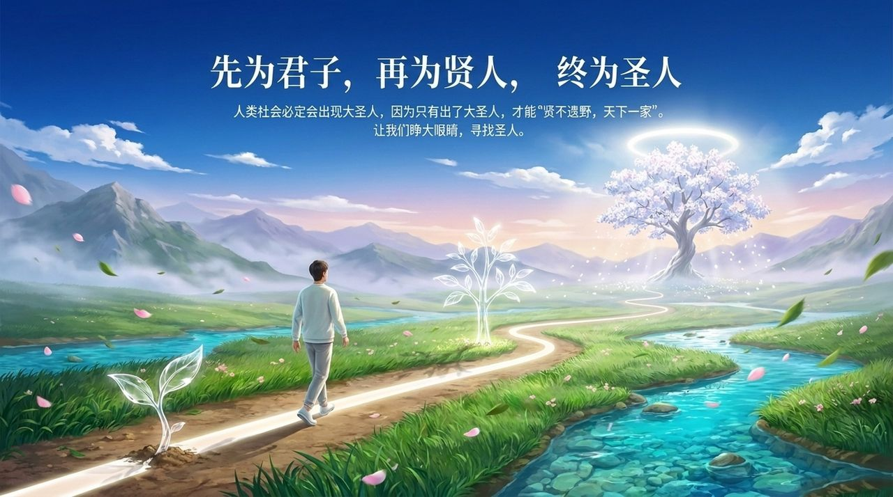

---

## 版本导航

| 版本 | 适合 | 核心角度 |
|------|------|----------|
| [友好版](friendly.md) | 初次了解 | 圣贤是谁·如何成为 |
| [学术版](academic.md) | 研究者 | 人群层次体系·圣贤特征分析·比较视角 |
| [内部版](internal.md) | 深度研修 | 导游原文存档 |

---

## 相关词条

[人群分类](/zh/people-classification/) · [人生的价值·意义和目的](/zh/value-meaning-purpose-of-life/) · [成仙成佛](/zh/becoming-celestial-buddha/) · [觉悟](/zh/awakening/) · [灵性](/zh/spirituality/) · [八大思维阶梯](/zh/eight-thinking-ladders/) · [无我无相](/zh/no-self-no-form/) · [谦卑](/zh/humility/) · [自性·佛性·如来本性](/zh/self-nature/)

> 注：本页引用的《新时代人类八百理念》条号，均为第四版的编号。第五版已重新编排，条号与第四版不再一一对应。
