<!-- id: LC-SSR-0001-ZH theme: 上帝与道 type: index direction: 上帝与道 lang: zh -->

# 上善若水

**上善若水**是生命禅院体系对老子《道德经》核心命题的阐发。雪峰指出：水"几于道"，以七种品性——滋润万物而不争、洗涤尘垢而不居高处、随形而形、幻化气云无处不安、柔弱谦卑、能流能停、能歌能寂——承载了道的全部品质。欲善者学水，求道者学水；人能若水，则与道同体，享万古长流。

---

## 视频版

<iframe style="width:100%;aspect-ratio:4/3;border:0" src="https://www.youtube-nocookie.com/embed/fP19Q7O8zaY" title="上善若水（生命禅院百科·视频版）" allowfullscreen></iframe>

??? info "📖 图文幻灯（14 张，点击展开）"

    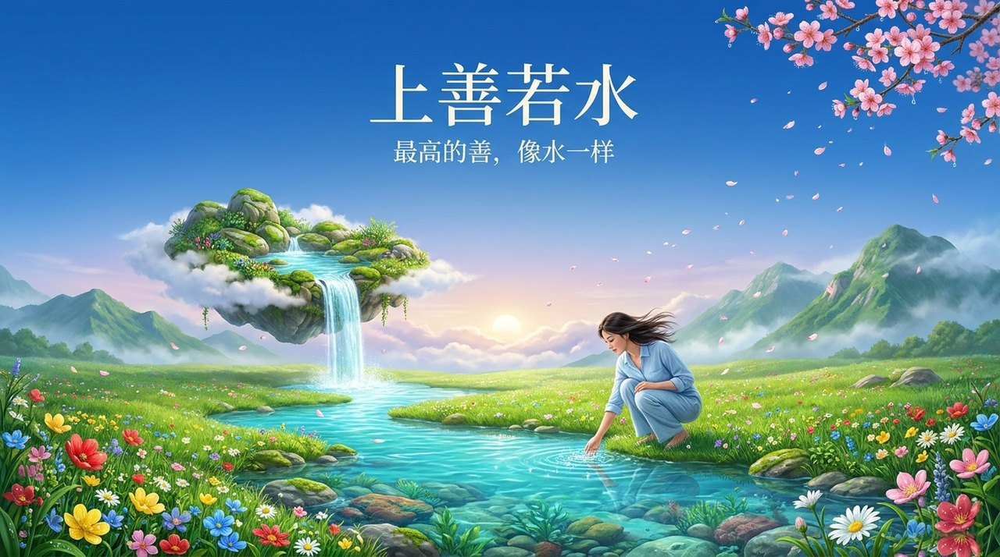
    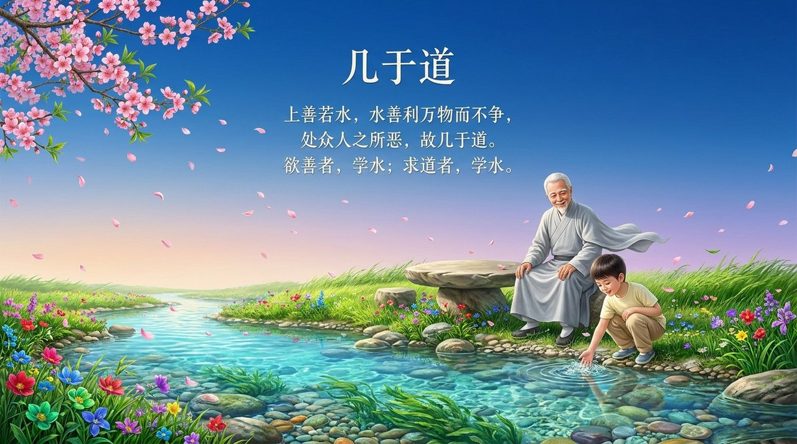
    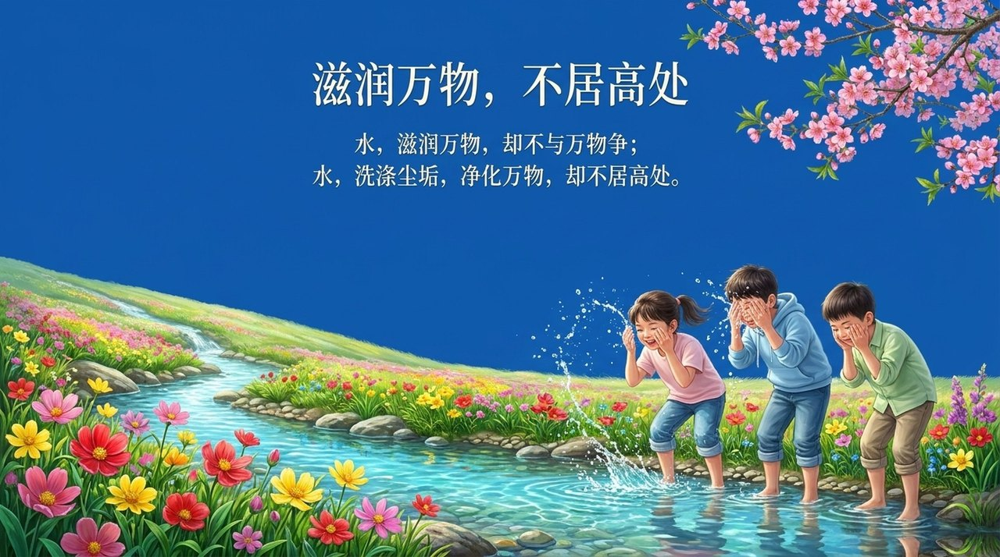
    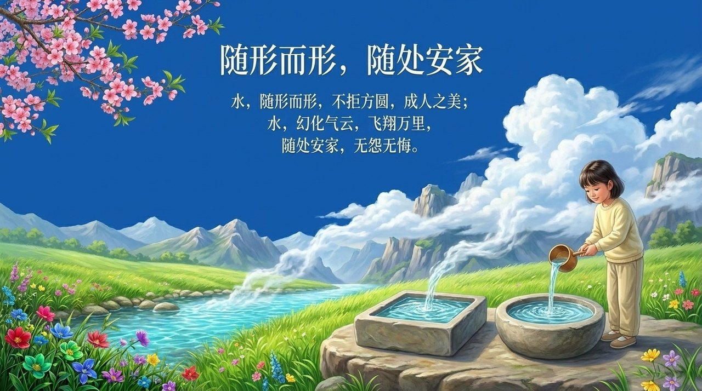
    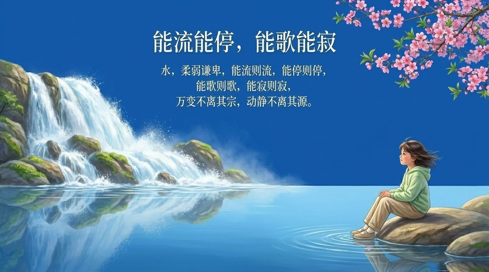
    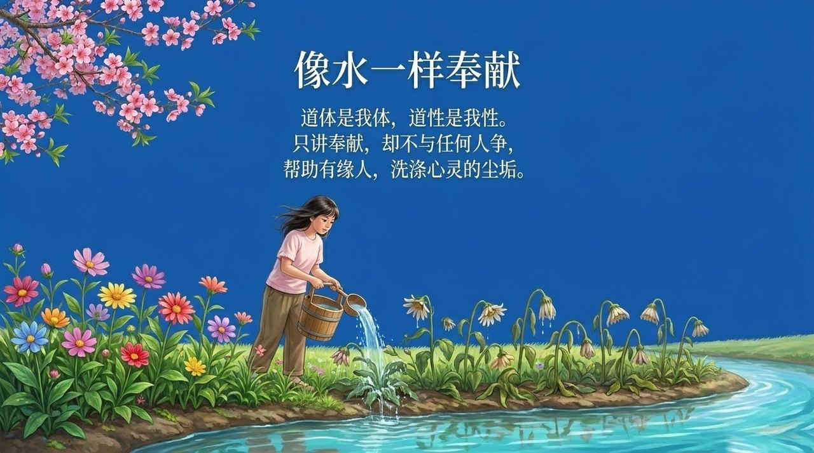
    
    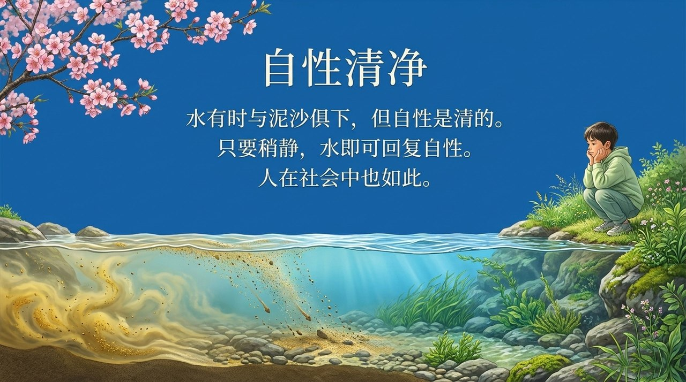
    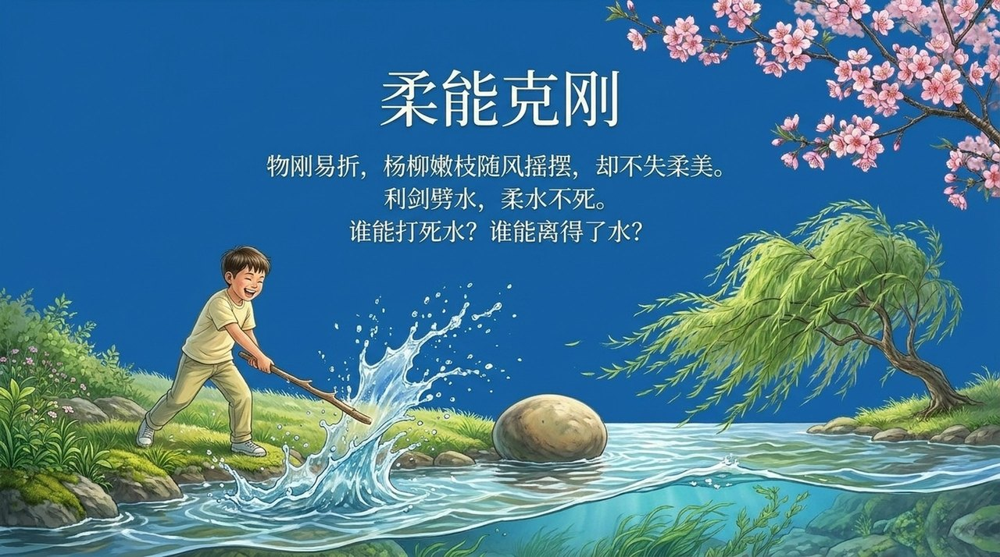
    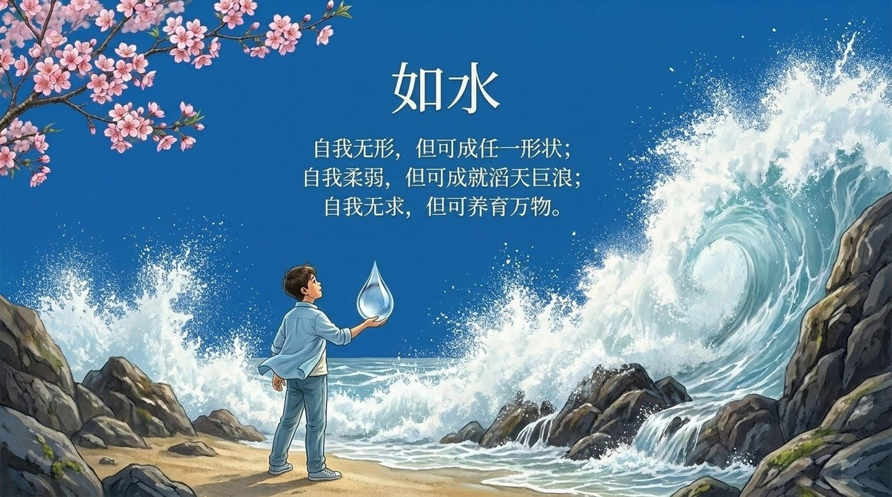
    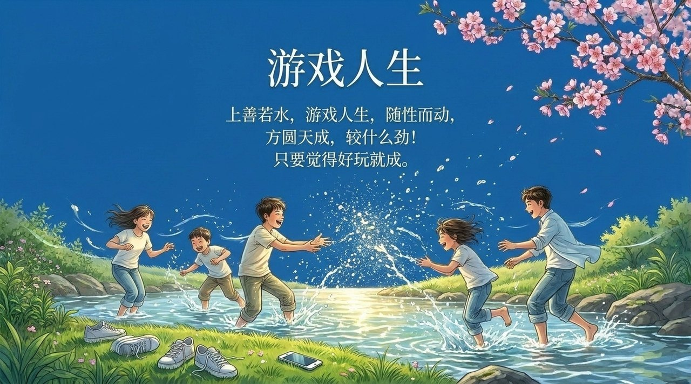
    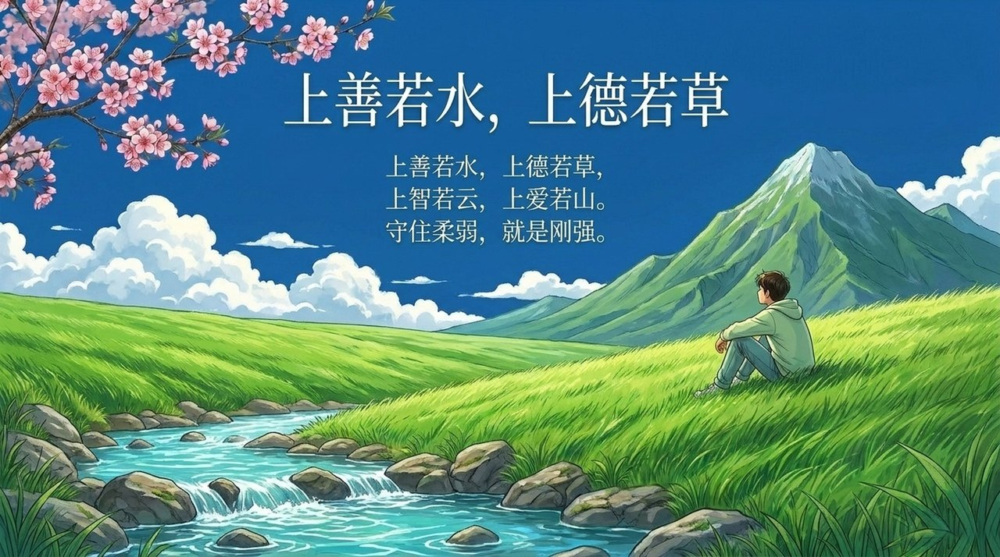
    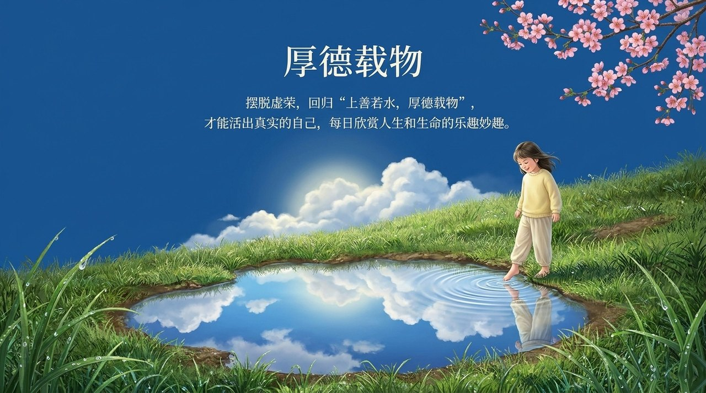
    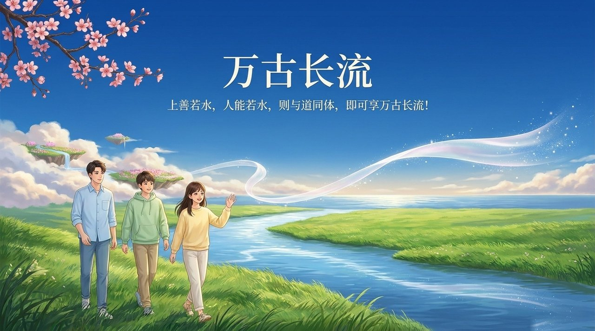

---

## 版本导航

| 版本 | 适合读者 | 核心角度 |
|------|---------|---------|
| [友好版](friendly.md) | 初次了解者 | 水有什么品质？为什么"若水"就是最高的善？ |
| [学术版](academic.md) | 研究者 | 水性与道性的对应、柔能克刚的修炼意义、与其他命题的关联 |
| [内部版](internal.md) | 深度研修 | 完整文集引文，雪峰智慧篇全文及相关篇章 |

---

## 相关词条

[道](/zh/dao/) · [上帝之道](/zh/way-of-the-greatest-creator/) · [无为而无不为](/zh/wu-wei/) · [有为与无为](/zh/you-wei-wu-wei/) · [随性而动](/zh/suixing-er-dong/) · [谦卑](/zh/humility/) · [浑沌（本体论）](/zh/hundun/) · [自洽](/zh/self-coherence/) · [自性·佛性·如来本性](/zh/self-nature/) · [无相布施](/zh/formless-giving/)
