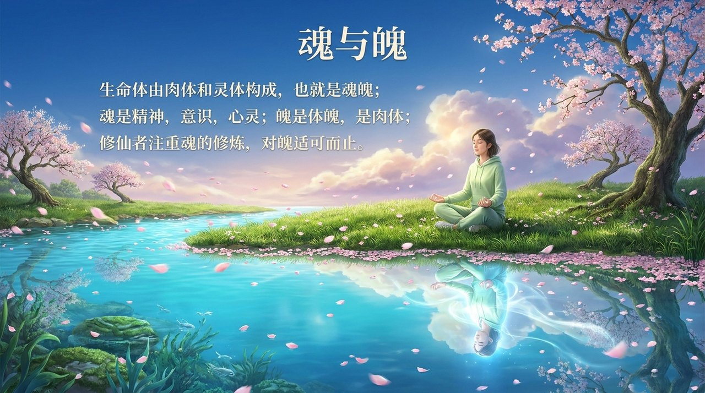
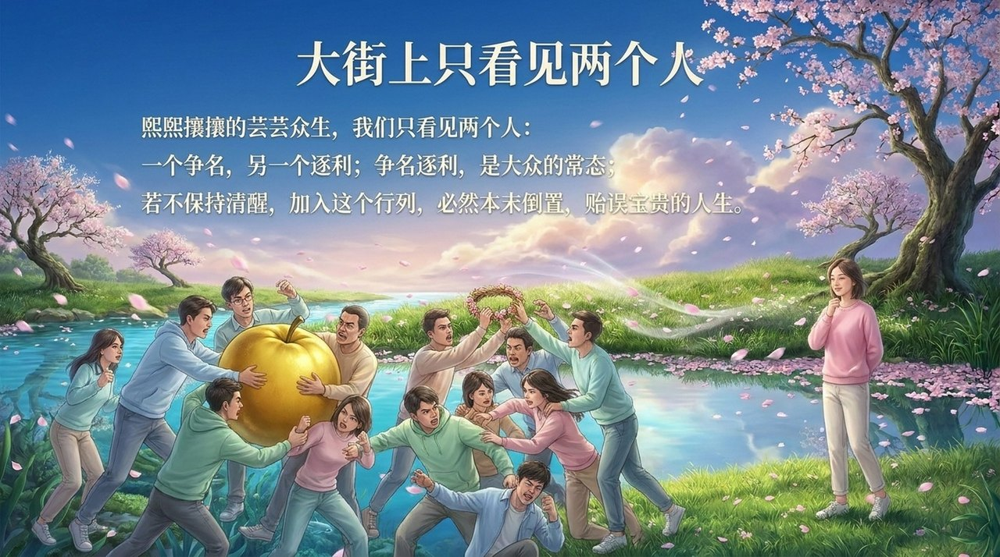
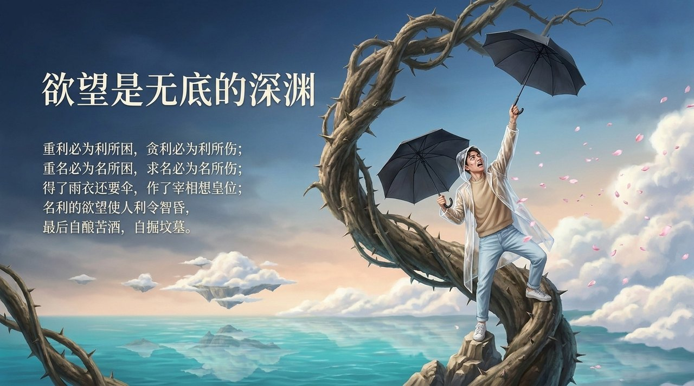
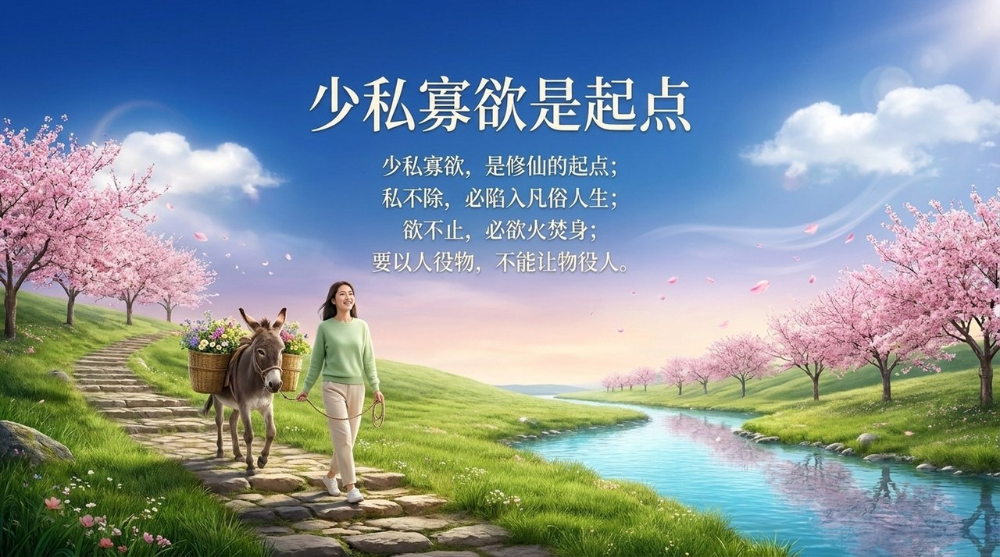

# 少私寡欲·宠辱不惊

**少私寡欲·宠辱不惊**，是生命禅院体系中修仙起步阶段的两项核心品质——少私寡欲意味着减少私心、降低物欲，不让功名利禄成为修仙的陷阱；宠辱不惊意味着无论得宠还是受辱，内心保持如如不动，不做外境的奴隶，守住天性的完整。导游雪峰指出，修仙者的注意力应从魄（肉体利益）转向魂（精神心灵），只有如此，方能踏上真正的修仙路径。

> 功名利禄、荣华富贵是修仙的陷阱；荣耀耻辱、宠幸落贱是修仙的障碍。只有少私寡欲、宠辱不惊，才能踏上修仙的路径。
>
> ——禅院文集·修仙篇·少私寡欲、宠辱不惊

## 视频版

<iframe style="width:100%;aspect-ratio:4/3;border:0" src="https://www.youtube-nocookie.com/embed/pzZT5LzQHZg" title="少私寡欲·宠辱不惊（生命禅院百科·视频版）" allowfullscreen></iframe>

??? info "📖 图文幻灯（14 张，点击展开）"

    
    
    
    
    
    
    
    
    
    
    
    
    
    

---

## 版本导航

| 版本 | 适合 | 核心角度 |
|------|------|----------|
| [友好版](friendly/) | 初次了解 | 生活感受与修仙警示 |
| [学术版](academic/) | 研究者 | 系统分析与跨文化比较 |
| [内部版](internal/) | 深度研修 | 导游原文存档 |

## 相关词条

[淡泊明志·宁静致远](/zh/dan-bo-ming-zhi/) · [随缘放旷·任运逍遥](/zh/sui-yuan-fangguan/) · [深根固柢·长生久视](/zh/shen-gen-gu-di/) · [自私与无私](/zh/zisi-wusi/) · [傲慢](/zh/aoman/) · [我执](/zh/wo-zhi/) · [超凡脱俗](/zh/chaofantuosu/) · [成仙](/zh/becoming-celestial/) · [天性](/zh/tianxing/)
