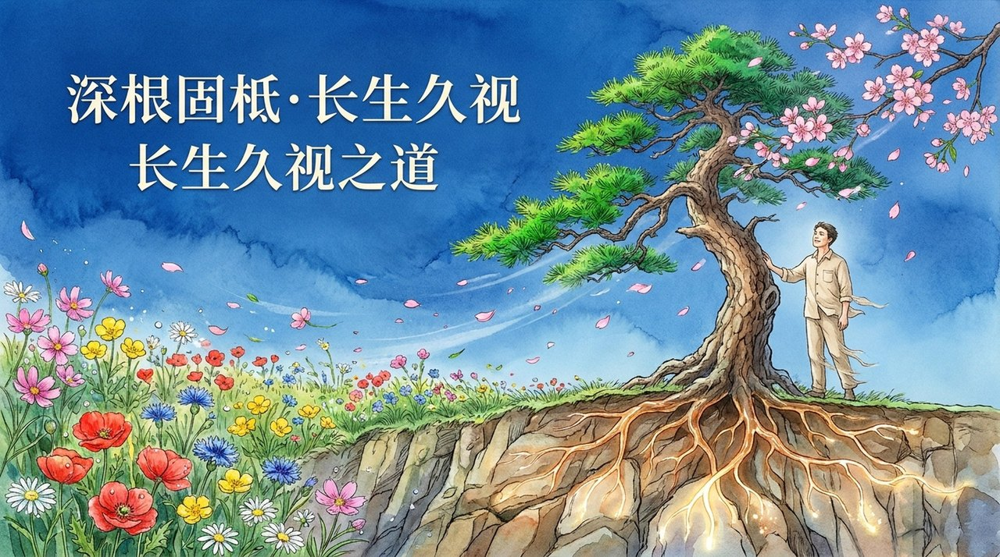
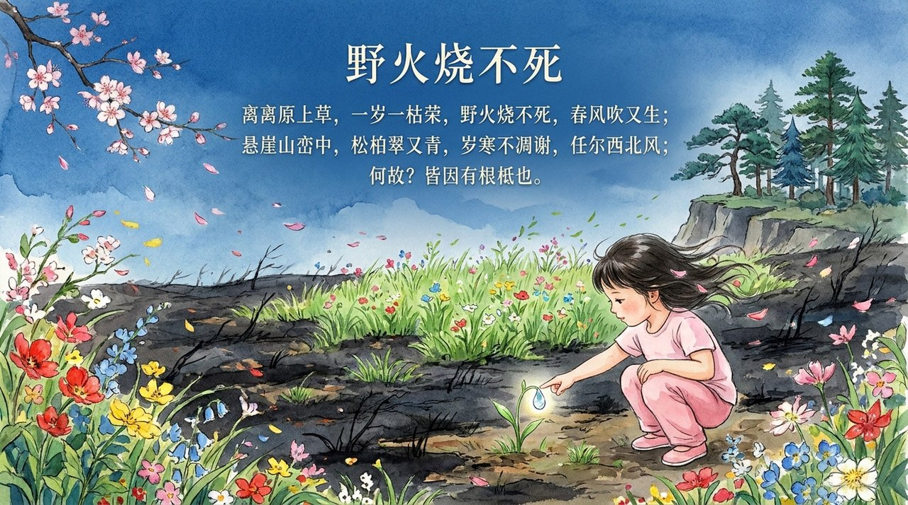
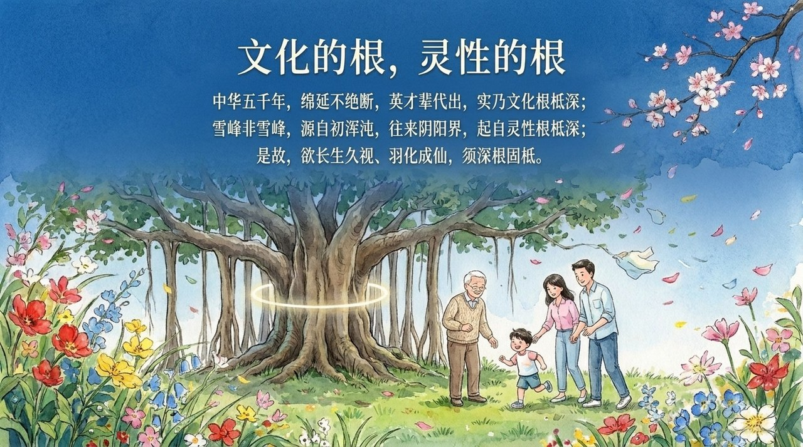
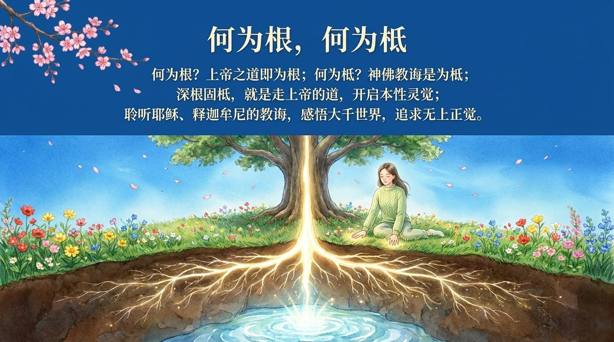
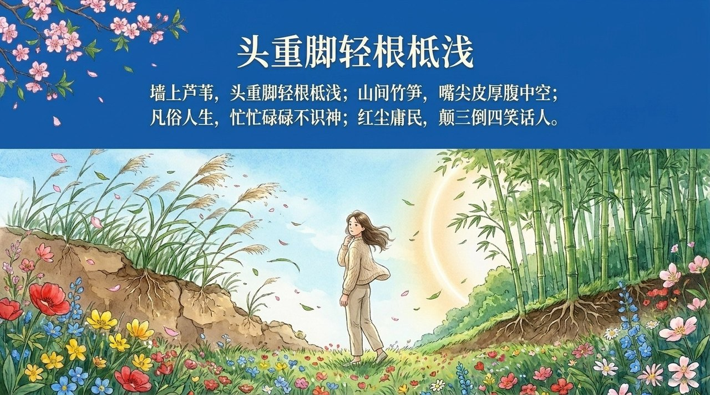
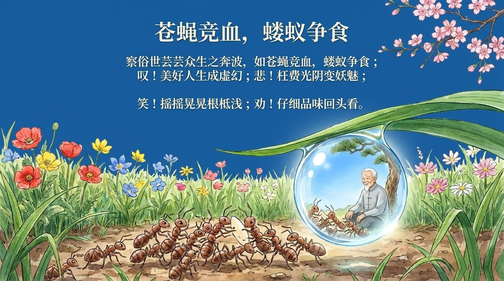
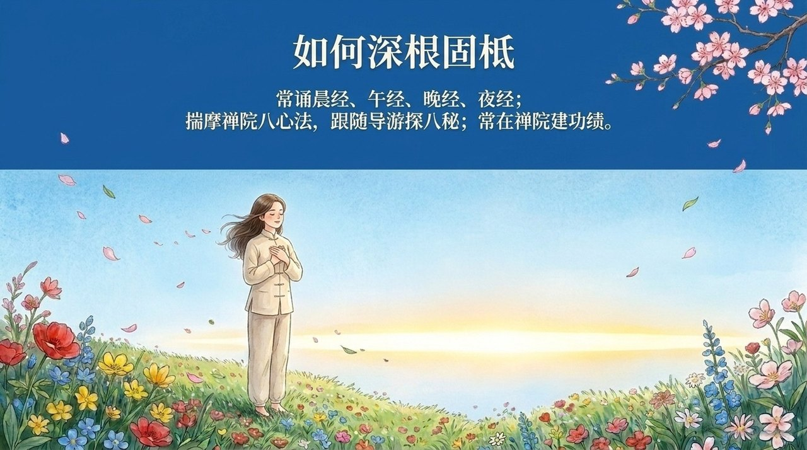
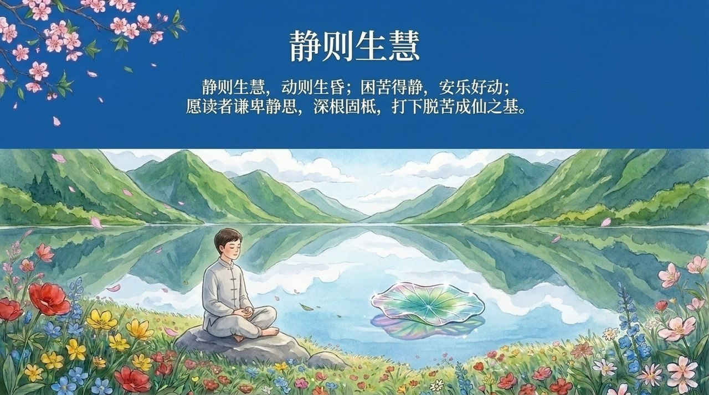
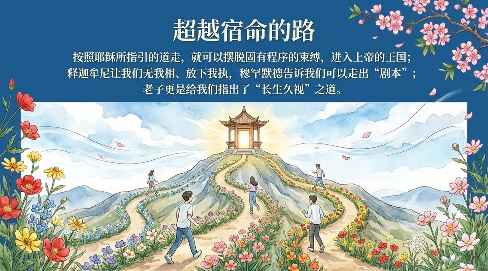
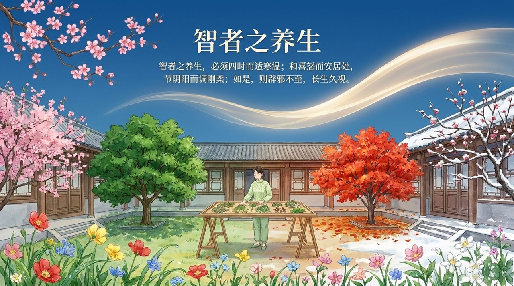

# 深根固柢·长生久视

**深根固柢·长生久视**，源自老子《道德经》"是谓深根固柢，长生久视之道"，在生命禅院体系中被诠释为修仙成道的根本法门——以上帝之道为根、以神佛教诲为柢，开启本性灵觉，将有限人生融入无限生命时空，从而实现真正的不朽与长久。导游雪峰以野草、松柏、中华文明为喻，说明唯有根柢深厚者方能历久不衰，超越生死，翱翔太宇。

> 静则生慧，动则生昏，困苦得静，安乐好动，愿读者谦卑静思，深根固柢，打下脱苦成仙之基。
>
> ——禅院文集·修仙篇·深根固柢 长生久视

## 视频版

<iframe style="width:100%;aspect-ratio:4/3;border:0" src="https://www.youtube-nocookie.com/embed/saGbhslG75k" title="深根固柢·长生久视（生命禅院百科·视频版）" allowfullscreen></iframe>

??? info "📖 图文幻灯（14 张，点击展开）"

    
    
    
    
    
    
    
    
    
    
    
    
    
    

---

## 版本导航

| 版本 | 适合 | 核心角度 |
|------|------|----------|
| [友好版](friendly/) | 初次了解 | 生活比喻与人生启示 |
| [学术版](academic/) | 研究者 | 系统分析与跨文化比较 |
| [内部版](internal/) | 深度研修 | 导游原文存档 |

## 相关词条

[道](/zh/dao/) · [上帝之道](/zh/way-of-the-greatest-creator/) · [自然之道](/zh/way-of-nature/) · [无为而无不为](/zh/wu-wei/) · [羽化成仙](/zh/yuhuachengxian/) · [成仙](/zh/becoming-celestial/) · [归零](/zh/return-to-zero/) · [觉悟](/zh/awakening/)
