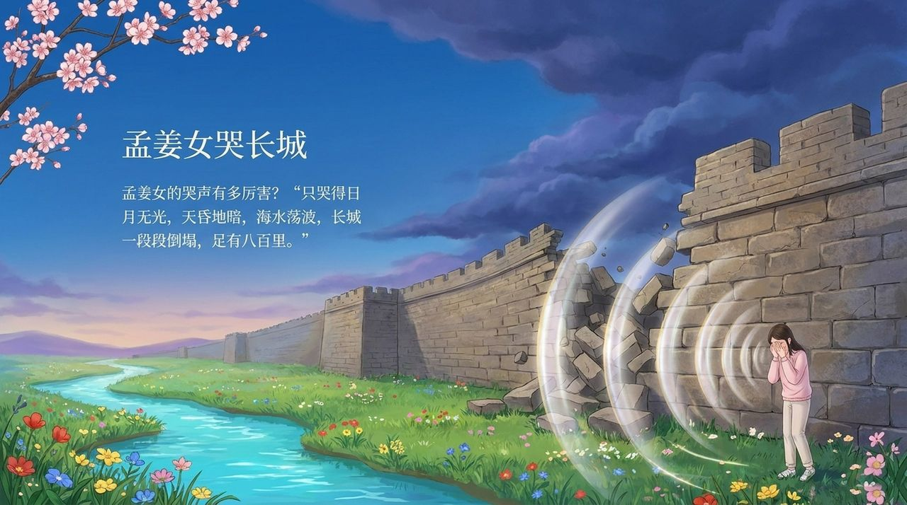
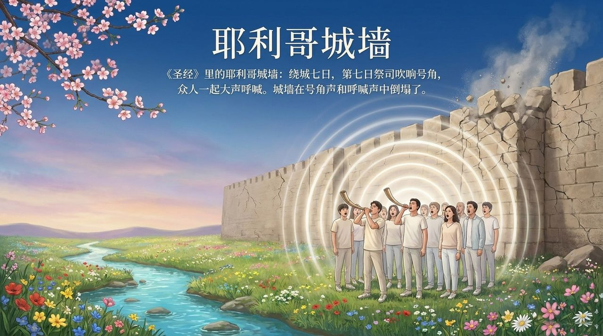
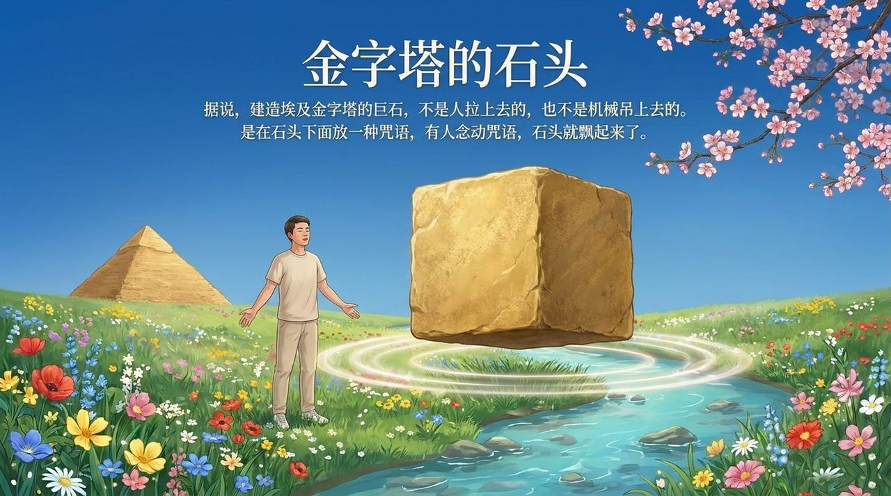
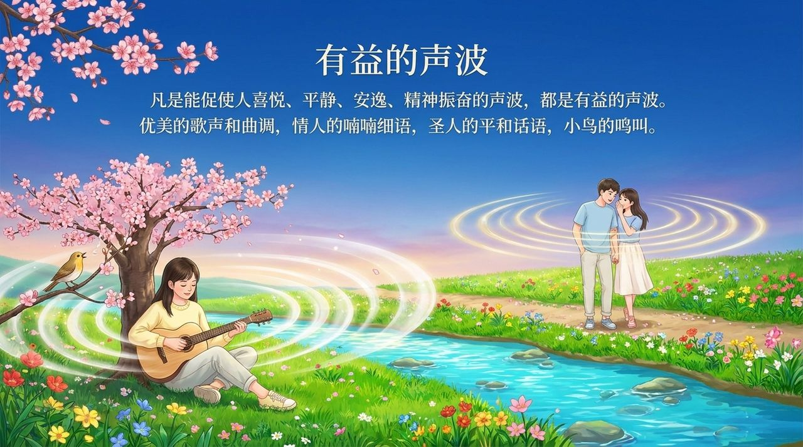

<!-- id: LC-SWE-0001-ZH theme: 生命奥秘 type: index direction: 生命奥秘 lang: zh -->

# 声波能量

**声波能量**是生命禅院体系中关于声音与生命能量关系的专题论述。雪峰指出，声波有频率，不同频率带有不同能量，对生命和大千世界的影响不同；正面积极的声波对生命有益，负面消极的声波有害，且伤人同时伤己。引用克拉尼图形、观音心咒读音、孟姜女哭长城、窦娥冤、耶利哥城墙、埃及金字塔等多个案例证明声波的巨大力量；核心原则：凡使你喜悦平静的声音就是有益于你的声波能量。

---

## 视频版

<iframe style="width:100%;aspect-ratio:4/3;border:0" src="https://www.youtube-nocookie.com/embed/yVdLdV3K2io" title="声波能量（生命禅院百科·视频版）" allowfullscreen></iframe>

??? info "📖 图文幻灯（14 张，点击展开）"

    
    
    
    
    
    
    
    
    
    
    
    
    
    

---

## 版本导航

| 版本 | 适合读者 | 核心角度 |
|------|---------|---------|
| [友好版](friendly.md) | 初次了解者 | 声音怎么影响生命？什么声音对你有益？ |
| [学术版](academic.md) | 研究者 | 声波能量的原理框架、案例体系、与生命能量的关联 |
| [内部版](internal.md) | 深度研修 | 完整文集引文，生命篇全文 |

---

## 相关词条

[能量](/zh/energy/) · [提升振动频率](/zh/raise-vibration-frequency/) · [空灵妙音·本真禅曲](/zh/ethereal-sound/) · [同频共振](/zh/resonance/) · [宇宙全息](/zh/cosmic-holography/) · [意识](/zh/consciousness/) · [生命奥秘](/zh/life-mysteries/) · [祈祷](/zh/prayer/) · [反物质结构](/zh/antimatter-structure/)
