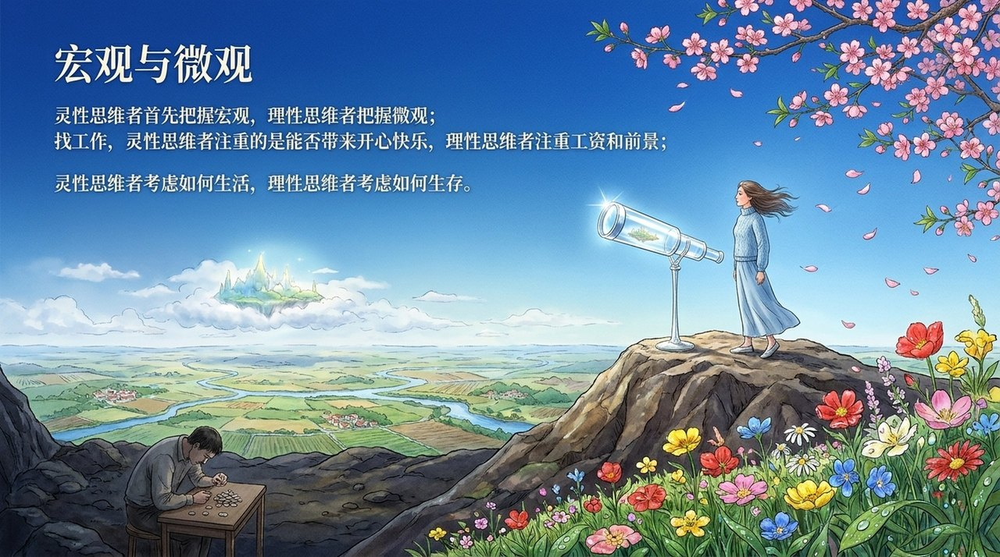
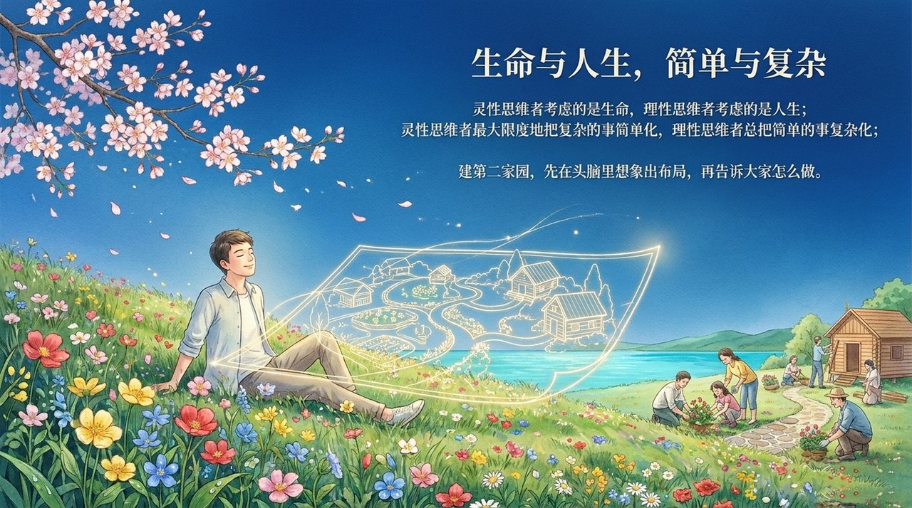
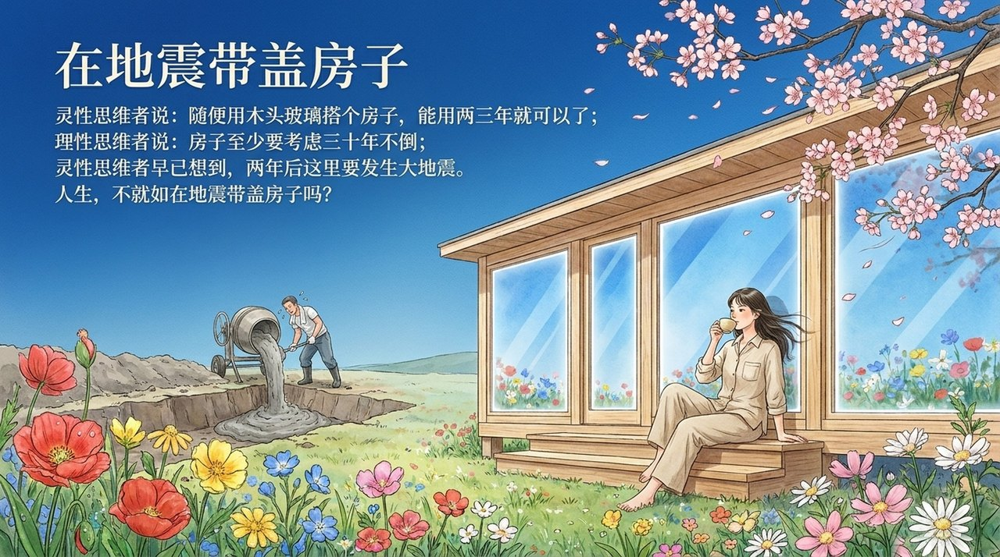

<!-- id: LC-SPT-0001 theme: 思维修炼 type: 入口页 direction: 意识升华路径 lang: zh -->

# 灵性思维

【入口页】

**灵性思维**是生命禅院八大思维阶梯中**后四梯**（心像思维、太极思维、无相思维、浑沌思维）的集合名，是"仙的思维"的准确定位，是人与仙的分水岭之上的全部思维方式。

> 理性思维和灵性思维是人和仙的分水岭。如果你的思维是理性思维，不要怀疑，你一定是人。
>
> ——禅院文集·智慧篇·灵性思维的思考方式和做事风格

灵性思维的核心是：以上帝的意愿为心愿，以道的法则为行事准则，靠信仰和直觉的随性率性，而不考虑对自己有什么好处。灵性思维是**圣人的思维**，是仙人的特征，是开心、快乐、自由、幸福的根源，是走向天国最直接的路径。

---

## 核心定位

在生命禅院思维体系中，灵性思维是"减法阶段"的全部四梯，无法靠知识学习和头脑训练达到，必须靠灵觉开启、心灵净化、放弃我执来推进。其本质是"没有思维"——直接依照内心的第一冲动做出判断，不经任何理性思考过程。

---

## 视频版

<iframe style="width:100%;aspect-ratio:4/3;border:0" src="https://www.youtube-nocookie.com/embed/YUTSeRt4KVY" title="灵性思维（生命禅院百科·视频版）" allowfullscreen></iframe>

??? info "📖 图文幻灯（14 张，点击展开）"

    
    
    
    
    
    
    
    
    
    
    
    
    
    

---

## 版本导航

| 版本 | 适合读者 | 链接 |
|------|---------|------|
| **友好版** | 初次接触生命禅院的朋友 | [阅读友好版](./friendly) |
| **学术版** | 哲学/宗教研究背景的读者 | [阅读学术版](./academic) |
| **内部版** | 禅院草和深度修炼者 | [阅读内部版](./internal) |

---

## 相关词条

- [八大思维阶梯](/zh/eight-thinking-ladders/)——灵性思维（后四梯）在完整体系中的坐标
- [理性思维](/zh/rational-thinking/)——与灵性思维相对的人的思维（物质/形象/联想/迷幻）
- [心像思维](/zh/heart-image-thinking/)——第五梯，灵性思维的第一梯，跨越人与仙分水岭的入口
- [浑沌思维](/zh/hundun-thinking/)——第八梯，灵性思维的最高形态，上帝的思维
