# 随缘放旷·任运逍遥

**随缘放旷·任运逍遥**，是生命禅院体系中仙道境界的核心表述——顺应因缘而不执着，自在随性而不勉强，既无烦恼捆绑，也无戒律束缚，如婴儿般天真自在，如流水般随形而行，时时处在愉悦与自由中。导游雪峰将此定性为仙道有别于佛道、基督之道、人道的本质特征，亦是"成仙三步曲"的第二步境界标志。

> 如果我们活得很累，离仙道远了；如果我们越活越开心快乐自由潇洒，离仙道近了。
>
> ——禅院文集·修仙篇·随缘放旷 任运逍遥

## 视频版

<iframe style="width:100%;aspect-ratio:4/3;border:0" src="https://www.youtube-nocookie.com/embed/LWwLkOmW-mI" title="随缘放旷·任运逍遥（生命禅院百科·视频版）" allowfullscreen></iframe>

??? info "📖 图文幻灯（14 张，点击展开）"

    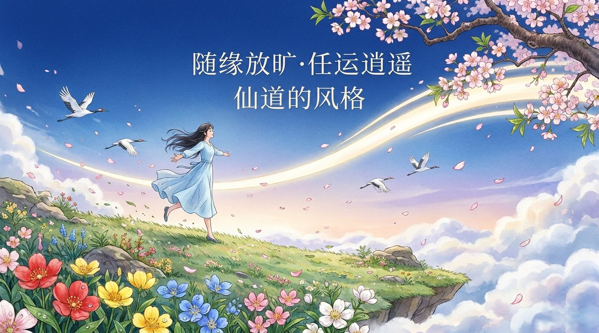
    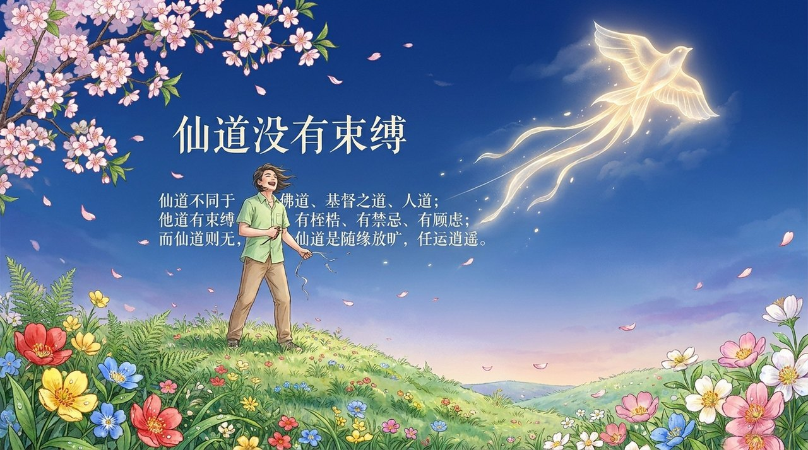
    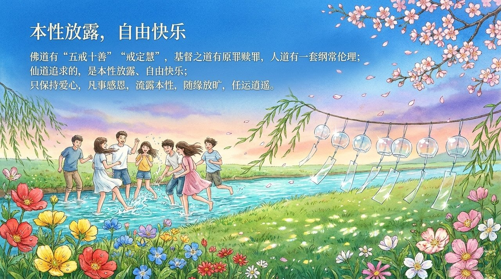
    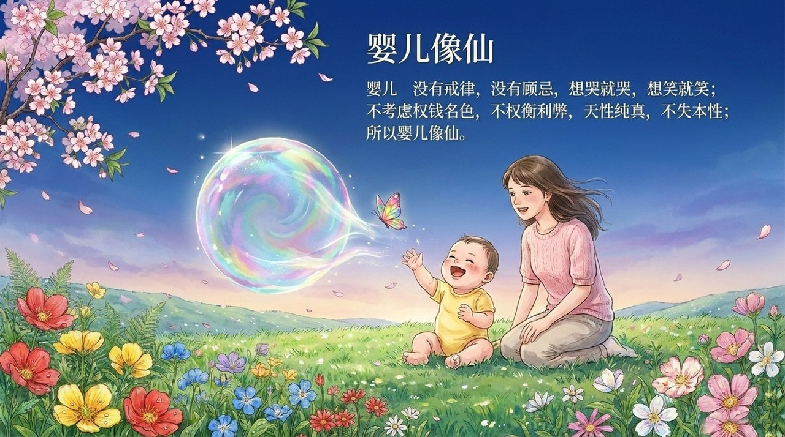
    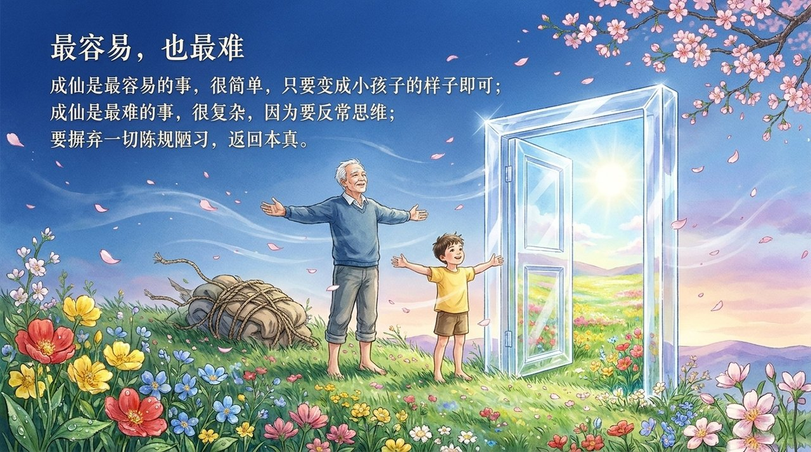
    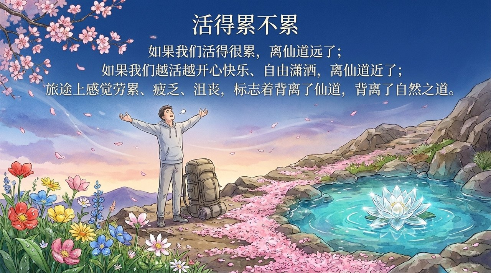
    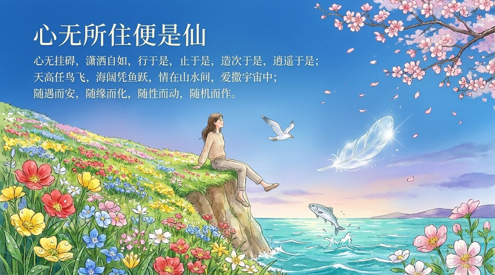
    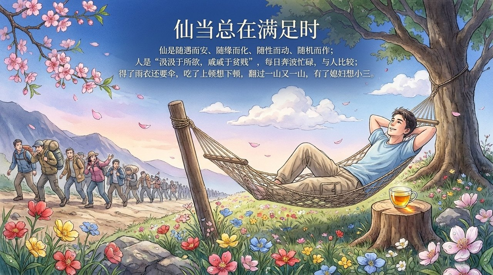
    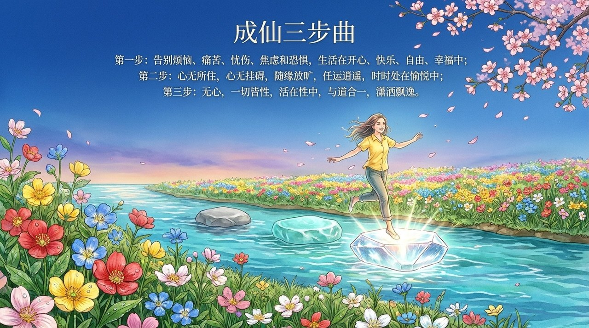
    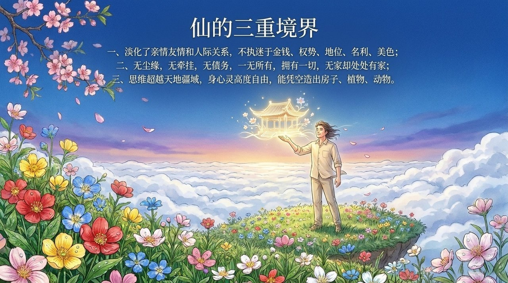
    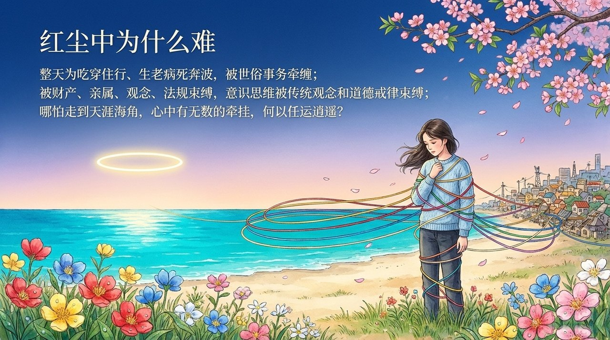
    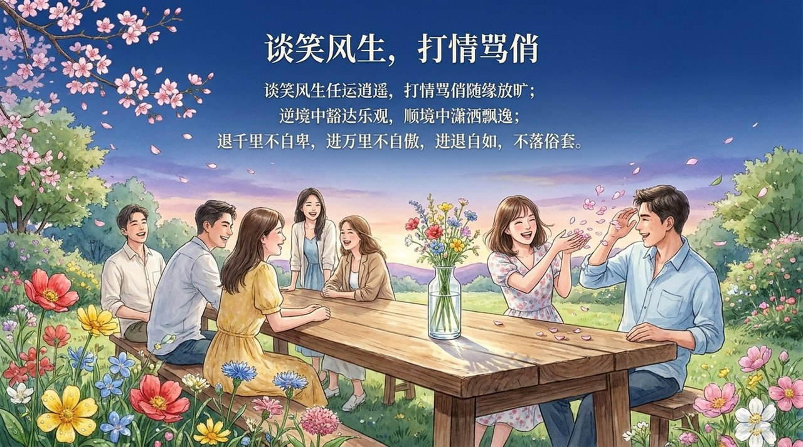
    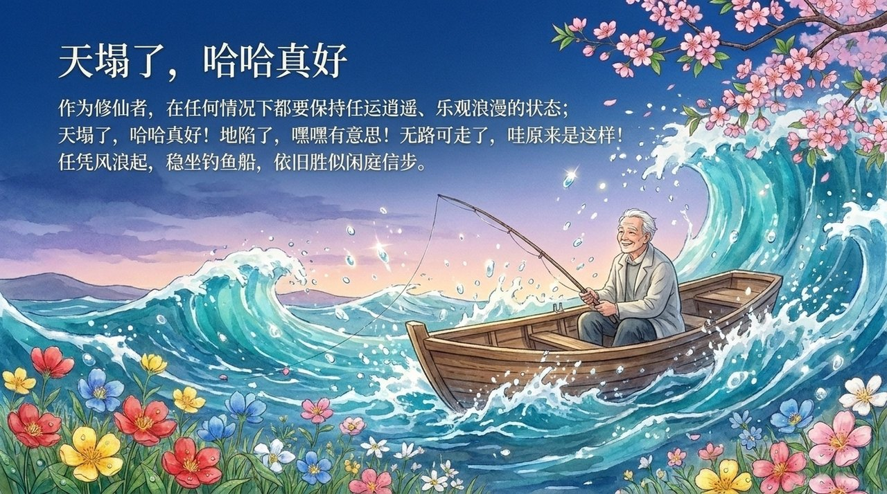
    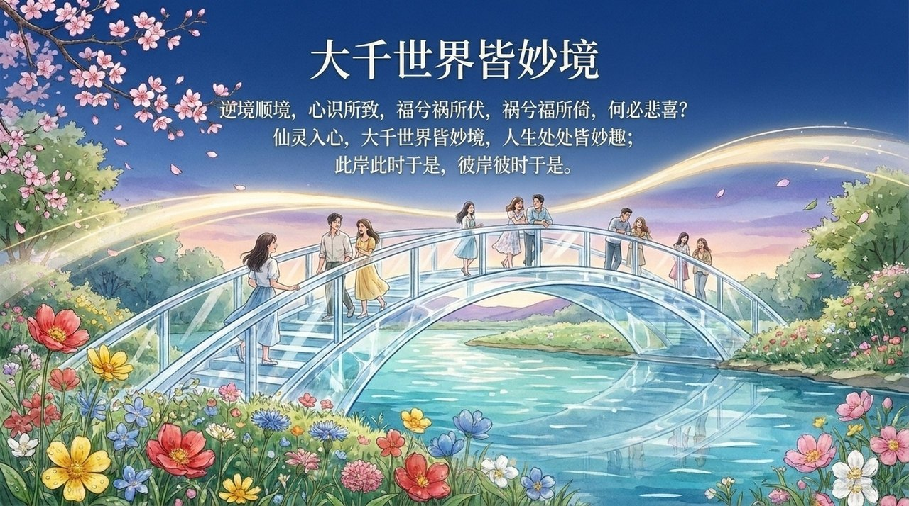

---

## 版本导航

| 版本 | 适合 | 核心角度 |
|------|------|----------|
| [友好版](friendly/) | 初次了解 | 生活感受与仙道体验 |
| [学术版](academic/) | 研究者 | 系统分析与跨文化比较 |
| [内部版](internal/) | 深度研修 | 导游原文存档 |

## 相关词条

[四随（随遇而安·随缘而化·随性而动·随机而作）](/zh/si-sui/) · [无为而无不为](/zh/wu-wei/) · [无我无相](/zh/no-self-no-form/) · [心无所住·心无挂碍](/zh/xinwu-suozhu-guaai/) · [自洽](/zh/self-coherence/) · [仙性](/zh/xianxing/) · [成仙](/zh/becoming-celestial/) · [小孩子模样](/zh/childlike-nature/) · [随性而动](/zh/suixing-er-dong/)
