# 太虚幻境

**太虚幻境**，在生命禅院体系中，是反物质世界的别称与隐喻入口。导游雪峰揭示：一切的幻境都是反物质世界，所有看似虚幻的事物，在更深的维度上都是真实的存在。以《红楼梦》"贾宝玉神游太虚境"为切入，雪峰解开了千古之谜——那个"假作真时真亦假，无为有处有还无"的太虚幻境，正是真实不虚的反物质世界；人类梦境、幻觉乃至幽灵船事件，皆可由此得到解答。进入这个世界的钥匙是：倒行逆施、反常思维、异想天开、色空不二。

> 花非花，梦非梦，结构意识显原形，梅开几度，梦初醒，修得一点真，太虚幻境是仙境。
>
> ——禅院文集·反物质世界篇·千古之谜太虚幻境

## 视频版

<iframe style="width:100%;aspect-ratio:4/3;border:0" src="https://www.youtube-nocookie.com/embed/hX390K0C5Rg" title="太虚幻境（生命禅院百科·视频版）" allowfullscreen></iframe>

??? info "📖 图文幻灯（14 张，点击展开）"

    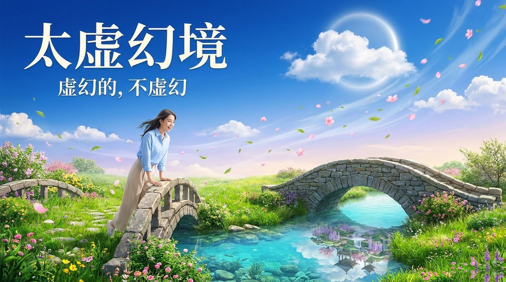
    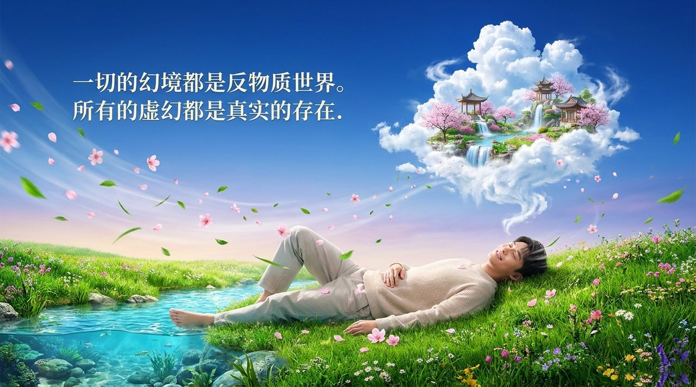
    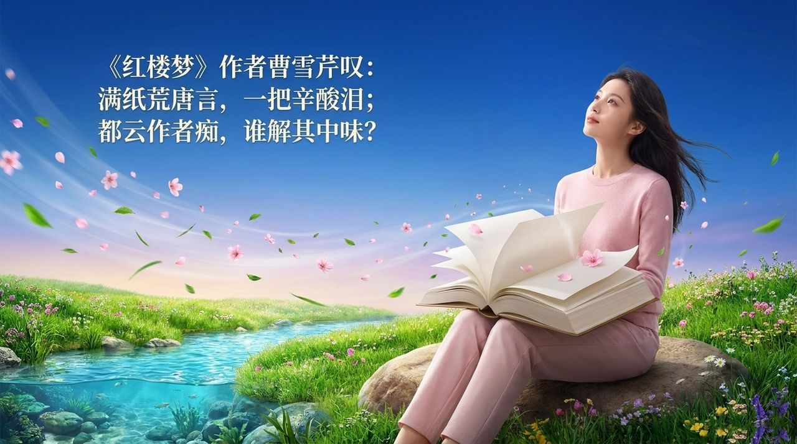
    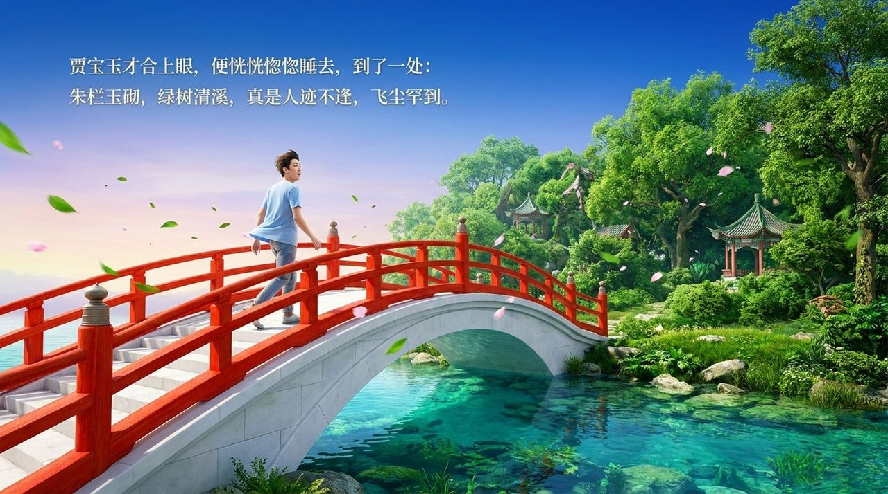
    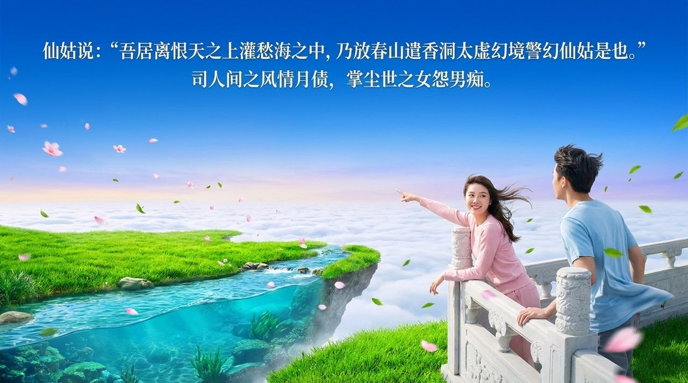
    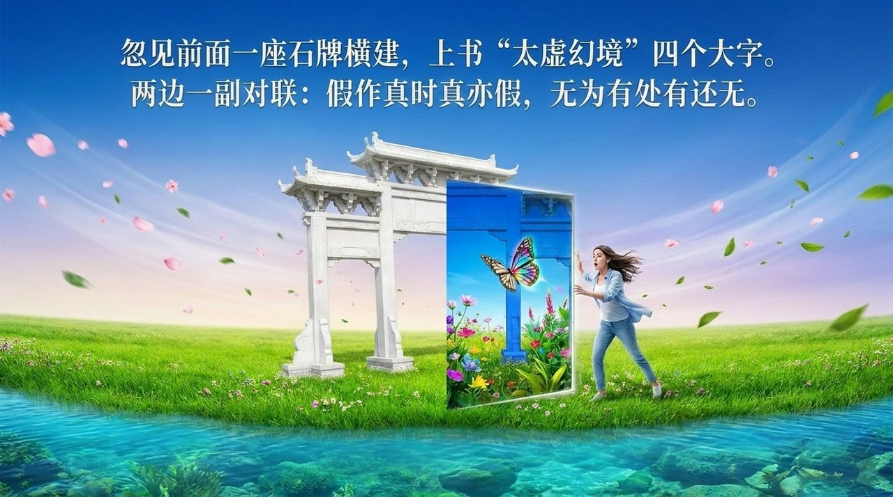
    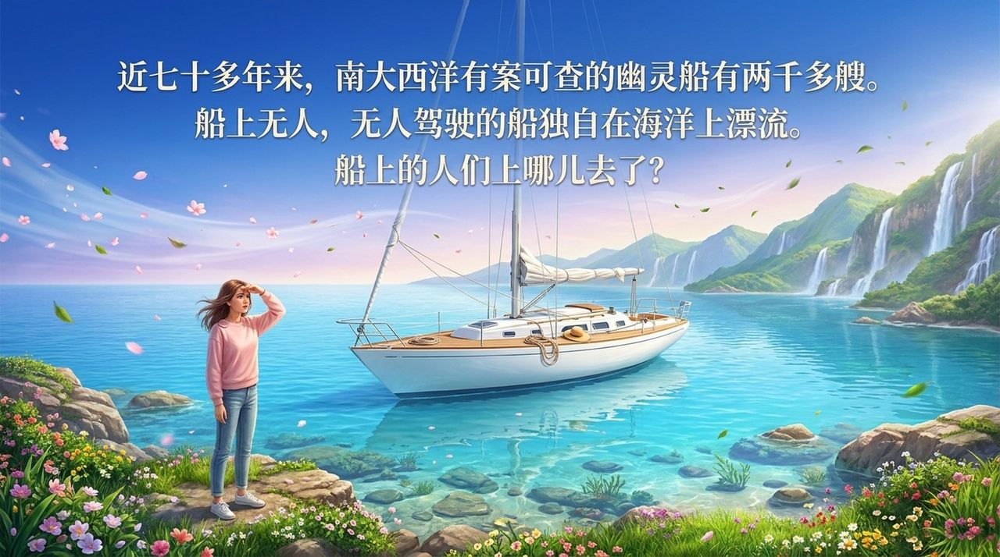
    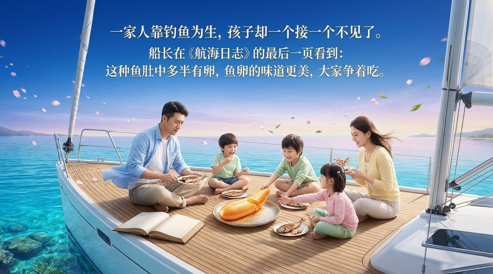
    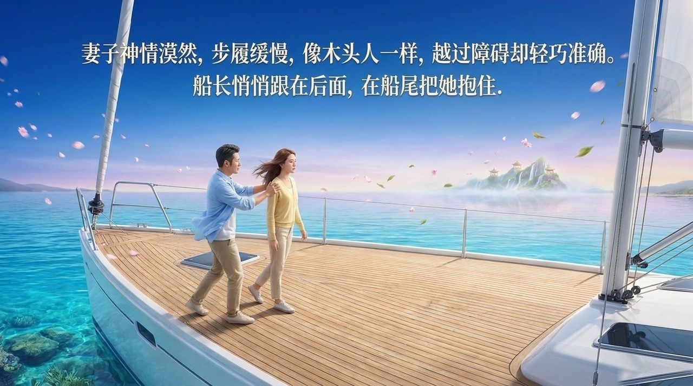
    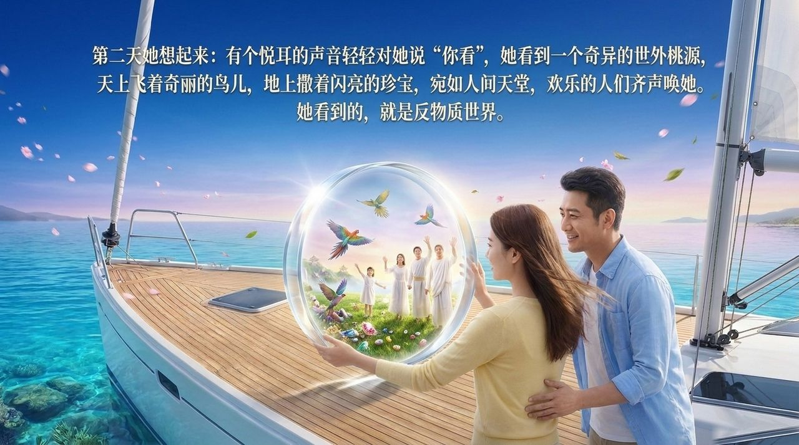
    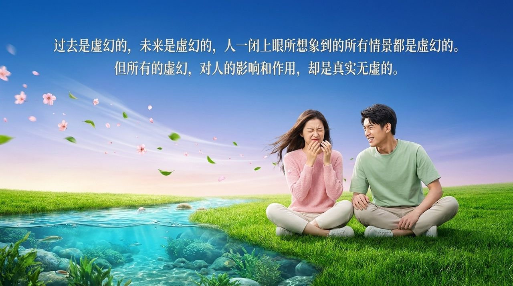
    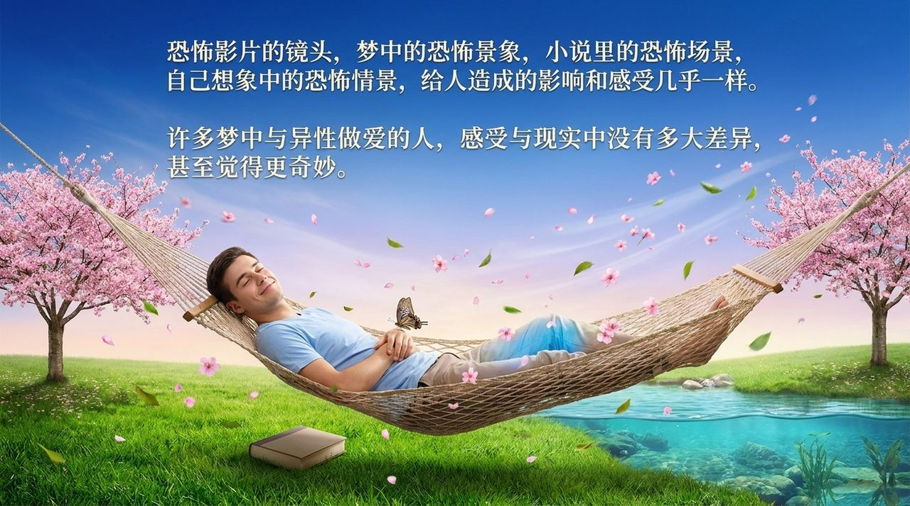
    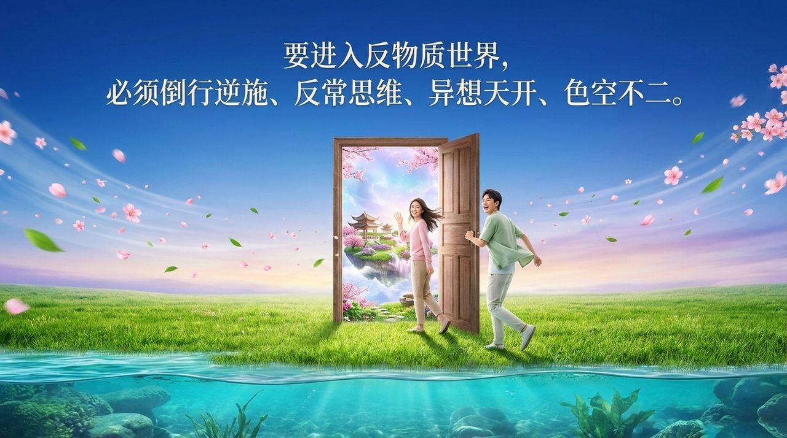
    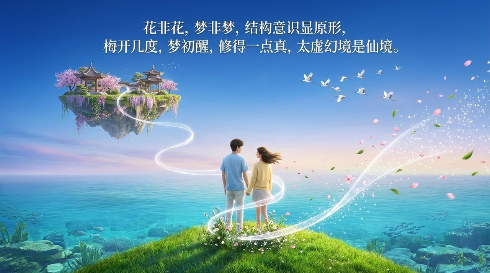

---

## 版本导航

| 版本 | 适合 | 核心角度 |
|------|------|----------|
| [友好版](friendly/) | 初次了解 | 以《红楼梦》和奇异案例走入反物质世界 |
| [学术版](academic/) | 研究者 | 虚幻与实在的哲学与宇宙学分析 |
| [内部版](internal/) | 深度研修 | 导游原文存档 |

## 相关词条

[反物质世界](/zh/antimatter-world/) · [梦境](/zh/dream-state/) · [浑沌](/zh/hundun/) · [反常思维](/zh/abnormal-thinking/) · [颠倒思维](/zh/inverted-thinking/) · [高层生命空间](/zh/high-life-spaces/) · [千年界](/zh/thousand-year-world/) · [无相思维](/zh/non-form-thinking/)
