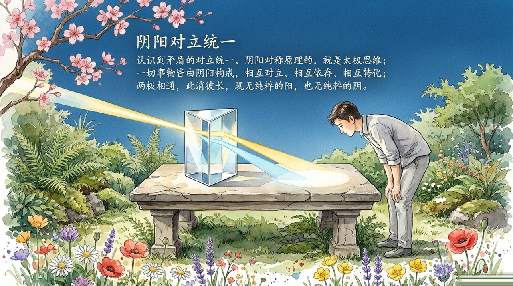

<!-- id: LC-TAJ-0001 theme: 思维修炼 type: 入口页 direction: 意识升华路径 lang: zh -->

# 太极思维

【入口页】

**太极思维**是八大思维阶梯中的**第六级**，是心像思维之上、无相思维之下的一梯，是"减法阶段"中迈向更高灵性境界的关键一步。太极思维的核心：认识到并能游刃有余地运用**阴阳对立统一的宇宙法则**。老子的思维是太极思维，整部《道德经》是太极思维智慧的完整体现。

> 太极思维：认识到矛盾的对立统一，阴阳对称原理的，就是太极思维。
>
> ——雪峰，《雪峰文集·X04友情篇·向青峰碧先生致敬》

---

## 核心定位

在生命禅院修行路线图中，太极思维是减法阶段的第二级（心像→**太极**→无相→浑沌）。太极思维者感知到的是整个宇宙正负能量的有效运行和一切事物发展变化的井然有序；他们很少需要刻意"思维"，阴阳在意识中自然流动。太极思维是圣贤的境界，具备太极思维的人前世是大师贤哲的转世。

---

## 视频版

<iframe style="width:100%;aspect-ratio:4/3;border:0" src="https://www.youtube-nocookie.com/embed/1IrGeG5jXx4" title="太极思维（生命禅院百科·视频版）" allowfullscreen></iframe>

??? info "📖 图文幻灯（14 张，点击展开）"

    
    
    
    
    
    
    
    
    
    
    
    
    
    

---

## 版本导航

| 版本 | 适合读者 | 链接 |
|------|---------|------|
| **友好版** | 初次接触生命禅院的朋友 | [阅读友好版](./friendly) |
| **学术版** | 哲学/宗教研究背景的读者 | [阅读学术版](./academic) |
| **内部版** | 禅院草和深度修炼者 | [阅读内部版](./internal) |

---

## 相关词条

- [八大思维阶梯](/zh/eight-thinking-ladders/)——太极思维在整体思维层级体系中的坐标
- [心像思维](/zh/heart-image-thinking/)——第五梯，太极思维的前一级
- [太极](/zh/taiji/)——太极的宇宙本体论定义
- [道](/zh/dao/)——太极思维与道的关系
