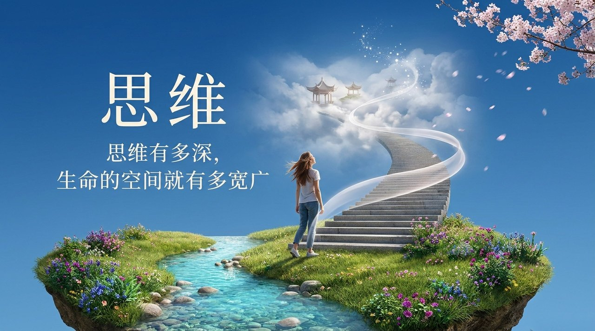
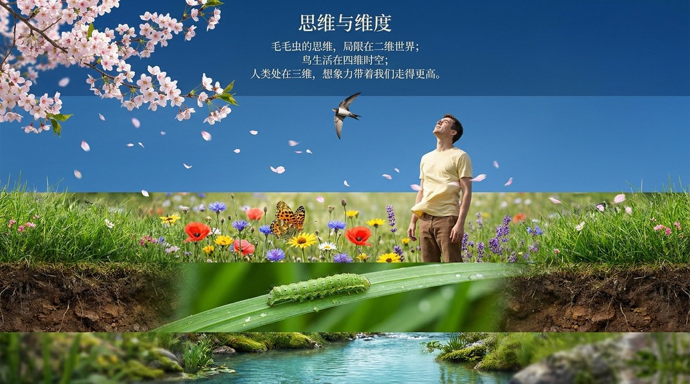
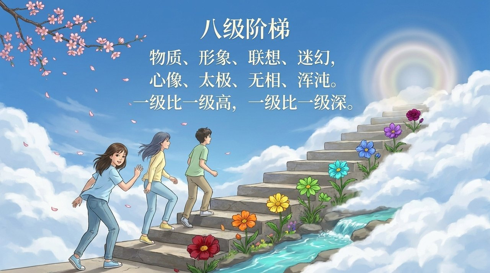
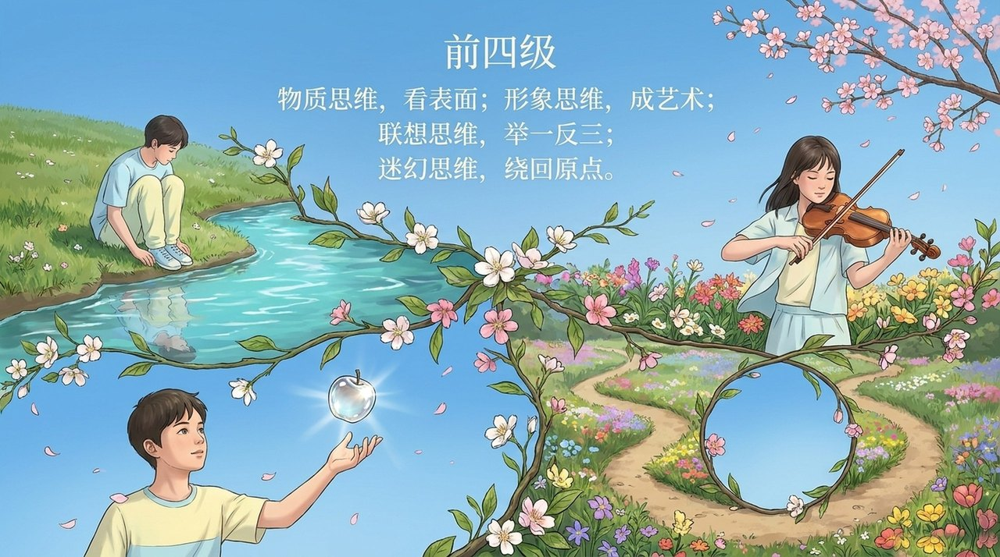
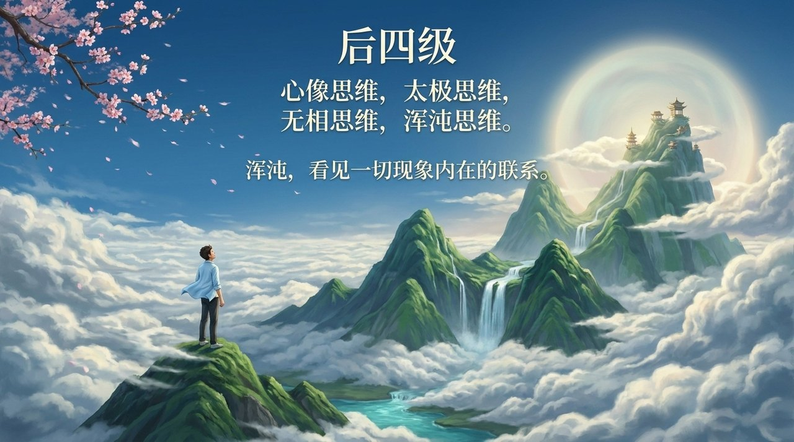
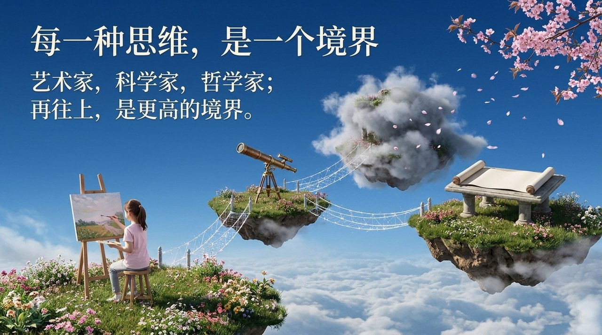
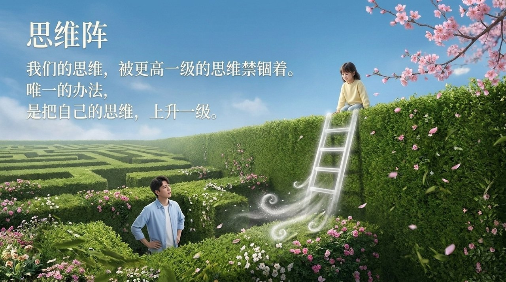
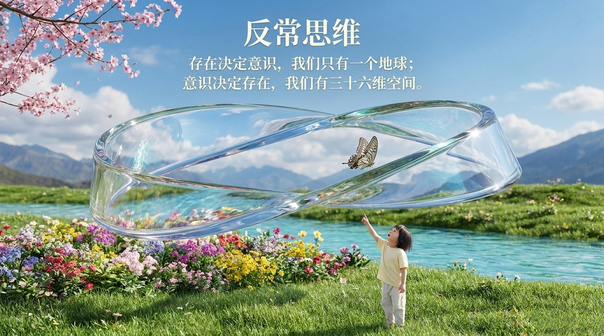
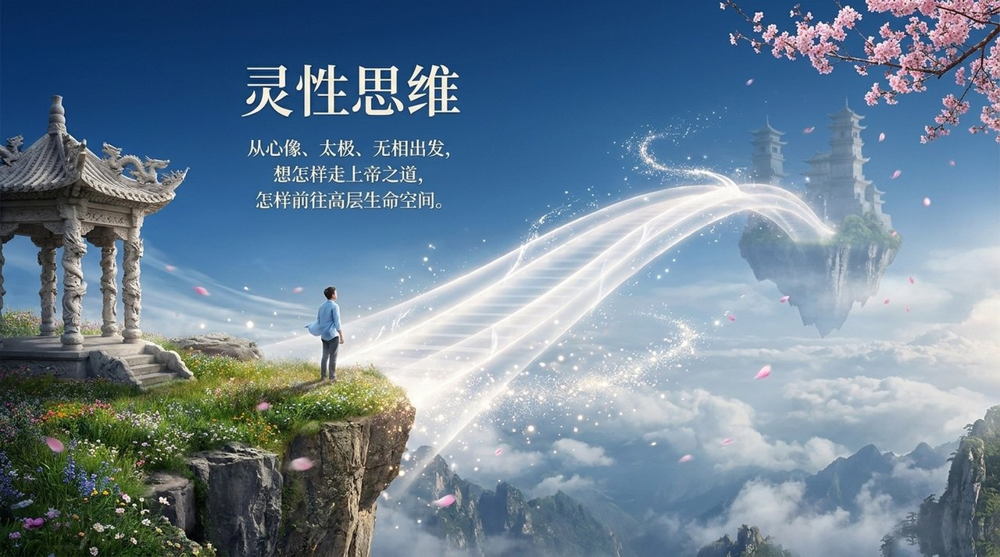

<!-- id: LC-THK-0001 theme: 思维奥秘 type: 入口页 direction: 生命升华路径 lang: zh -->

# 思维（总论）

> 思维是意识的核心成分，思维能改变意识。要想改变自己的生活方式，要想进入一个理想的家园，首先要改变思维模式和方式。有什么样的思维方式，就会有什么样的生命存在形式。
>
> ——《建设我们理想的家园》，雪峰文集

**思维**是思想、思索、思考的维度与过程，是意识的核心组成部分，也是决定生命层次与去向的关键力量。禅院体系将思维分为八大阶梯，从物质思维到浑沌思维依次递进；思维层次越高，生命境界越深，越接近上帝。改变思维，是改变生命去向、进入理想家园的根本之道。

---

## 各版本

| 版本 | 适合人群 | 核心内容 |
|------|----------|----------|
| [友好版](/zh/thinking-overview/friendly/) | 初次接触者 | 什么是思维？八大阶梯的白话解读与生活类比 |
| [学术版](/zh/thinking-overview/academic/) | 研究者 | 与西方哲学、认知科学思维理论的比较研究 |
| [内部版](/zh/thinking-overview/internal/) | 禅院草 | 文集完整原文，十一章全量照引 |

---

## 视频版

<iframe style="width:100%;aspect-ratio:4/3;border:0" src="https://www.youtube-nocookie.com/embed/Z37p0iBLp0Q" title="思维（总论）（生命禅院百科·视频版）" allowfullscreen></iframe>

??? info "📖 图文幻灯（14 张，点击展开）"

    
    
    
    
    
    
    
    
    
    
    
    
    
    

---

## 相关词条

- [八大思维阶梯](/zh/eight-thinking-ladders/)
- [浑沌思维](/zh/hundun-thinking/)
- [无相思维](/zh/non-form-thinking/)
- [太极思维](/zh/taiji-thinking/)
- [心像思维](/zh/heart-image-thinking/)
- [反常思维](/zh/abnormal-thinking/)
- [灵性思维](/zh/spiritual-thinking/)
- [定式思维](/zh/fixed-mindset/)
- [意识](/zh/consciousness/)
- [生命](/zh/life/)
