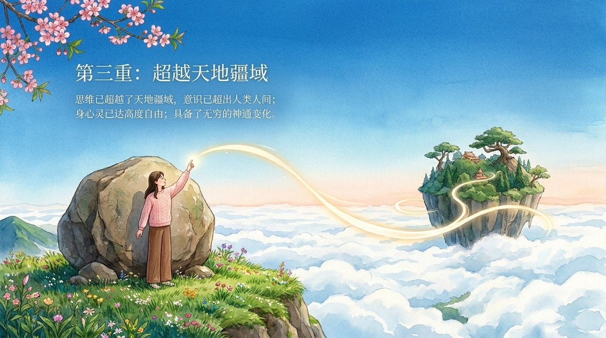
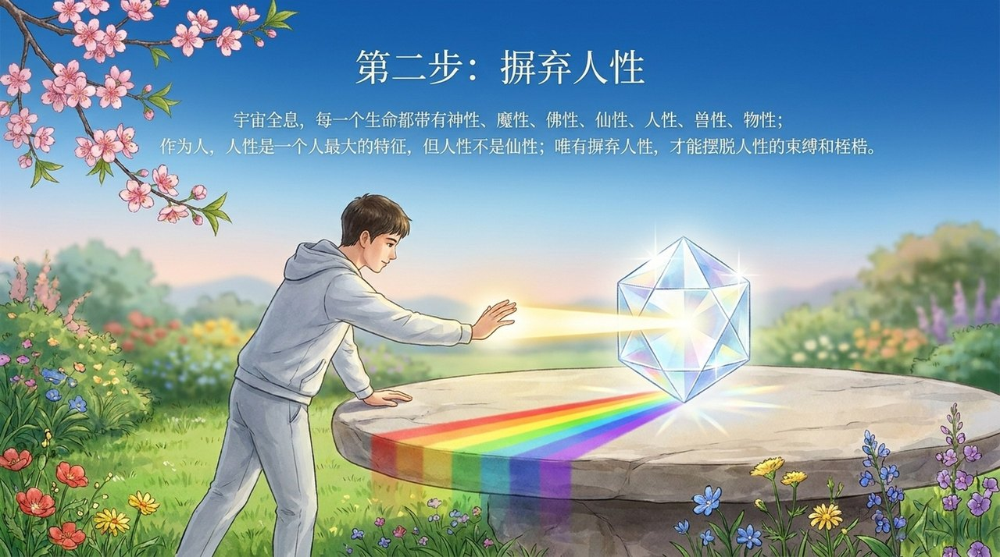
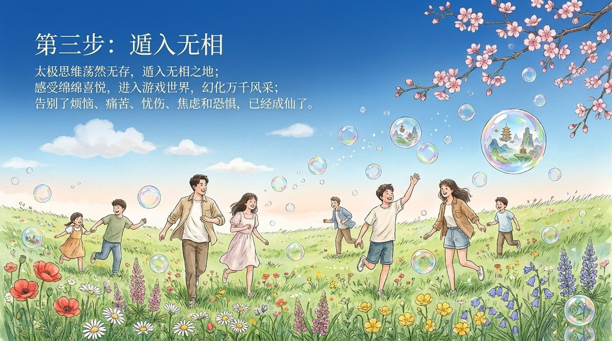

# 仙的三重境界

> 仙的三重境界是：一、淡化了亲情友情……随缘放旷，任运逍遥；二、无尘缘，无牵挂，无债务，无我无私无执着……一无所有拥有一切；三、思维已超越了天地疆域……具备了无穷的神通变化……挥洒自如，毫无滞塞。
>
> —— 禅院文集·修仙篇·仙的三重境界和成仙的三个步骤

**仙的三重境界**由导游雪峰于2025年系统阐述，揭示了仙的生命状态从"脱俗随缘"到"无牵无碍"再到"神通变化"的三个层次，并给出了成仙的三个对应步骤。本词条适用对象为"来自千年界的天生禅院草"，非仙根者仅供参考了解。

| 版本 | 适合 | 核心角度 |
|------|------|----------|
| [友好版](friendly.md) | 初次了解 | 以日常语言描绘仙的生命状态 |
| [学术版](academic.md) | 研究者 | 三境界结构分析与修行路径 |
| [内部版](internal.md) | 深度研修 | 原文完整引述 |

---

## 视频版

<iframe style="width:100%;aspect-ratio:4/3;border:0" src="https://www.youtube-nocookie.com/embed/cPMqDXmZk8w" title="仙的三重境界（生命禅院百科·视频版）" allowfullscreen></iframe>

??? info "📖 图文幻灯（14 张，点击展开）"

    
    
    
    
    
    
    
    
    
    
    
    
    
    

---

## 相关词条

[成仙](/zh/becoming-celestial/) · [仙性](/zh/xianxing/) · [超凡脱俗](/zh/chaofantuosu/) · [羽化成仙](/zh/yuhuachengxian/) · [仙风道骨](/zh/xianfengdaogu/) · [无我无相](/zh/no-self-no-form/) · [一无所有·拥有一切](/zh/own-nothing-have-everything/) · [千年界仙](/zh/thousand-year-world-celestials/) · [仙·天仙·佛](/zh/xian-tian-xian-fo/)
