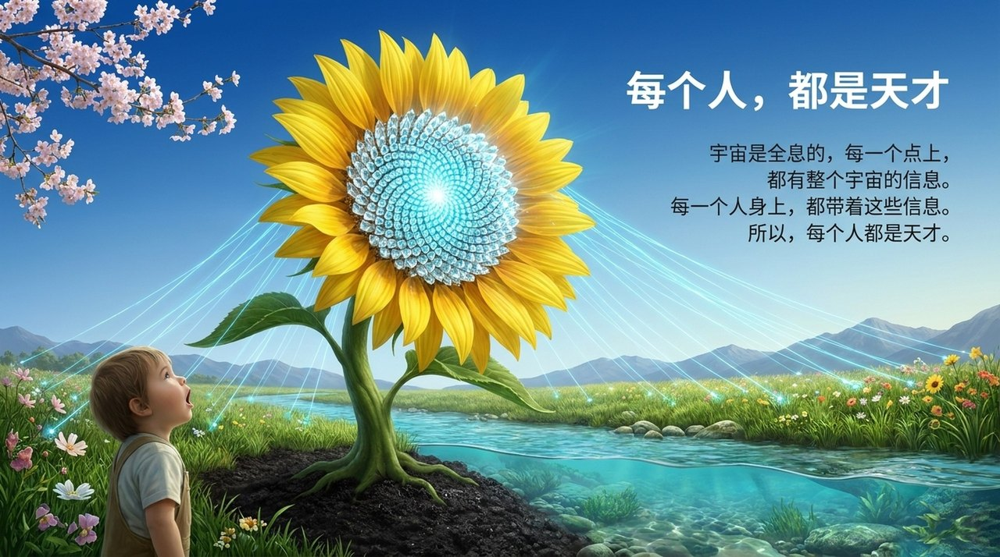
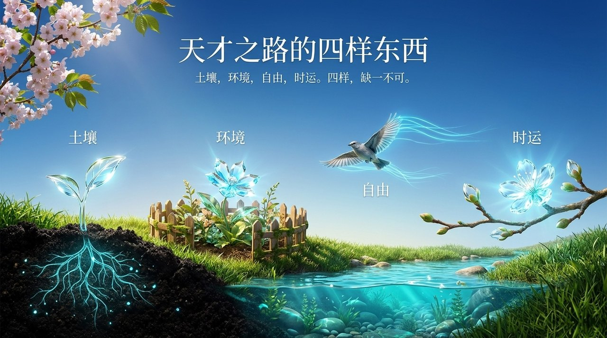
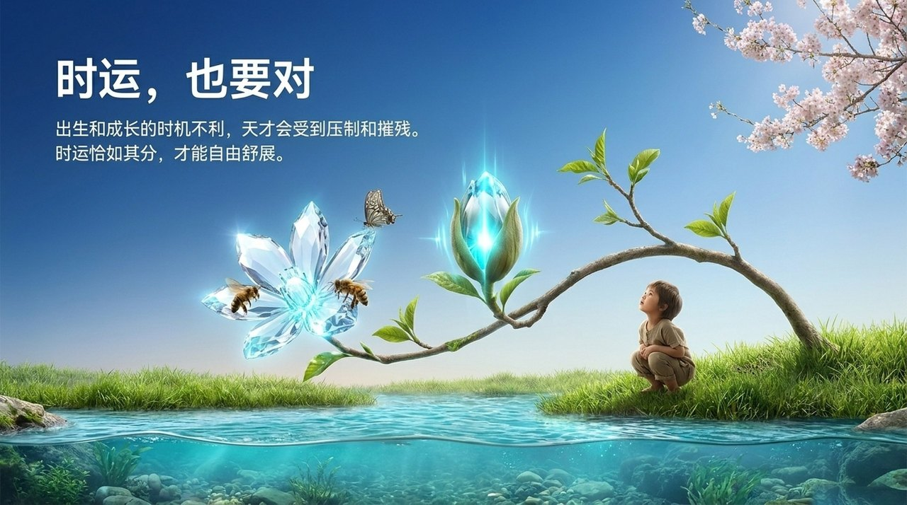
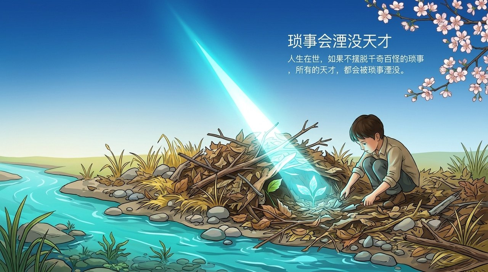
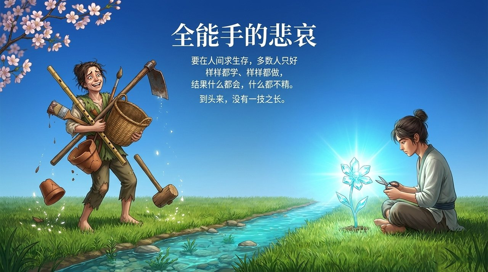

<!-- id: LC-TC-0001-ZH theme: 修行修炼 type: 入口页 direction: 修行修炼 lang: zh -->

# 天才

**天才，是生命在前世前前世积累的意识素质于今生的显现，是全息宇宙赋予每个生命的潜在可能**——只要专注于某一方面、具备合适的土壤与自由，人人皆可成为天才；而杂务、应酬、兴趣广、不自由是毁灭天才的四大元凶。在生命禅院体系中，能成仙成佛者必定是天才，第二家园的生活模式是使天才得以充分彰显的根本出路。

---

## 视频版

<iframe style="width:100%;aspect-ratio:4/3;border:0" src="https://www.youtube-nocookie.com/embed/Ftj3wSzw418" title="天才（生命禅院百科·视频版）" allowfullscreen></iframe>

??? info "📖 图文幻灯（14 张，点击展开）"

    
    
    
    
    
    
    
    
    
    
    
    
    
    

---

## 版本导航

| 版本 | 适合读者 | 核心内容 |
|------|---------|---------|
| [友好版](friendly.md) | 初次接触 | 为什么你也是天才、四大元凶、全能手的悲哀与出路 |
| [学术版](academic.md) | 研究参考 | 全息宇宙天才论、天才结构性障碍分析、与创造力研究的比较 |
| [内部版](internal.md) | 深度研习 | 七板块全部原文引证，含出处 |

---

## 相关词条

[天赋](/zh/tianfu/) · [天性](/zh/tianxing/) · [天命](/zh/tianming/) · [第二家园](/zh/second-home/) · [觉悟](/zh/awakening/) · [仙·天仙·佛](/zh/xian-tian-xian-fo/) · [成仙成佛](/zh/becoming-celestial-buddha/)
