<!-- id: LC-TF-0001 theme: 修行修炼 type: 索引 direction: 修行修炼 lang: zh -->

# 天赋

**天赋在生命禅院体系中涵盖两个互相关联的维度**——其一，上天赋予每个生命的先天才能与素质：天才不是后天培养出来的，而是前世意识信息积累的遗传；其二，上天赋予人的天然权利：思想权、自由等是上帝给予每个生命不可剥夺的天赋人权。全息论指出人人皆是天才，但平庸与杂乱是毁灭天才的元凶；天才之路有四要素：合适的土壤与环境、自由、时运。成仙成佛的人必定是天才，因为没有如此高的灵性与坚毅，无法抵达修炼的极致境界。

---

## 视频版

<iframe style="width:100%;aspect-ratio:4/3;border:0" src="https://www.youtube-nocookie.com/embed/eAmOyPW7sS0" title="天赋（生命禅院百科·视频版）" allowfullscreen></iframe>

??? info "📖 图文幻灯（14 张，点击展开）"

    
    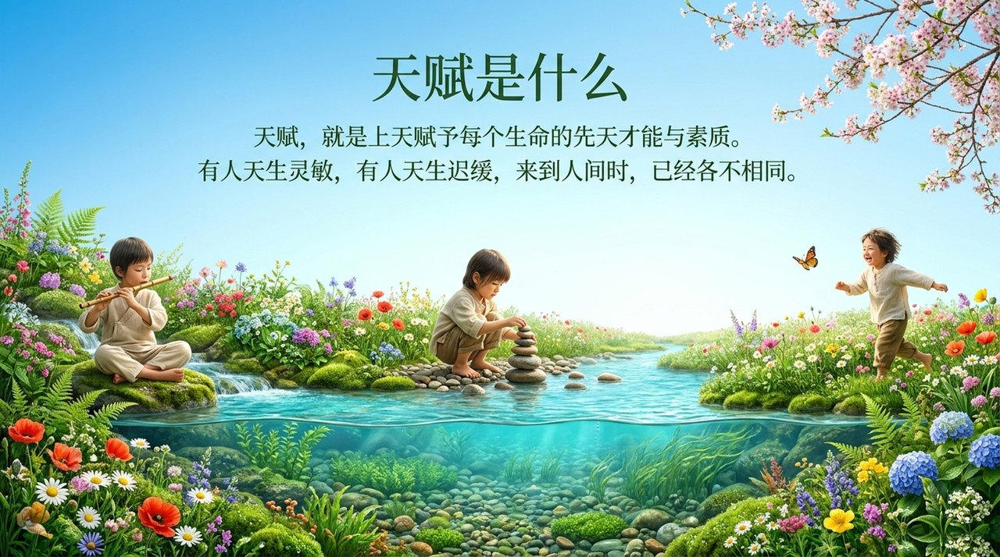
    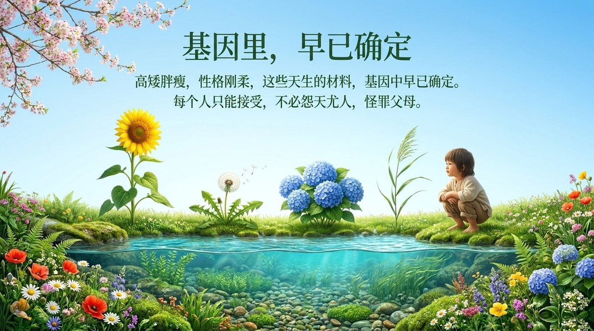
    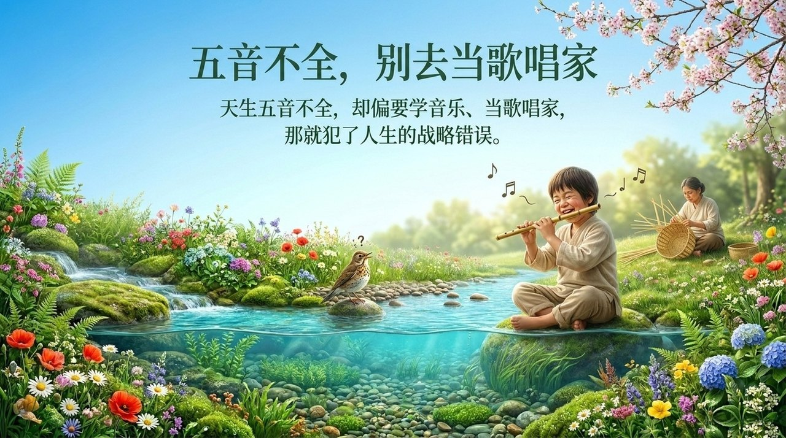
    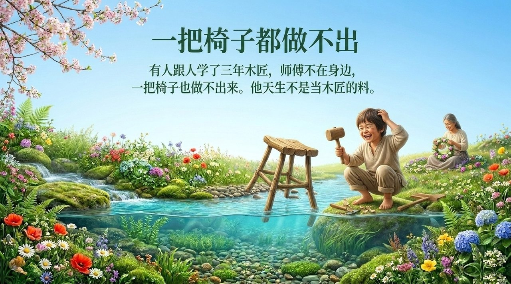
    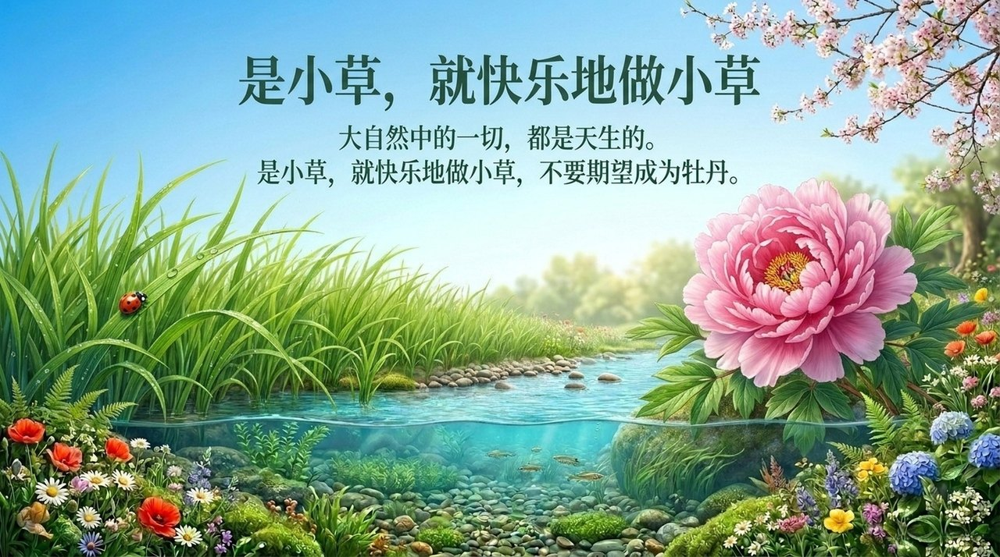
    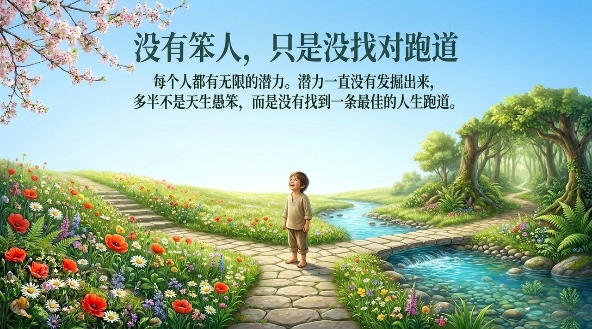
    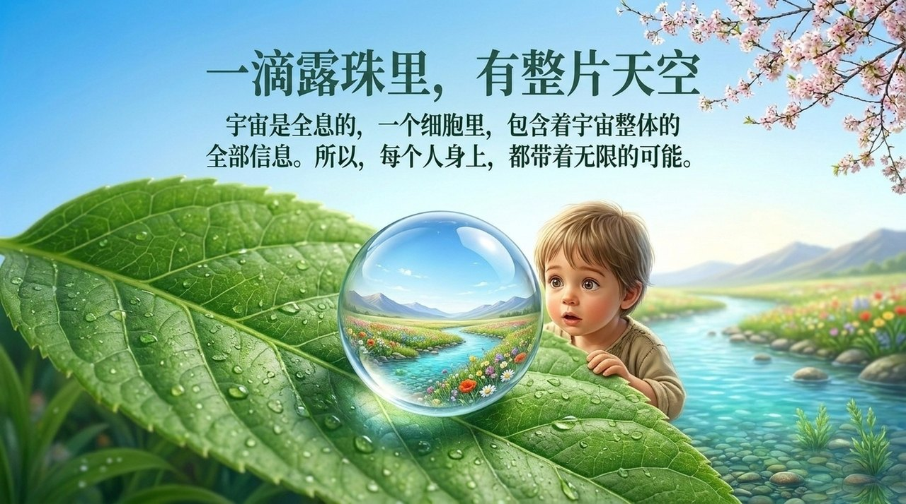
    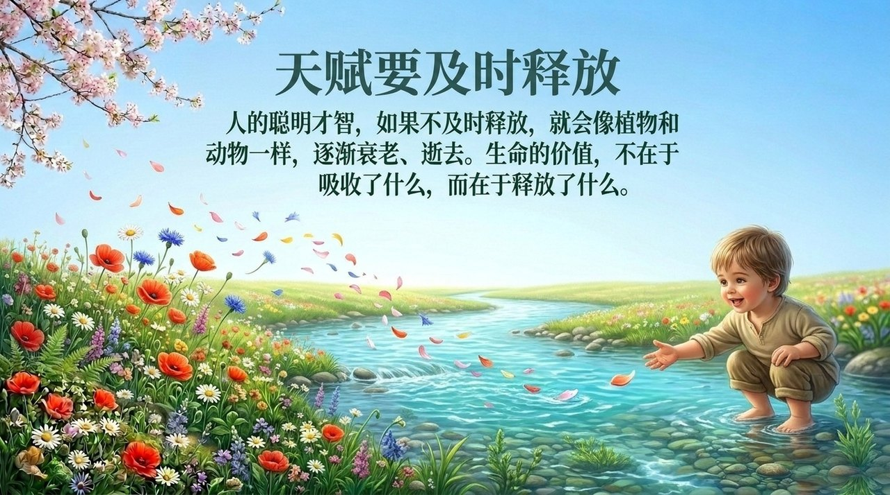
    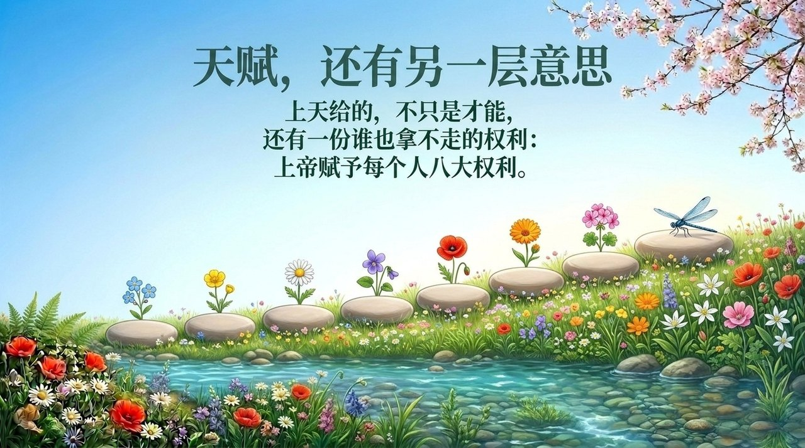
    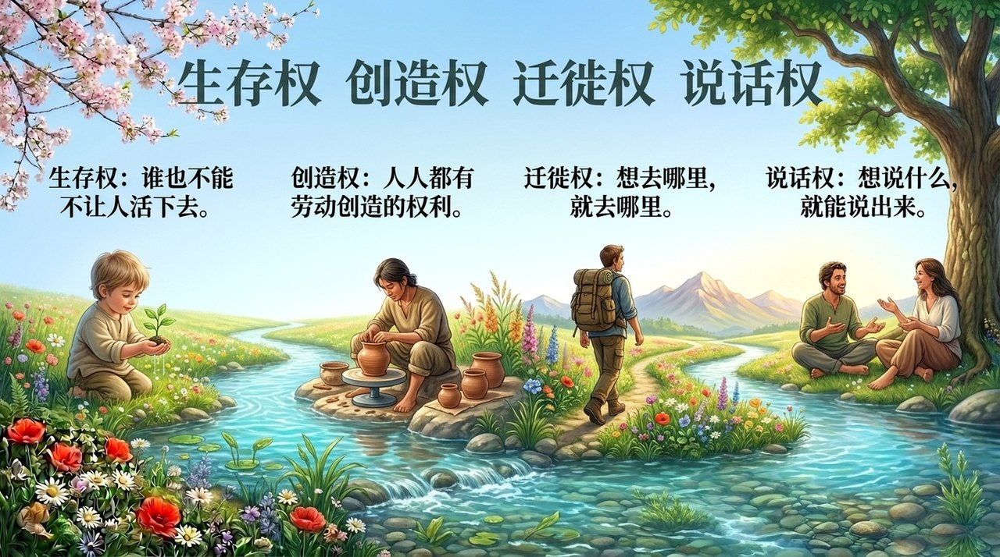
    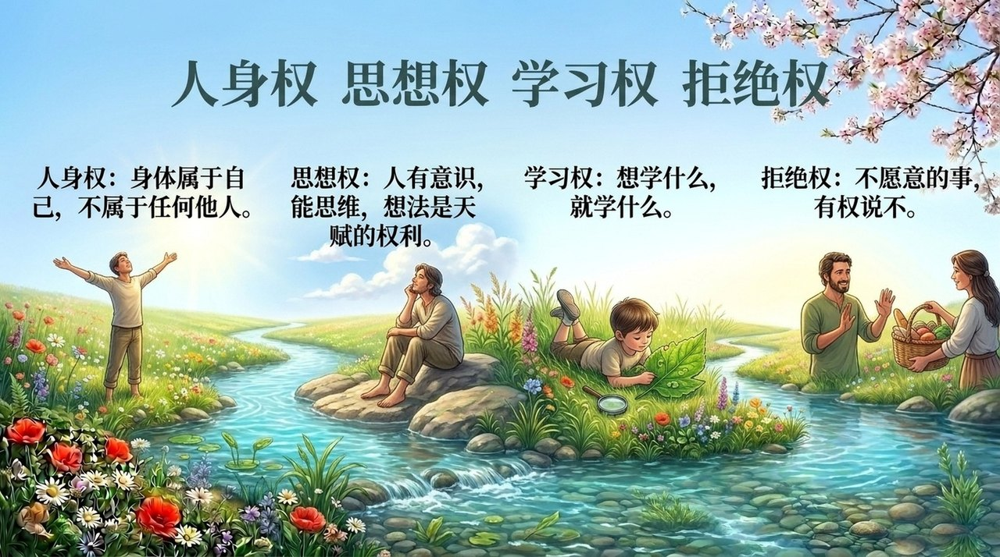
    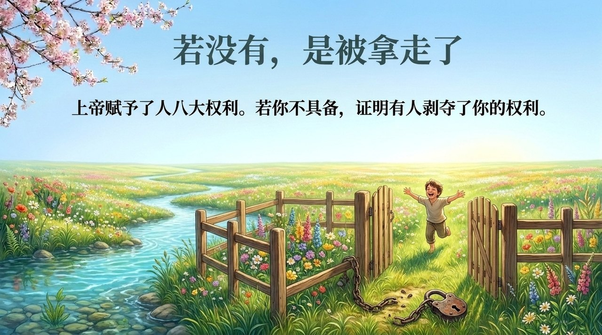
    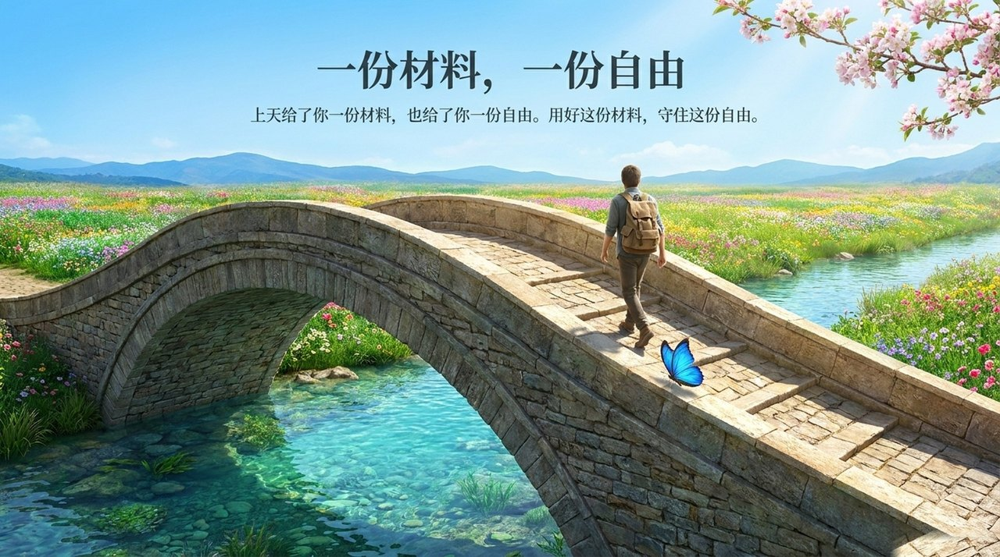

---

## 版本导航

| 版本 | 适合读者 | 核心内容 |
|------|---------|---------|
| [友好版](friendly.md) | 初次接触者 | 梵高/姜子牙等错位案例、伊甸园类比、四元凶故事 |
| [学术版](academic.md) | 研究者 | 概念结构、全息天才论、环境决定论框架 |
| [内部版](internal.md) | 深入研究 | 完整原文引文、七板块、逐段出处 |

---

## 相关词条

[天命](/zh/tianming/) · [天性·秉性·习性](/zh/tianxing-bingxing-xixing/) · [自由意志](/zh/free-will/) · [人生剧本](/zh/life-script/) · [觉悟](/zh/awakening/) · [灵性](/zh/spirituality/) · [第二家园](/zh/second-home/) · [人生的价值·意义和目的](/zh/value-meaning-purpose-of-life/)
