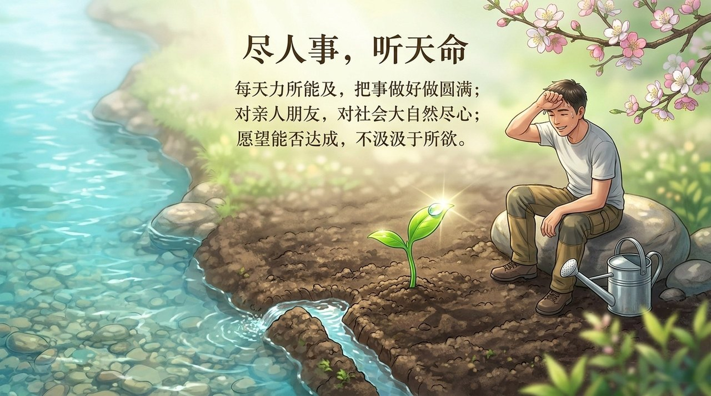

<!-- id: LC-TM-0001 theme: 修行修炼 type: 索引 direction: 修行修炼 lang: zh -->

# 天命

**天命在生命禅院体系中涵盖三个层次**——其一，上天赋予每个生命与生俱来的才能与使命；其二，道（程序）预先编排的人生轨迹与宿命；其三，宇宙万物运行的必然法则。"知天命"是修炼的重要境界：认清自己是什么材料，做自己，顺天应命。而"超越宿命"则是更高追求：98%的人遵循宿命程序，少数禅院草通过反常思维、开启灵觉，从必然王国走向自由王国。

---

## 视频版

<iframe style="width:100%;aspect-ratio:4/3;border:0" src="https://www.youtube-nocookie.com/embed/sacYI0GZsz0" title="天命（生命禅院百科·视频版）" allowfullscreen></iframe>

??? info "📖 图文幻灯（14 张，点击展开）"

    
    
    
    
    
    
    
    
    
    
    
    
    
    

---

## 版本导航

| 版本 | 适合读者 | 核心内容 |
|------|---------|---------|
| [友好版](friendly.md) | 初次接触者 | 剧本类比、知天命的历史人物故事、为何违天命必遭坎坷 |
| [学术版](academic.md) | 研究者 | 概念结构、宿命论框架、与中西哲学的比较 |
| [内部版](internal.md) | 深入研究 | 完整原文引文、七板块、逐段出处 |

---

## 相关词条

[因果·报应·轮回](/zh/karma-retribution-reincarnation/) · [人生轨迹](/zh/life-trajectory/) · [人生剧本](/zh/life-script/) · [自由意志](/zh/free-will/) · [觉悟](/zh/awakening/) · [知识·智慧·智](/zh/knowledge-wisdom-zhi/) · [人生的价值·意义和目的](/zh/value-meaning-purpose-of-life/) · [明心见性](/zh/illuminate-mind-see-nature/)
