<!-- id: LC-TX-0001-ZH theme: 修行修炼 type: 入口页 direction: 修行修炼 lang: zh -->

# 天性

**天性，即如来本性，是创造者赋予每种事物和生命的本质属性与原始特性**——先天澄澈清明、一尘不染，体现上帝神佛的特征。在生命禅院体系中，天性属全属（全体共有），有别于属类属的秉性和属个属的习性；彰显天性、随天性而行，是上帝之道八大内涵之一；仙佛即不受家庭、国家、文化等因素制约而随天性而行的生命。

---

## 视频版

<iframe style="width:100%;aspect-ratio:4/3;border:0" src="https://www.youtube-nocookie.com/embed/15C-ZGxkb84" title="天性（生命禅院百科·视频版）" allowfullscreen></iframe>

??? info "📖 图文幻灯（14 张，点击展开）"

    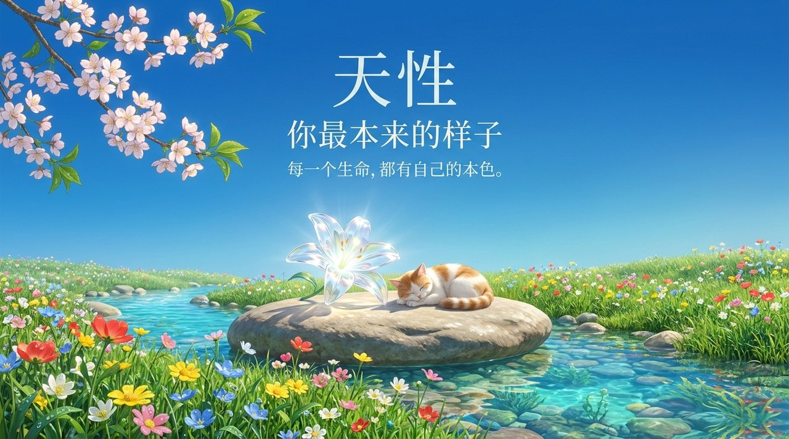
    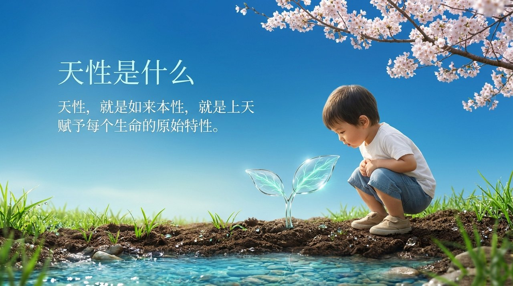
    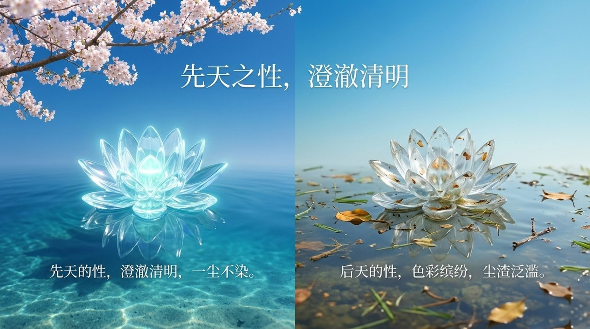
    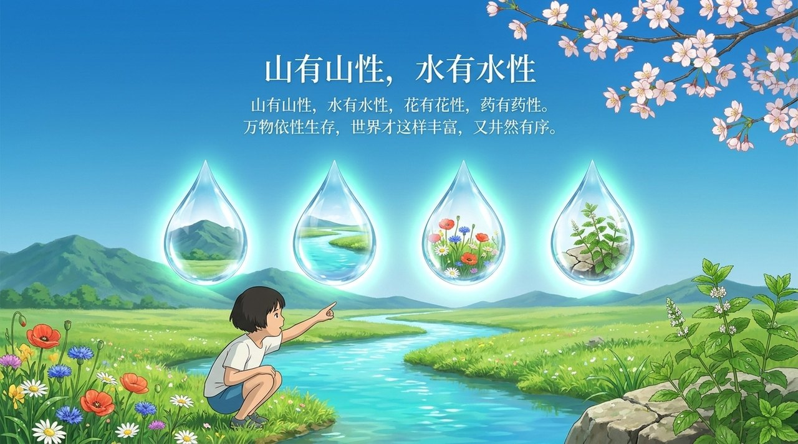
    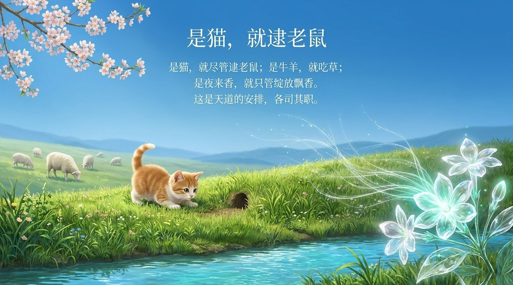
    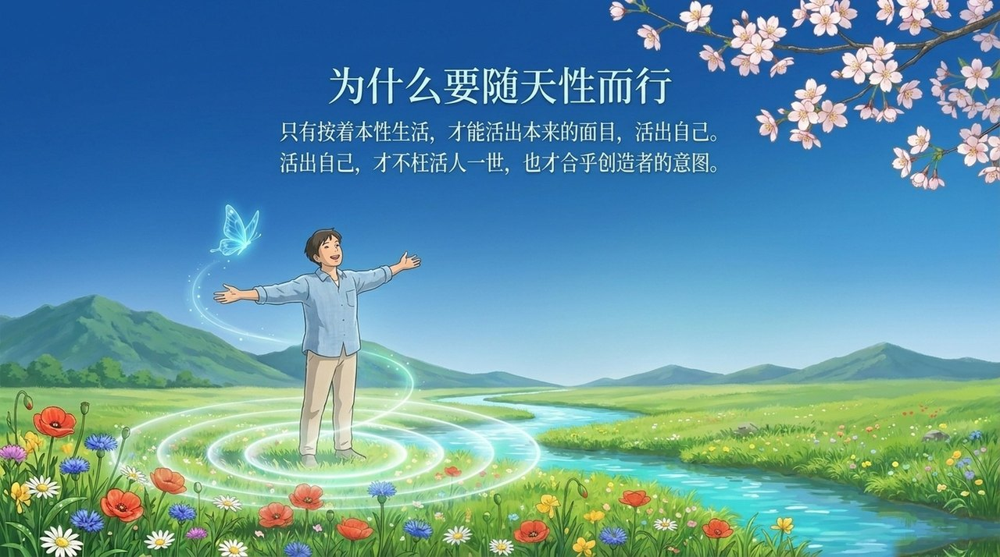
    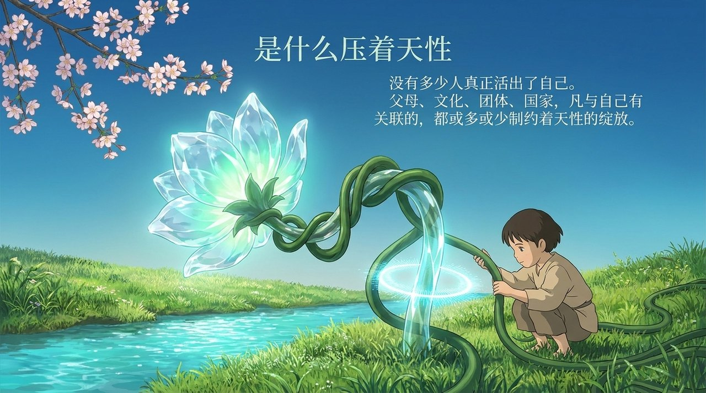
    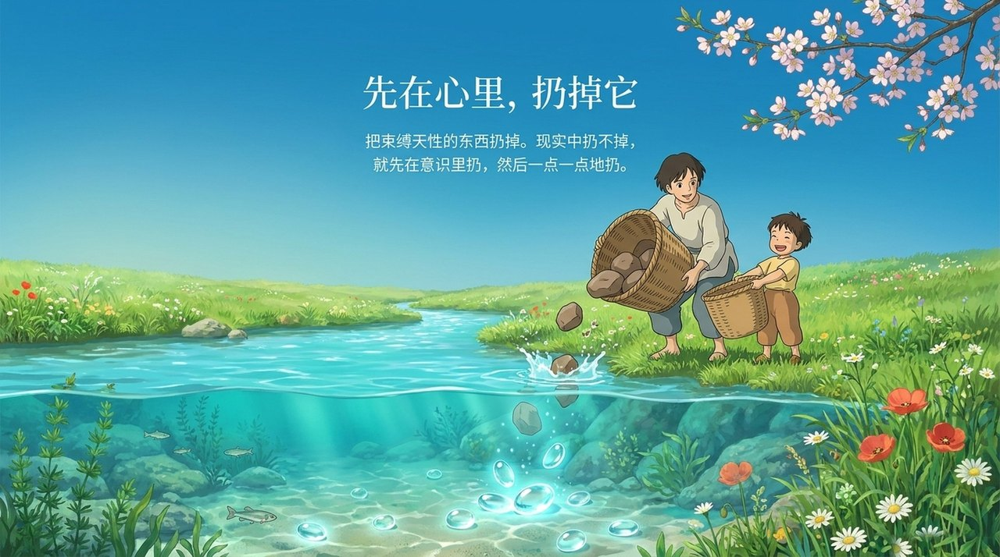
    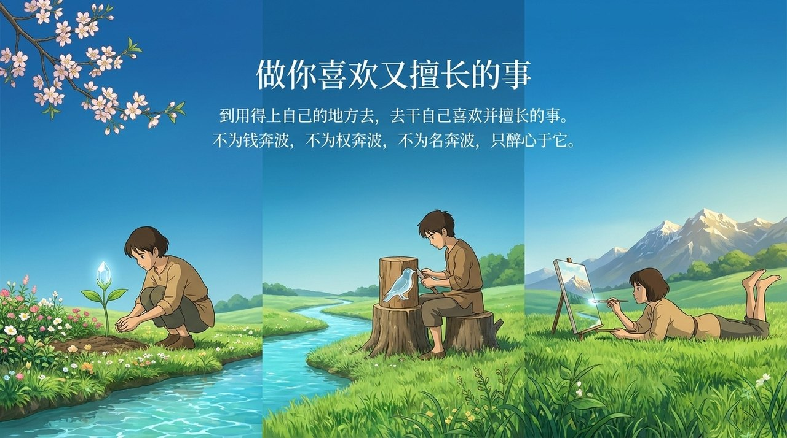
    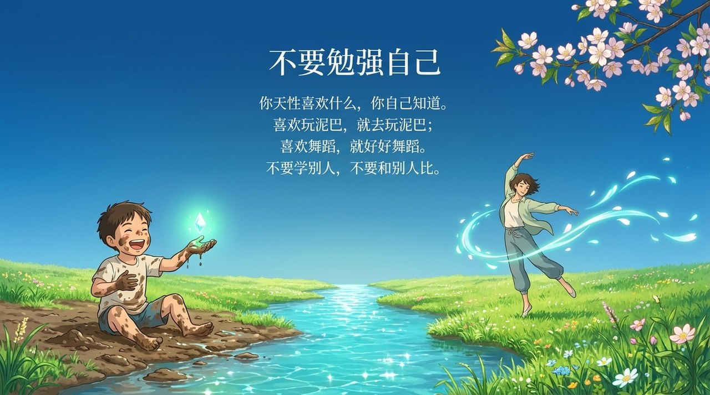
    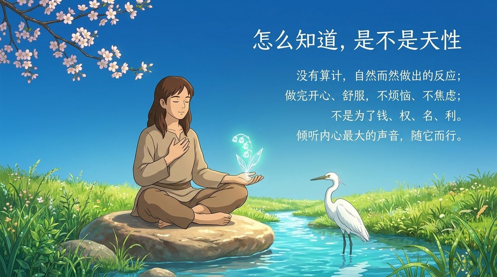
    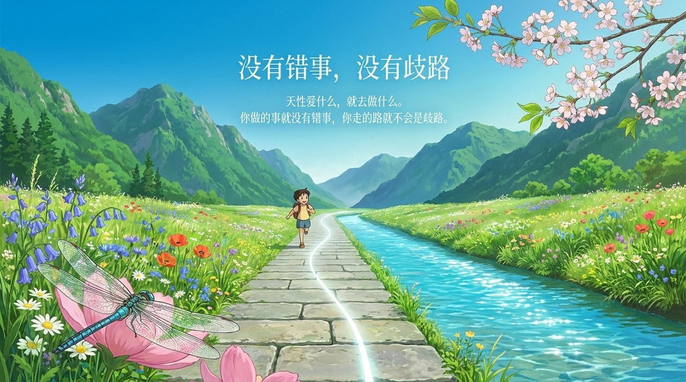
    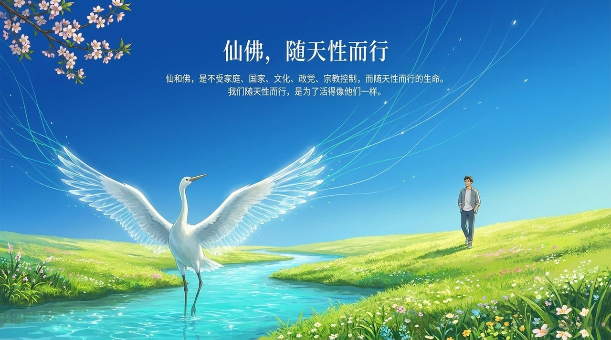
    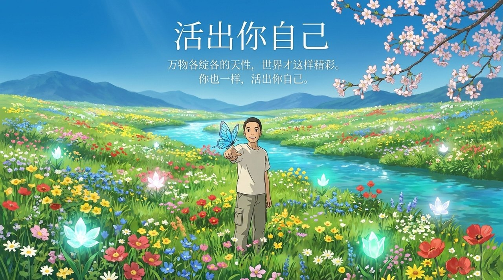

---

## 版本导航

| 版本 | 适合读者 | 核心内容 |
|------|---------|---------|
| [友好版](friendly.md) | 初次接触 | 随天性而行的生活智慧、制约天性的五大枷锁、仙佛的天性状态 |
| [学术版](academic.md) | 研究参考 | 三性概念分析、天性与儒释道的比较、修炼体系中的天性论 |
| [内部版](internal.md) | 深度研习 | 七板块全部原文引证，含出处 |

---

## 相关词条

[天性·秉性·习性](/zh/tianxing-bingxing-xixing/) · [天赋](/zh/tianfu/) · [天命](/zh/tianming/) · [自性·佛性·如来本性](/zh/self-nature/) · [道](/zh/dao/) · [灵性](/zh/spirituality/) · [随性而动·四随](/zh/si-sui/) · [觉悟](/zh/awakening/) · [仙·天仙·佛](/zh/xian-tian-xian-fo/)
