# 信任

**信任**，在生命禅院体系中，是"毫不怀疑地相信"——是一种巨大无形的能量，是天堂生命的品质与专利，是人与人之间最珍贵的资源。信任创造天国，不信任则使天堂变成地狱。生命禅院以"信"为七大品质之一，视"大信"（对佛祖上帝、对导游的百分之百信任）为文化建设的首要基石。

> "信任是蜂蜜，不信任是一把刀。"
>
> ——雪峰《新时代人类八百理念》

## 视频版

<iframe style="width:100%;aspect-ratio:4/3;border:0" src="https://www.youtube-nocookie.com/embed/CC_HFUyPlcE" title="信任（生命禅院百科·视频版）" allowfullscreen></iframe>

??? info "📖 图文幻灯（14 张，点击展开）"

    
    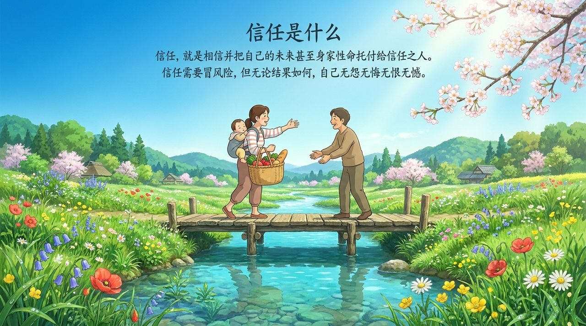
    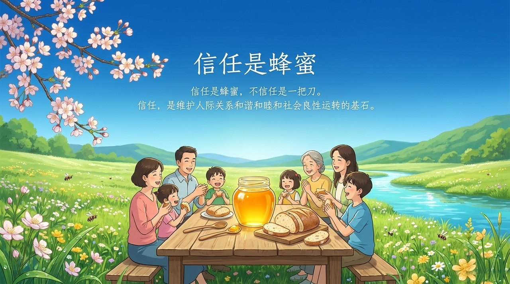
    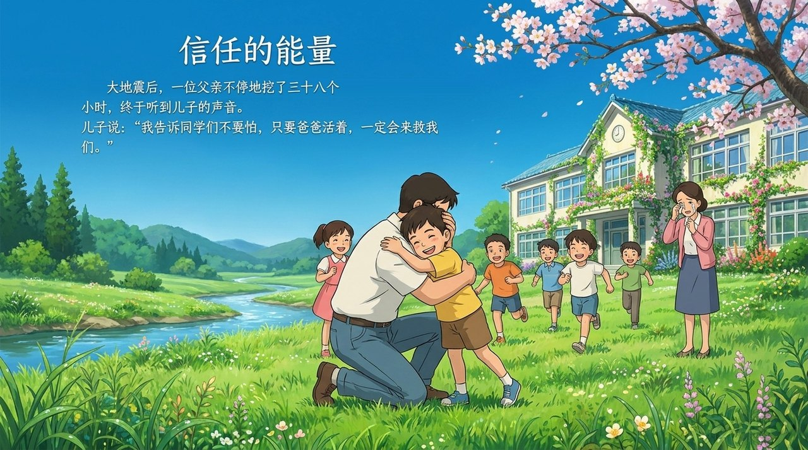
    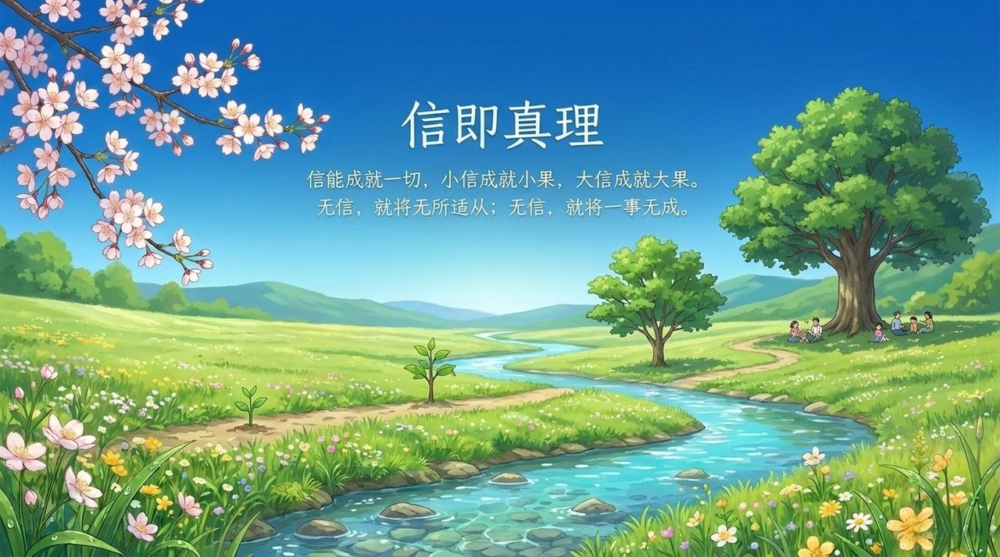
    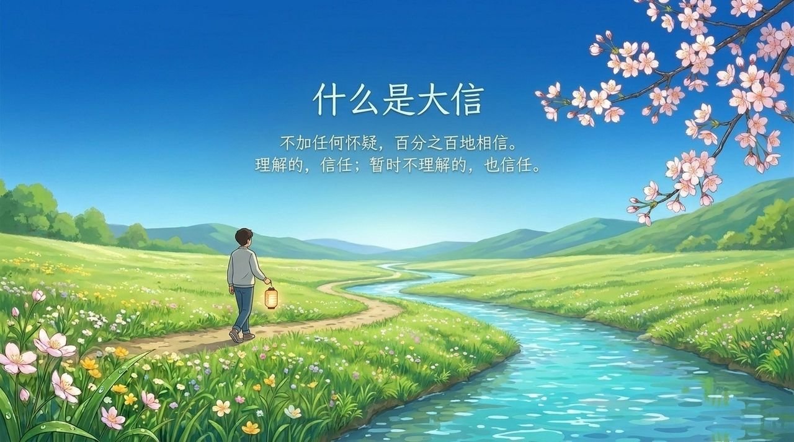
    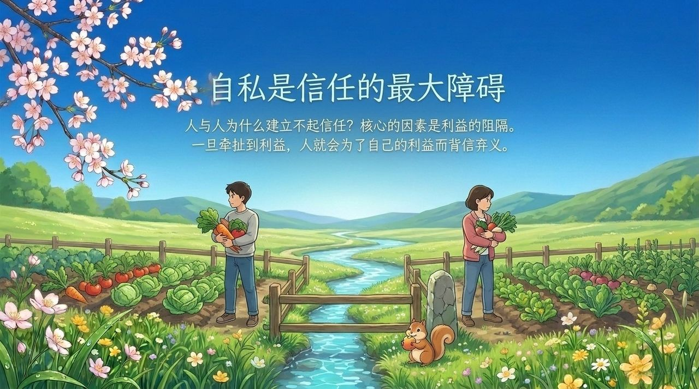
    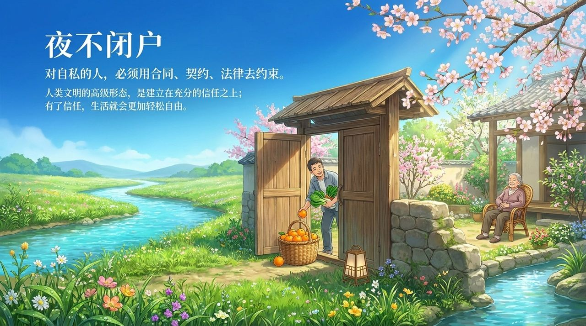
    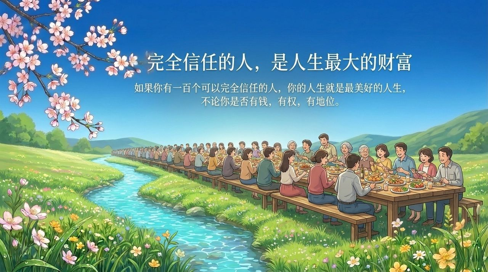
    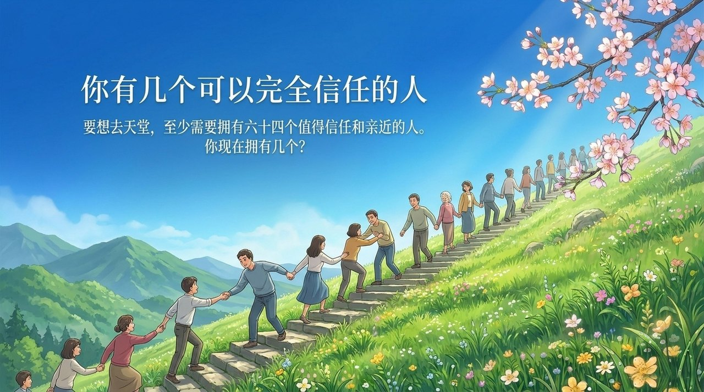
    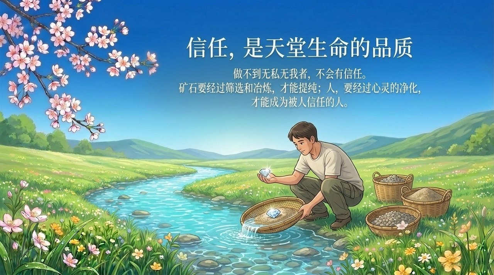
    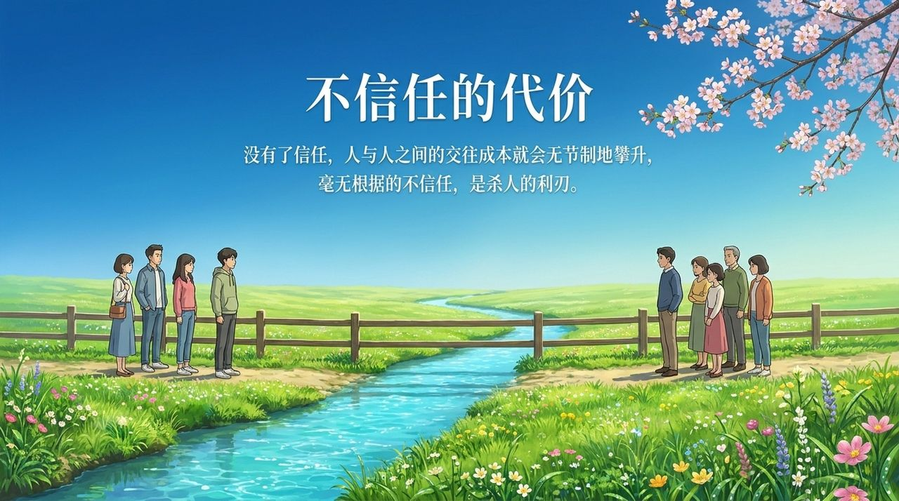
    
    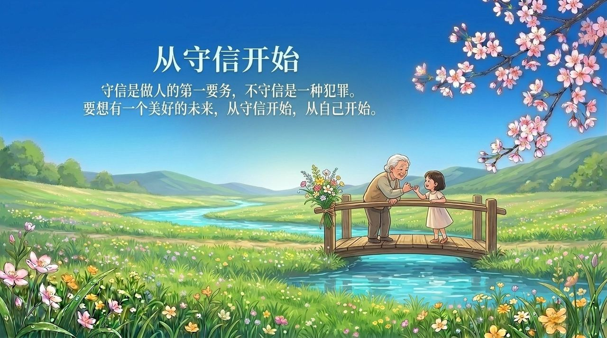

---

| 版本 | 适合 | 核心角度 |
|------|------|----------|
| [友好版](friendly.md) | 初次了解 | 用生动故事与生活语言解读信任的意义 |
| [学术版](academic.md) | 研究者 | 系统分析信任的定义、层次与文明意义 |
| [内部版](internal.md) | 深度研修 | 文集全文，一字不改 |

## 相关词条

[自洽](/zh/self-coherence/) · [抱一](/zh/embrace-the-one/) · [无我无相](/zh/no-self-no-form/) · [大乘心愿](/zh/dasheng-xinyuan/) · [同频共振](/zh/resonance/) · [禅院理念](/zh/values/) · [归零](/zh/return-to-zero/) · [诚](/zh/sincerity/)

> 注：本页引用的《新时代人类八百理念》条号，均为第四版的编号。第五版已重新编排，条号与第四版不再一一对应。
