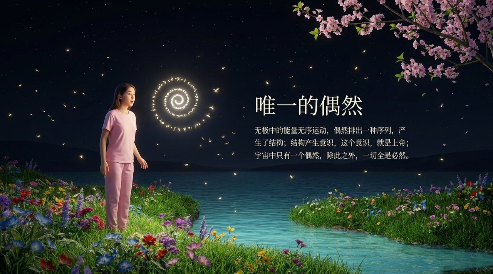
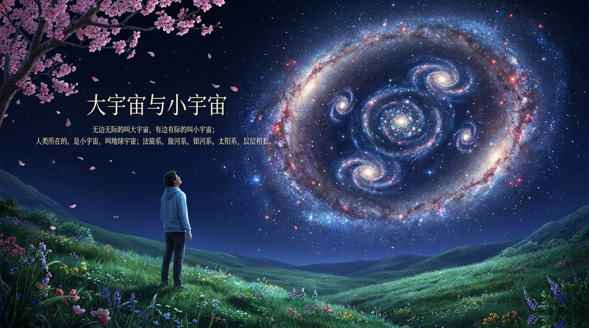
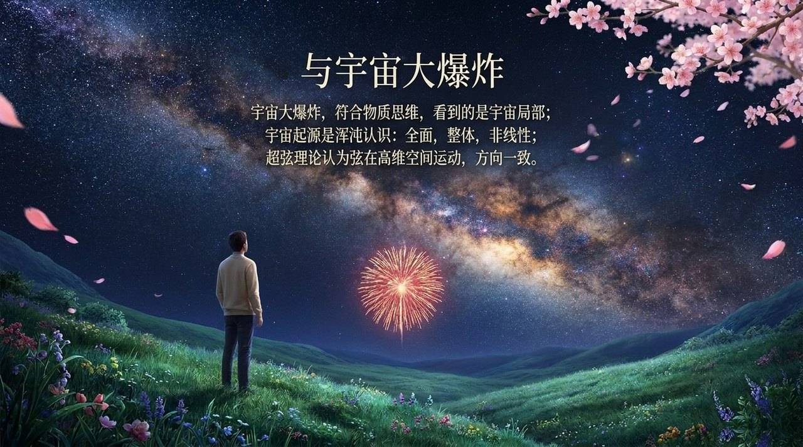

# 宇宙起源

**宇宙起源**，是生命禅院宇宙论中的根基词条，回答"宇宙从何而来、如何展开、为何有序运行"这三个核心问题；该体系以"无极生太极，混沌变浑沌"为总纲，提出"结构产生意识，上帝由此诞生，宇宙由此展开"的完整链路。

> 宇宙是上帝意识的产物；宇宙起源不是大爆炸，而是无极生太极、混沌变浑沌。

## 视频版

<iframe style="width:100%;aspect-ratio:4/3;border:0" src="https://www.youtube-nocookie.com/embed/tflYLWpP7SQ" title="宇宙起源（生命禅院百科·视频版）" allowfullscreen></iframe>

??? info "📖 图文幻灯（14 张，点击展开）"

    
    
    
    
    
    
    
    
    
    
    
    
    
    

---

## 版本导航

| 版本 | 适合 |
|------|------|
| [友好版](friendly/) | 首次接触，内容丰满、可读性强 |
| [学术版](academic/) | 理论研究与引用 |
| [内部版](internal/) | 体系内核心学习，以文集原文为准 |

## 相关词条

[道](/zh/dao/) · [上帝](/zh/greatest-creator/) · [上帝之道](/zh/way-of-the-greatest-creator/) · [三十六维空间](/zh/thirty-six-dimensional-space/) · [反物质结构](/zh/antimatter-structure/) · [生命起源](/zh/life-origin/)
