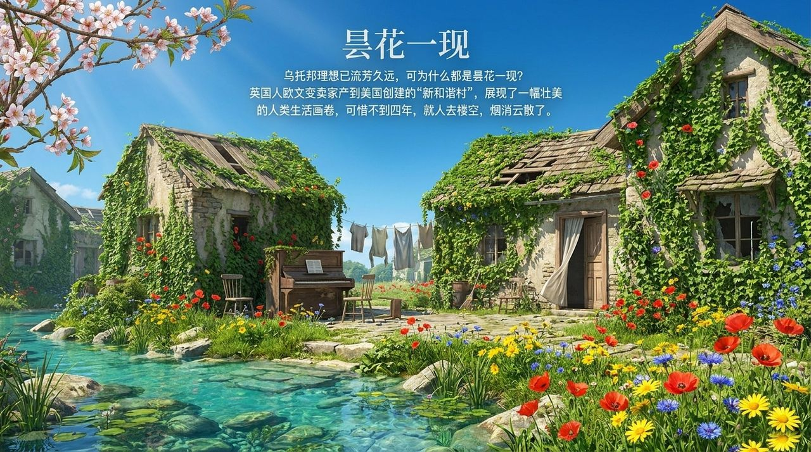
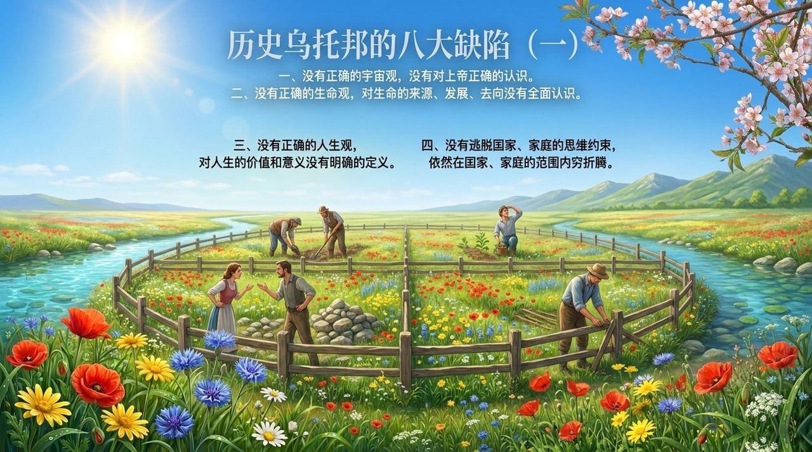
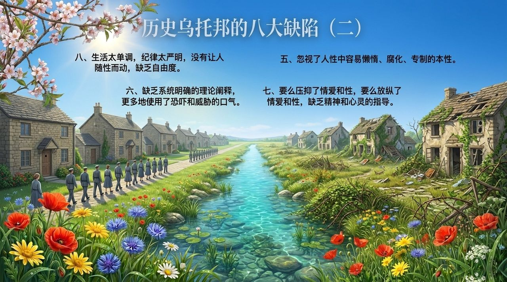
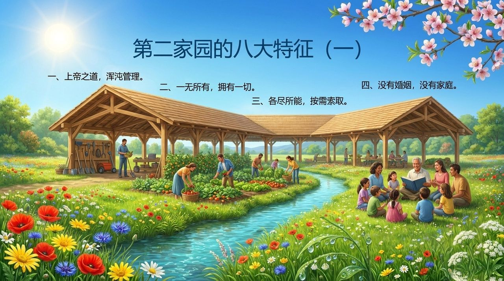

# 乌托邦

> **天国千年界就是一个地地道道纯纯粹粹的乌托邦，存在几十万年了，依然完美无瑕有序运行。**
>
> —— 雪峰《哈耶克对乌托邦的无知》

## 视频版

<iframe style="width:100%;aspect-ratio:4/3;border:0" src="https://www.youtube-nocookie.com/embed/AyGPli3CiAw" title="乌托邦（生命禅院百科·视频版）" allowfullscreen></iframe>

??? info "📖 图文幻灯（14 张，点击展开）"

    
    
    
    
    
    
    
    
    
    
    
    
    
    

---

| 版本 | 适合 | 核心角度 |
|------|------|----------|
| [友好版](friendly.md) | 初次了解 | 什么是真正的乌托邦、为什么第二家园不是空想 |
| [学术版](academic.md) | 研究者 | 乌托邦在禅院社会理论中的地位与历史反思 |
| [内部版](internal.md) | 深度研修 | 文集汇编，完整引文与出处 |

## 简介

在生命禅院体系中，"乌托邦"是指具有天国意识的人们对理想社会的追求与实践，并非空想，而是已在天国千年界实现了几十万年的真实存在。生命禅院创建的第二家园，即是人类历史上乌托邦理想的"续集"——吸取了历史乌托邦失败的八大教训，以禅院理念为准则，建成了人类真正能够达到的最高生活理想境界。

导游雪峰对哈耶克等批判乌托邦的思想家提出了系统驳斥：乌托邦的失败并非因为乌托邦本身，而是因为那些被误认为是乌托邦的历史实践（如纳粹体制、苏联计划经济）根本不是真正的乌托邦。

## 相关词条

- [第二家园](/zh/second-home/) · [雪峰式共产主义](/zh/xuefeng-communism/) · [文明3.0](/zh/civilization-3-0/)
- [各尽所能·按需索取](/zh/contribute-by-ability-take-by-need/) · [浑沌管理](/zh/hundun-management/) · [坚守理念·信靠家园](/zh/steadfast-principles-trust-home/)
- [千年界](/zh/thousand-year-world/) · [生命禅院时代（新时代）](/zh/lifechanyuan-new-era/) · [禅院理念](/zh/values/)
