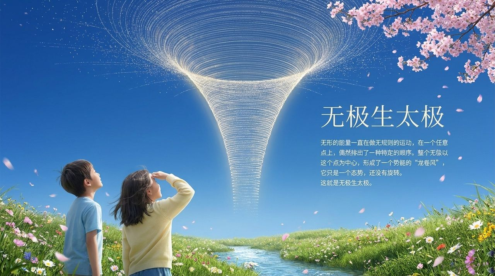

# 无极

**无极**，是生命禅院宇宙论中的起点概念，用于回答"宇宙诞生前是什么状态"这一根本问题；无极不是绝对虚无，而是"无时空、无形态、无有序结构，但具有潜在能量运动"的前宇宙状态，无极之后是太极，上帝由"无序能量偶然成序、结构产生意识"的机制中诞生。

## 视频版

<iframe style="width:100%;aspect-ratio:4/3;border:0" src="https://www.youtube-nocookie.com/embed/8kxvMszrTI0" title="无极（生命禅院百科·视频版）" allowfullscreen></iframe>

??? info "📖 图文幻灯（14 张，点击展开）"

    
    
    
    
    
    
    
    
    
    
    
    
    
    

---

## 版本导航

| 版本 | 适合 |
|------|------|
| [友好版](friendly/) | 首次接触，内容丰满、可读性强 |
| [学术版](academic/) | 理论研究与引用 |
| [内部版](internal/) | 体系内核心学习，以文集原文为准 |

## 相关词条

[宇宙起源](/zh/universe-origin/) · [太极](/zh/taiji/) · [道](/zh/dao/) · [上帝](/zh/greatest-creator/) · [上帝之道](/zh/way-of-the-greatest-creator/)
