# 仙子·仙女

在生命禅院体系中，**仙子**是对禅院男性成员的称谓，**仙女**是对禅院女性成员的称谓。这一命名源自宇宙论框架：千年界、万年界等高层生命空间中，男性生命称仙子，女性生命称仙女。禅院草以此互称，彼此以高层生命标准期许。禅院的核心理念"乾坤颠倒，仙女为尊"——仙子为绿叶，仙女为花蕊；危险面前仙子在前，享受面前仙女优先。

| 版本 | 适合 | 核心角度 |
|------|------|----------|
| [友好版](friendly.md) | 初次了解 | 生活化解读仙子仙女的角色与关系 |
| [学术版](academic.md) | 研究者 | 系统分析其宇宙论背景与社区功能 |
| [内部版](internal.md) | 深度研修 | 导游文集全文，含规范与千年界描绘 |

---

## 视频版

<iframe style="width:100%;aspect-ratio:4/3;border:0" src="https://www.youtube-nocookie.com/embed/cmS4RlLCwmU" title="仙子·仙女（生命禅院百科·视频版）" allowfullscreen></iframe>

??? info "📖 图文幻灯（14 张，点击展开）"

    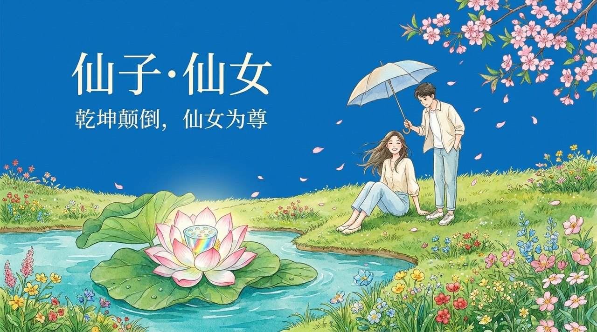
    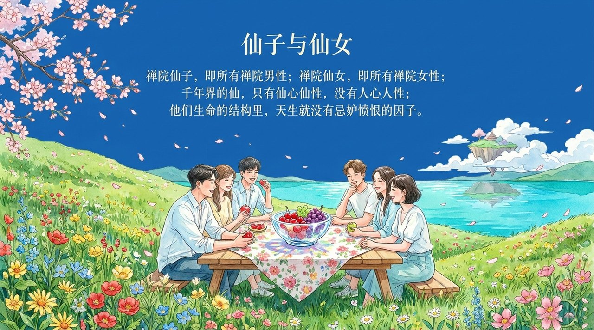
    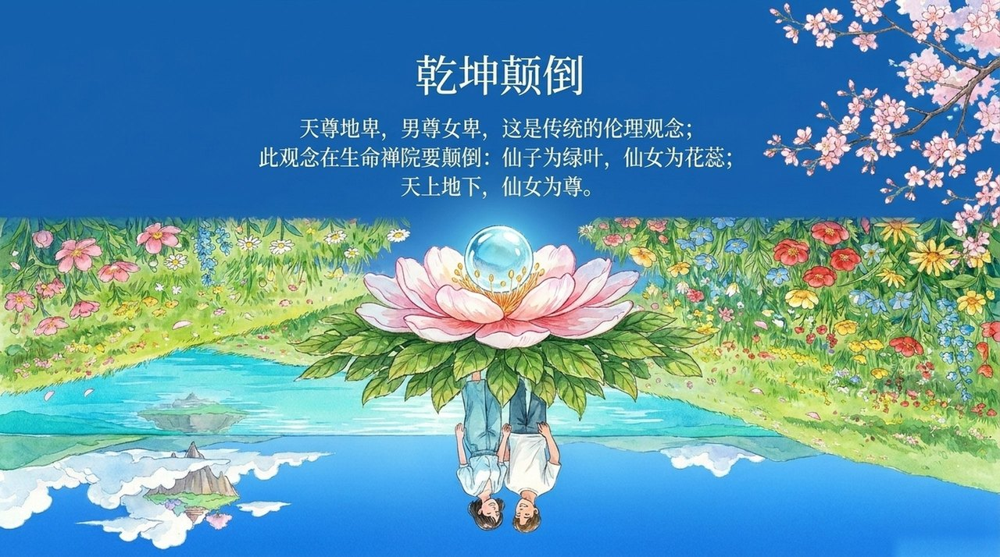
    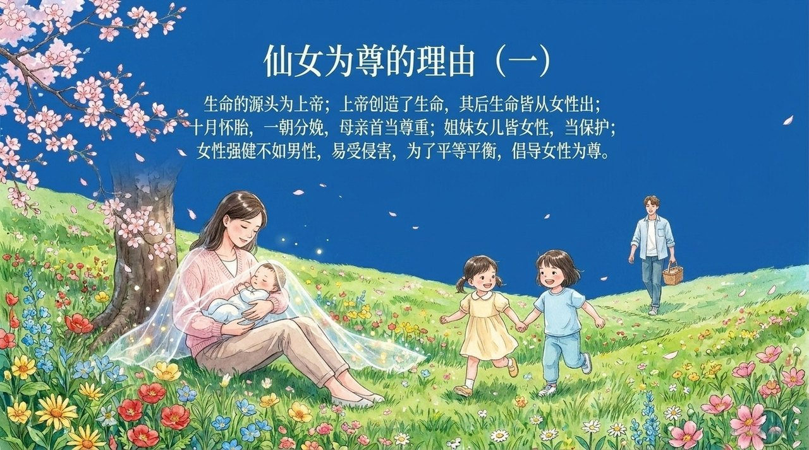
    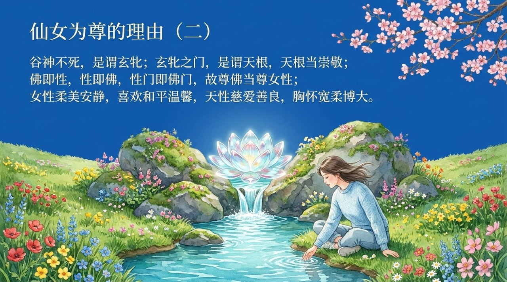
    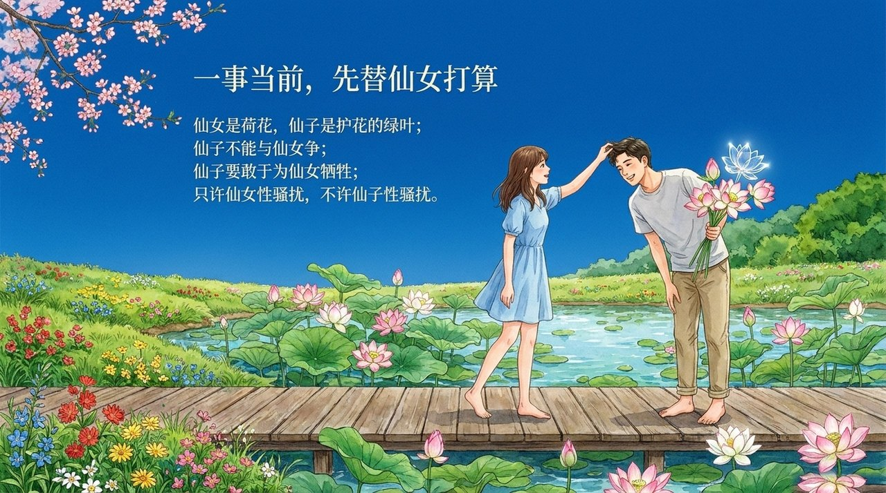
    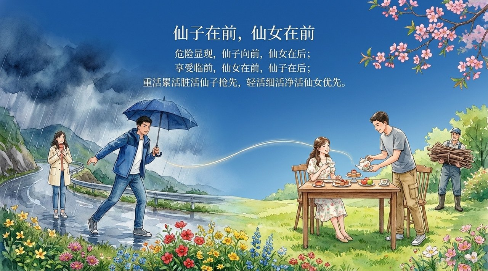
    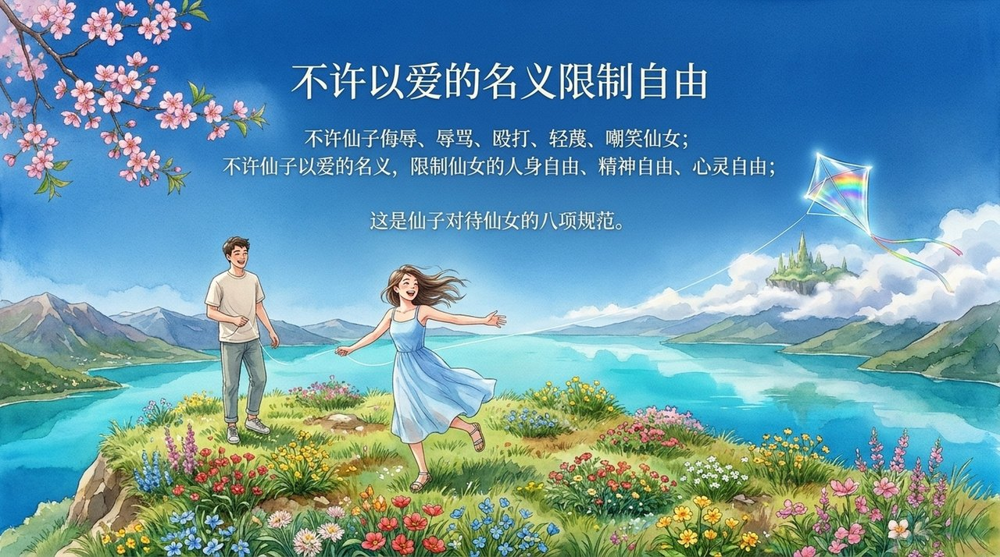
    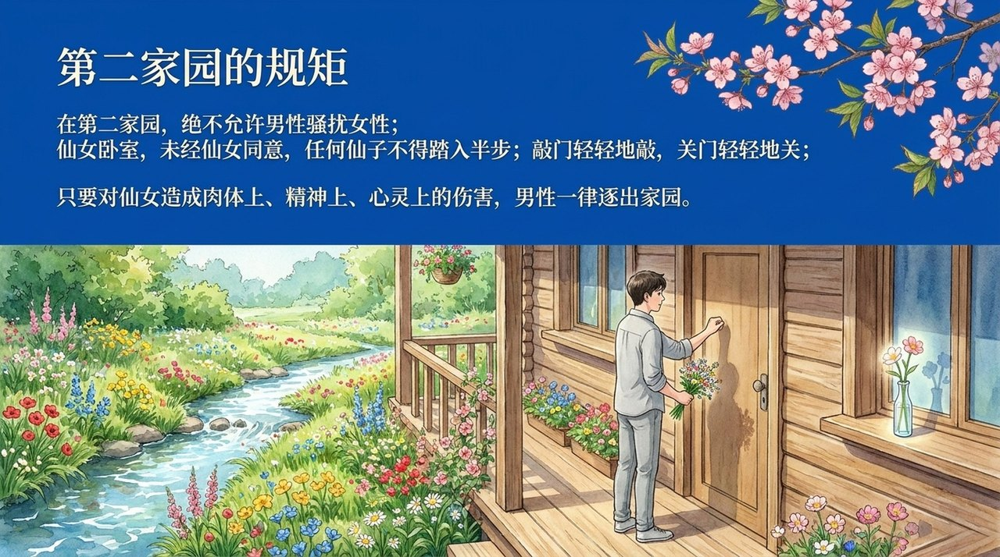
    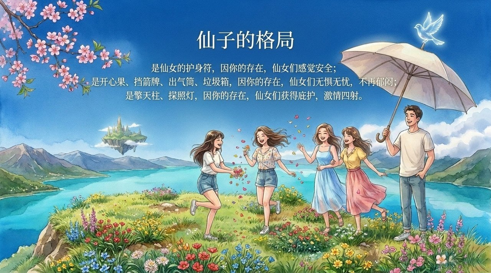
    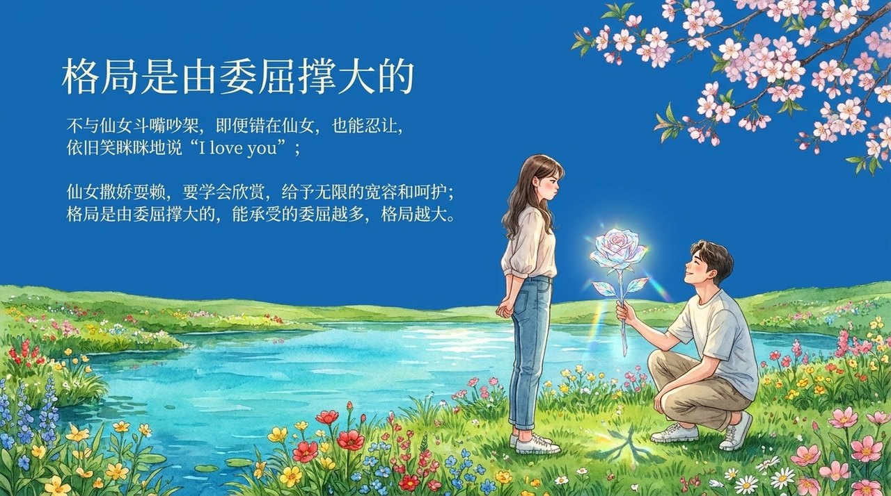
    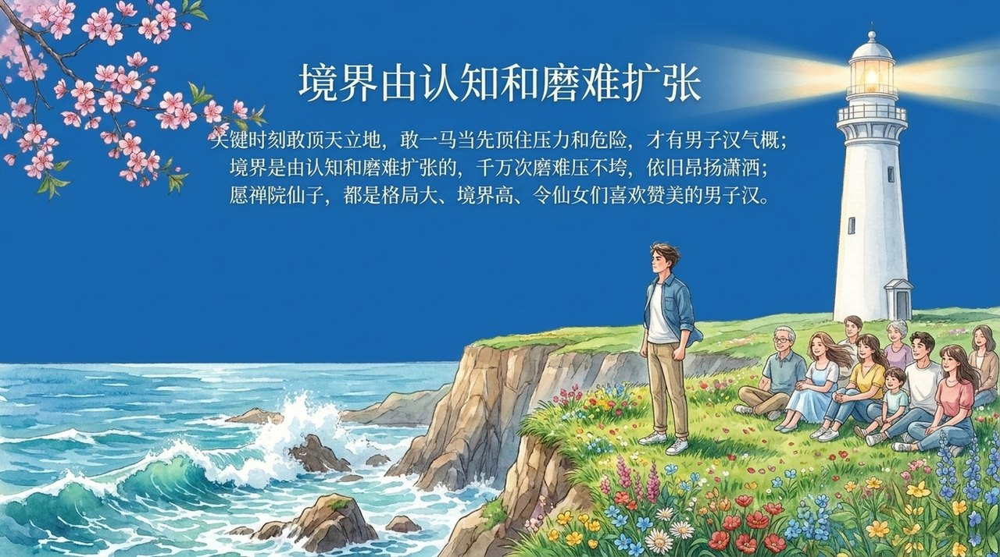
    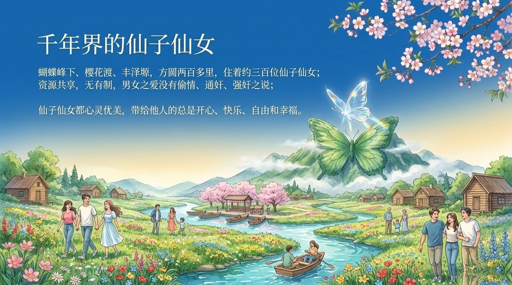
    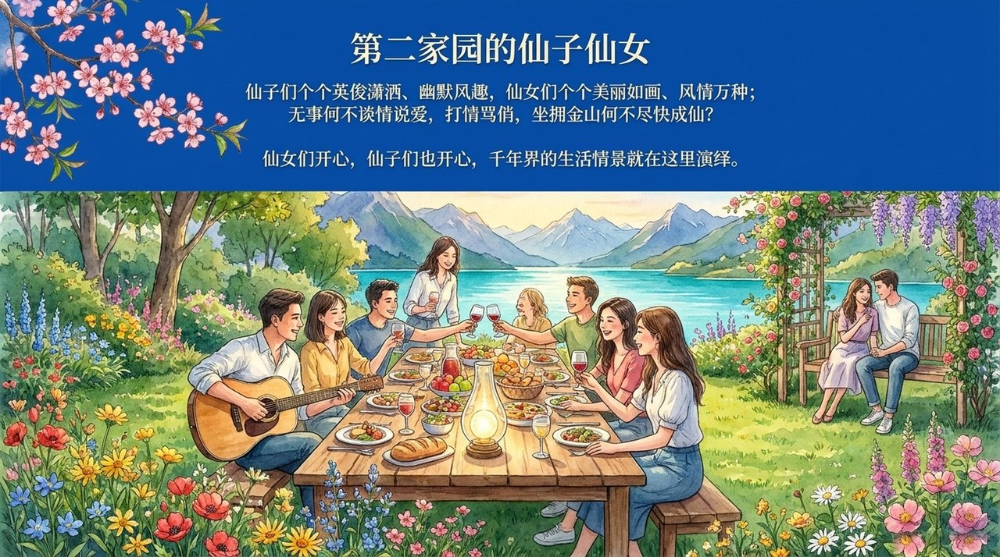

---

## 相关词条

- [千年界仙](/zh/thousand-year-world-celestials/) — 仙子仙女在高层空间的生命形态
- [仙·天仙·佛](/zh/xian-tian-xian-fo/) — 生命层次体系
- [成仙](/zh/becoming-celestial/) — 从凡人升华为仙的路径
- [仙风道骨](/zh/xianfengdaogu/) — 仙子仙女的气质标准
- [超凡脱俗](/zh/chaofantuosu/) — 脱离世俗的内在特质
- [女性以柔为美](/zh/feminine-beauty-in-softness/) — 仙女之美的具体阐释
- [男性以刚为美](/zh/masculine-beauty-in-strength/) — 仙子阳刚之美的具体阐释
- [国际大家庭](/zh/guoji-dajiating/) — 家园中仙子仙女共生的社区模型
- [量子纠缠和"另一半"](/zh/quantum-entanglement-and-the-other-half/) — 仙子与仙女之间的宇宙缘分
