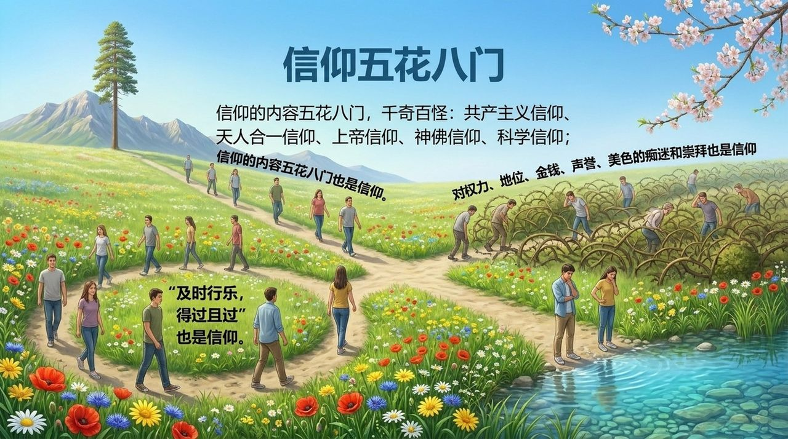
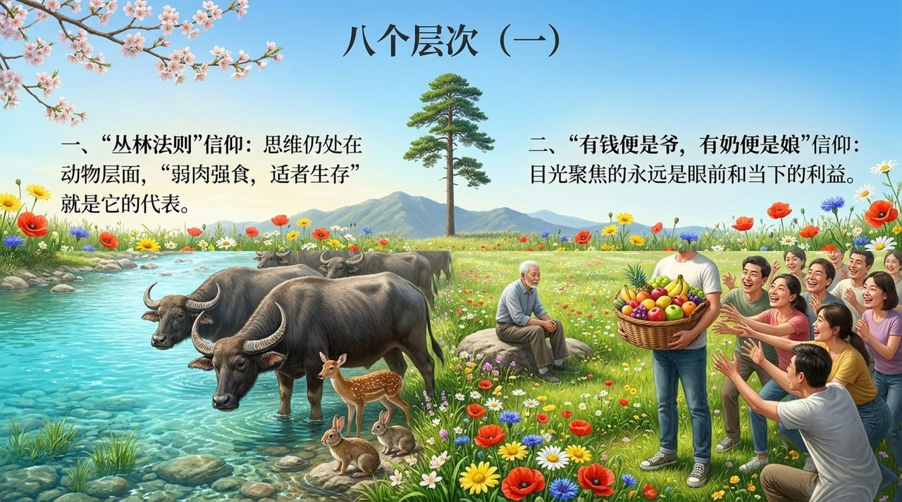
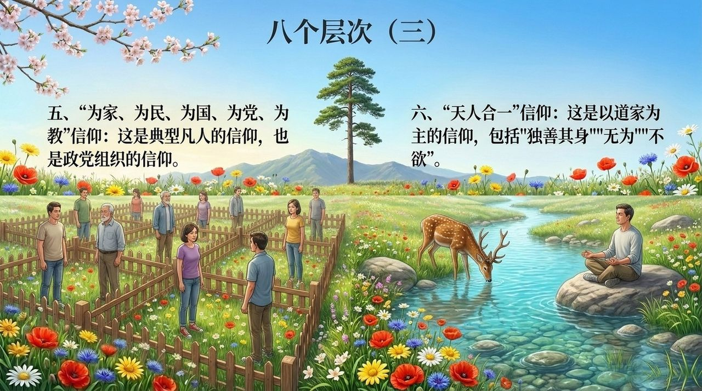
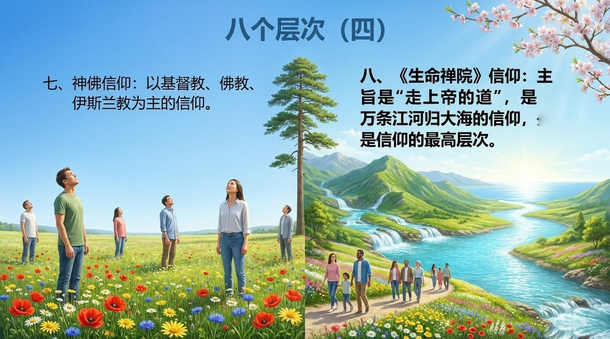
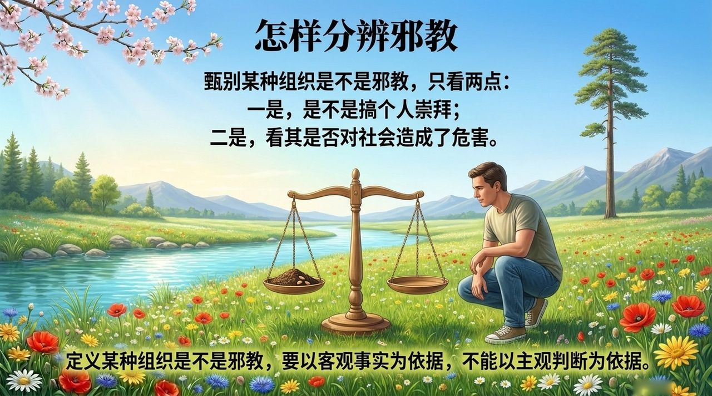
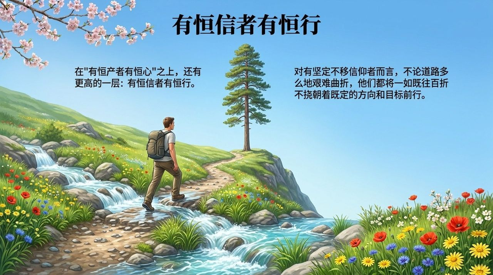

# 信仰

> 人生不能没有信仰，没有信仰的人生是矛盾和迷茫的人生，是没有方向的人生，是没有前途的人生，是注定有悲剧的人生。  
> ——《新时代人类八百理念》第57条

信仰，是植根于人心灵深处指导人思想、行为、话语的导航仪，是灵魂的坐标系，是维系人与上帝、人与人、人与大自然和谐共处的纽带。在生命禅院体系中，信仰被分为八个层次，以"走上帝的道"为最高层次；信仰与宗教、邪教有本质区别——信仰属心灵范畴，是个人私事，不靠人多势众。有什么样的信仰，就有什么样的生命结局。

## 视频版

<iframe style="width:100%;aspect-ratio:4/3;border:0" src="https://www.youtube-nocookie.com/embed/5cYWQzXdR5A" title="信仰（生命禅院百科·视频版）" allowfullscreen></iframe>

??? info "📖 图文幻灯（14 张，点击展开）"

    
    
    
    
    
    
    
    
    
    
    
    
    
    

---

| 版本 | 适合 | 核心角度 |
|------|------|----------|
| [友好版](friendly.md) | 初次了解 | 信仰是什么，如何建立自己的信仰 |
| [学术版](academic.md) | 研究者 | 信仰的层次体系与比较研究 |
| [内部版](internal.md) | 深度研修 | 完整文集与修炼路径 |

---

## 相关词条

[宗教](/zh/religion/) · [上帝](/zh/greatest-creator/) · [觉悟](/zh/awakening/) · [道德](/zh/morality/) · [信](/zh/faith/) · [真善美爱信诚](/zh/six-qualities/) · [灵性人生](/zh/spiritual-life/) · [天命](/zh/tianming/)

> 注：本页引用的《新时代人类八百理念》条号，均为第四版的编号。第五版已重新编排，条号与第四版不再一一对应。
