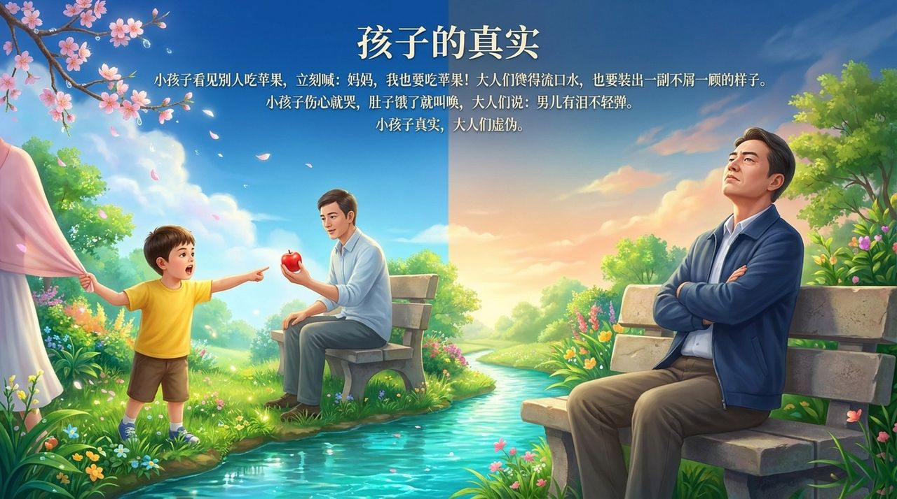

<!-- id: LC-XY-0001-ZH theme: 修行 type: 导航 direction: 品性修炼 lang: zh -->

# 虚荣与虚伪

虚荣，是以他人的评价和赞美为满足感来源的心性，是人性的癌细胞；虚伪，是心里想要一套、言论行动上却表现截然相反的状态，是生命结构不完美的症状之一。两者互为表里。在生命禅院体系中，真实（纯朴、顺性、自然）是与虚伪对立的正面品质，也是进入天国的必要条件。

---

## 视频版

<iframe style="width:100%;aspect-ratio:4/3;border:0" src="https://www.youtube-nocookie.com/embed/S9nb28UDMGI" title="虚荣与虚伪（生命禅院百科·视频版）" allowfullscreen></iframe>

??? info "📖 图文幻灯（14 张，点击展开）"

    
    
    
    
    
    
    
    
    
    
    
    
    
    

---

## 版本导航

| 版本 | 适合读者 | 特点 |
|------|---------|------|
| [通俗版](friendly.md) | 初次了解者 | 生活情境·孩子的真实 vs 成人的虚伪·诚实路径 |
| [学术版](academic.md) | 学者·跨文化比较 | 与儒家"表里如一"·佛教"表里不一"·心理学自我呈现理论对照 |
| [内部版](internal.md) | 修行者·研究者 | 完整引文·六节框架·体系内深度理解 |

---

## 相关词条

[自私与无私](/zh/zisi-wusi/) · [魔性](/zh/moxing/) · [傲慢](/zh/aoman/) · [谦卑](/zh/humility/) · [感恩](/zh/gratitude/) · [真](/zh/truth/) · [诚](/zh/sincerity/) · [放下](/zh/letting-go/) · [心灵花园](/zh/soul-garden/)
