# 养生（初级·中级·高级）

**养生**，在生命禅院体系中是一套三阶修炼体系——初级以保护肉体为主，中级兼顾肉体与灵体，高级以灵体冥想为主；宗旨是"保健康、得长寿、脱凡骨、成仙道"，最终指向完美化生命的反物质结构、通往成仙成佛的生命升华之路。

> 新时代人人需要养生，最大限度不生病，养生主要养精、气、神、形，养生先养心，养心先养德，养德先入道。
>
> ——新时代人类八百理念

---

## 视频版

<iframe style="width:100%;aspect-ratio:4/3;border:0" src="https://www.youtube-nocookie.com/embed/ISYYoLJLr50" title="养生（生命禅院百科·视频版）" allowfullscreen></iframe>

??? info "📖 图文幻灯（14 张，点击展开）"

    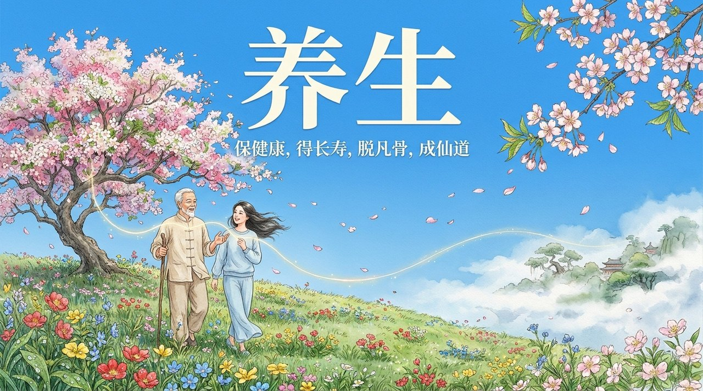
    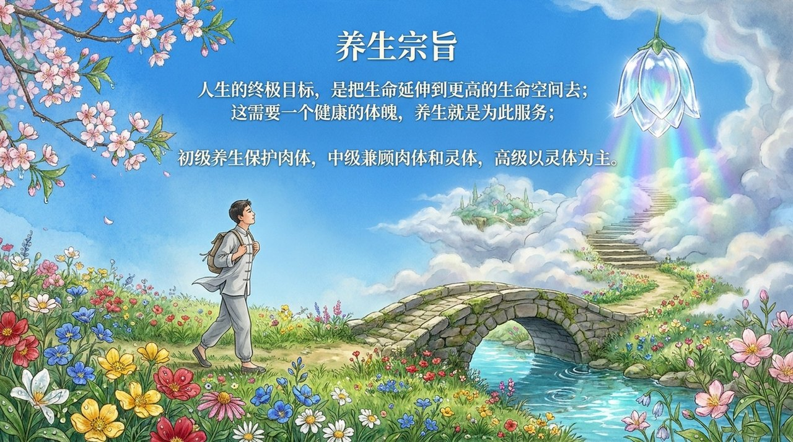
    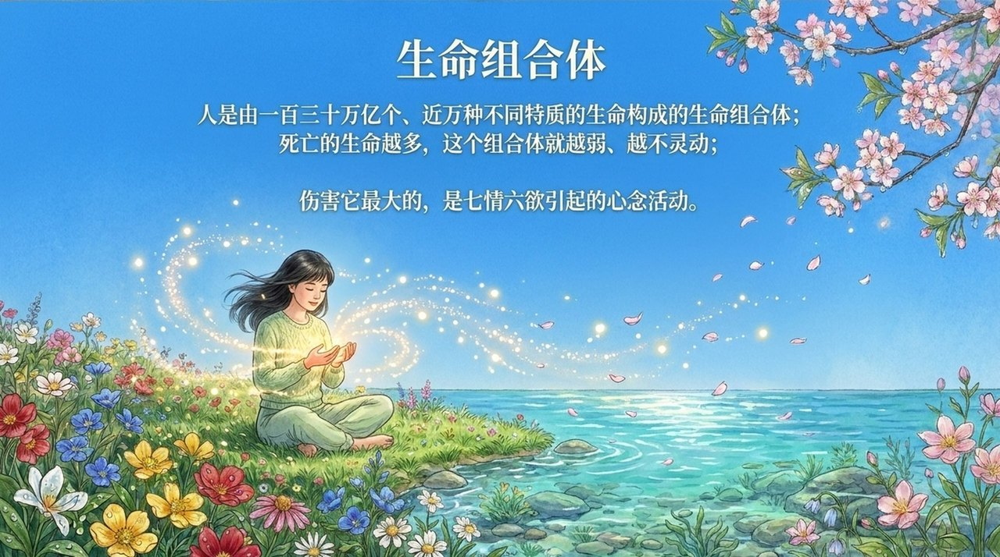
    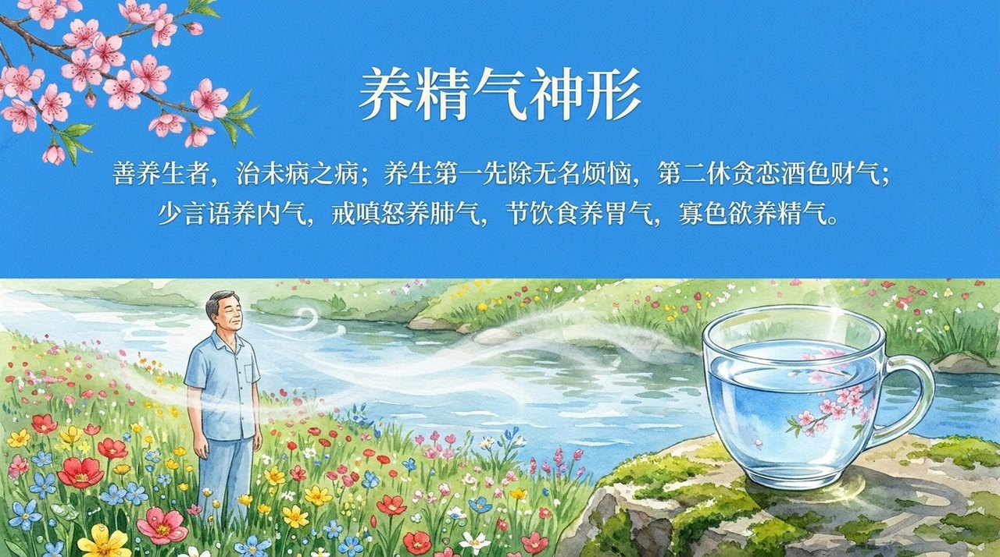
    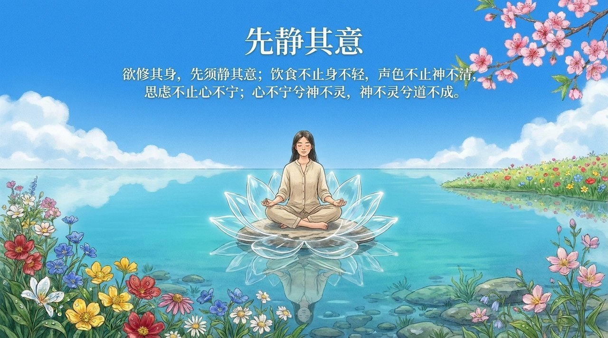
    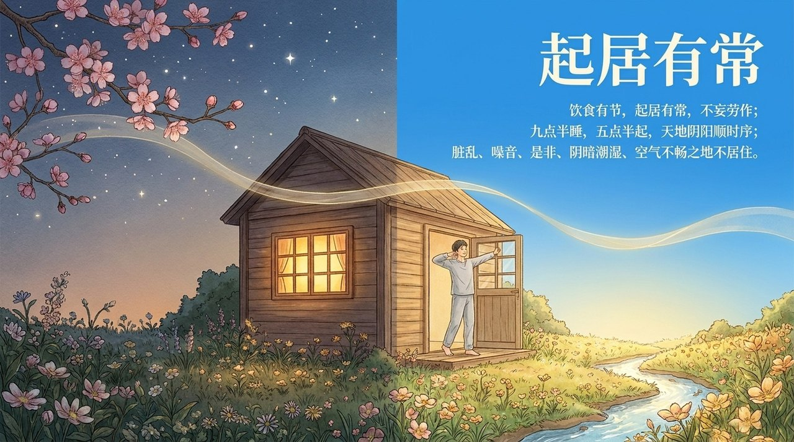
    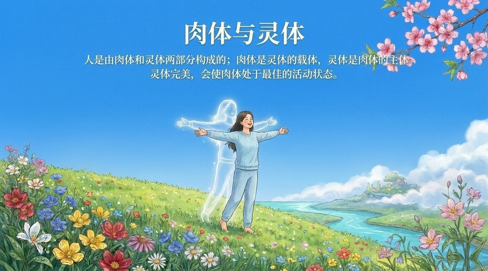
    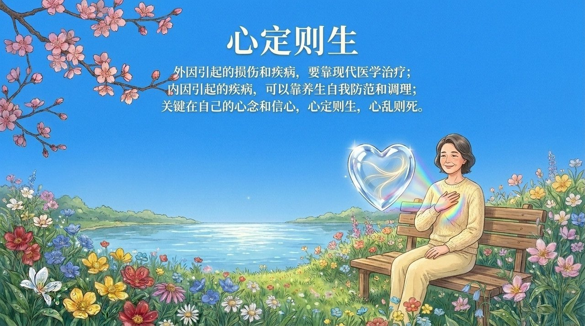
    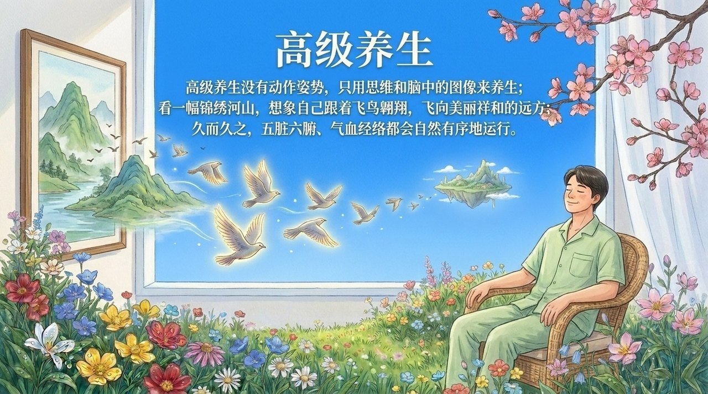
    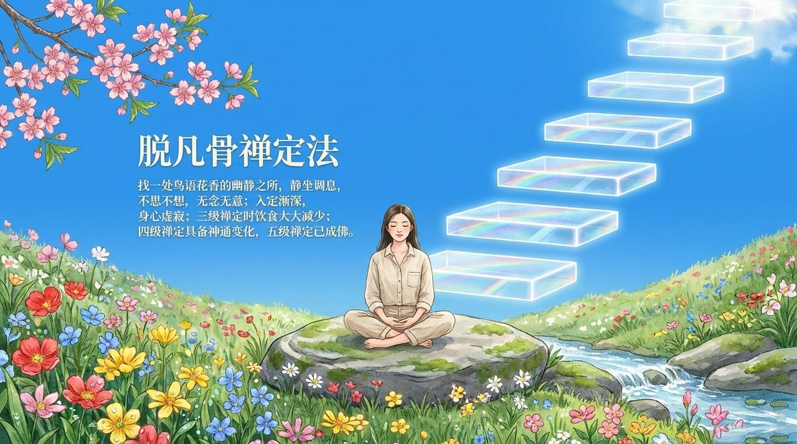
    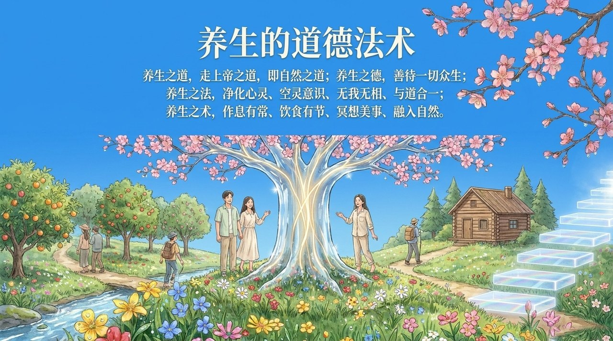
    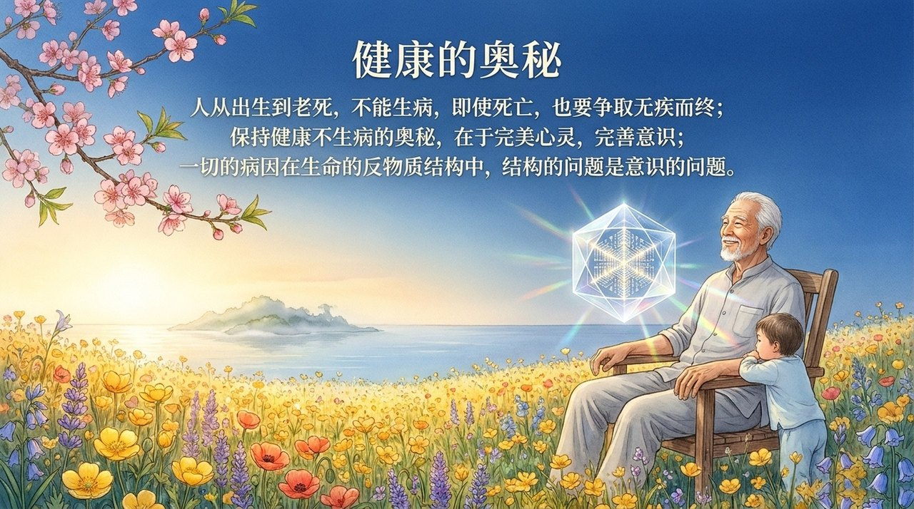
    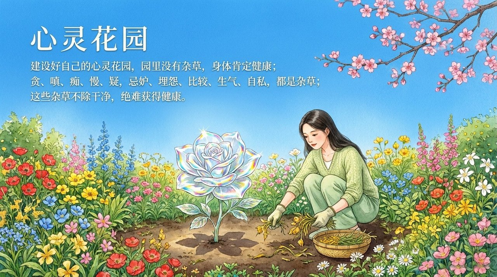
    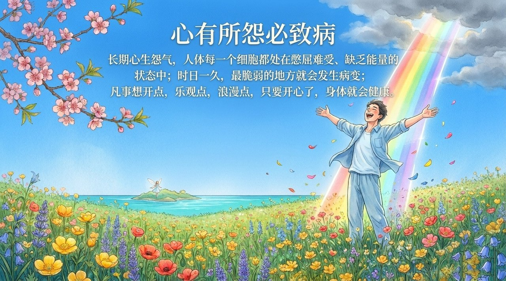

---

## 版本导航

| 版本 | 适合 | 核心角度 |
|------|------|----------|
| [友好版](friendly.md) | 初次了解 | 三阶养生的生活化解读与实践入口 |
| [学术版](academic.md) | 研究者 | 系统框架·跨传统比较·意识–健康机制 |
| [内部版](internal.md) | 深度研修 | 导游原文存档 |

---

## 相关词条

[净化心灵](/zh/jinghuaxinling/) · [心灵花园](/zh/soul-garden/) · [修正身心·内功](/zh/neigong/) · [打坐·静坐·定静功夫](/zh/settled-stillness/) · [成仙](/zh/becoming-celestial/) · [疾病·健康](/zh/disease-health/) · [生命的反物质结构](/zh/antimatter-structure/) · [初级修炼](/zh/elementary-refinement/) · [高级修炼](/zh/advanced-refinement/)

> 注：本页引用的《新时代人类八百理念》条号，均为第四版的编号。第五版已重新编排，条号与第四版不再一一对应。
