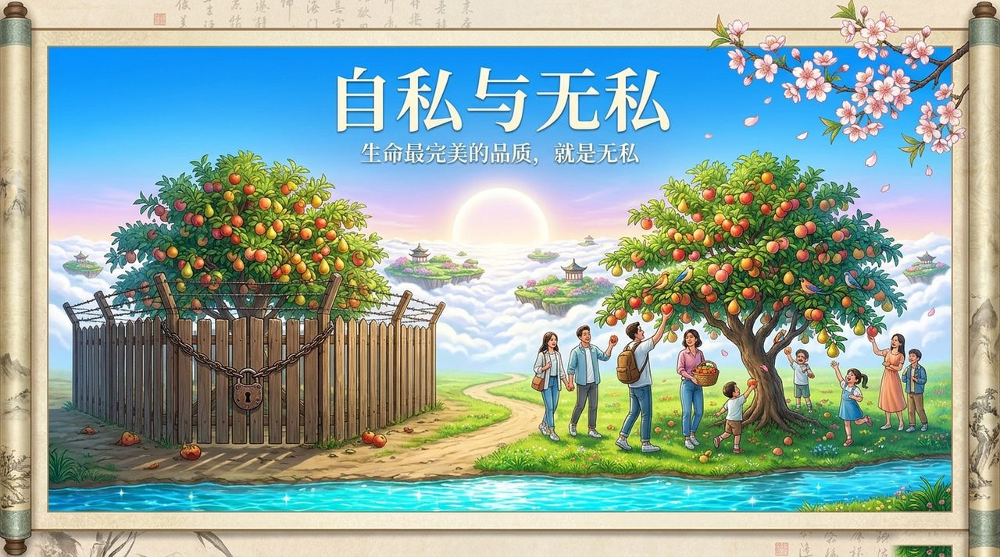
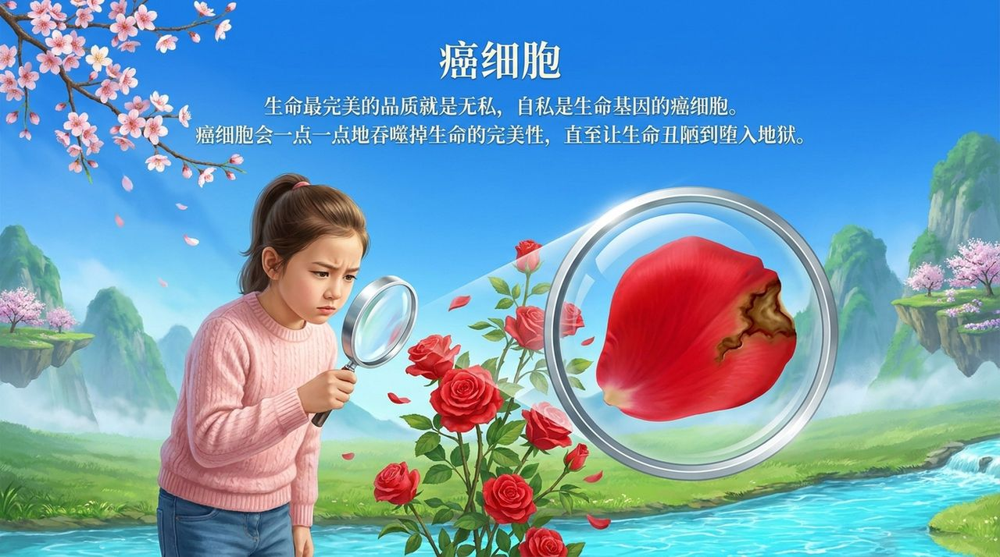
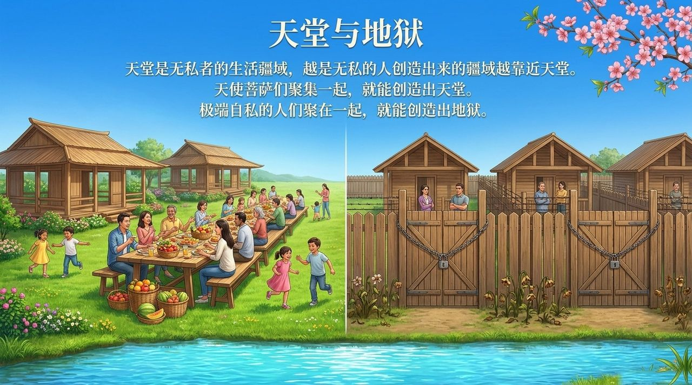
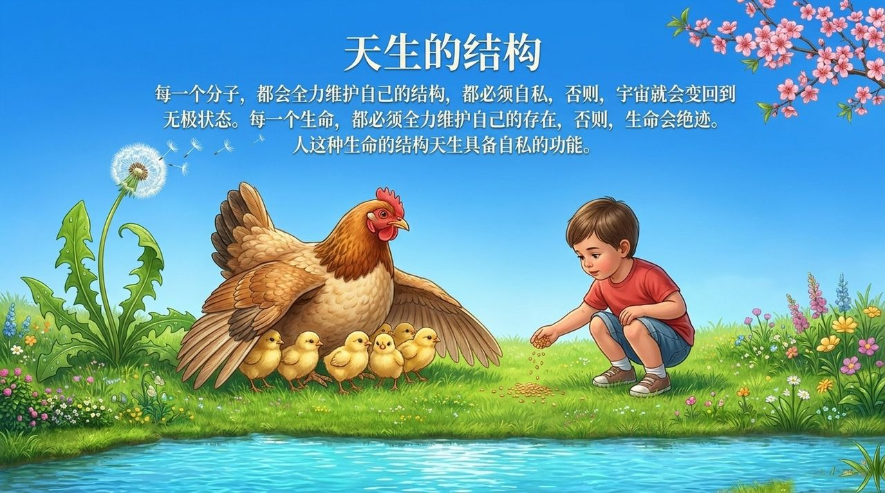
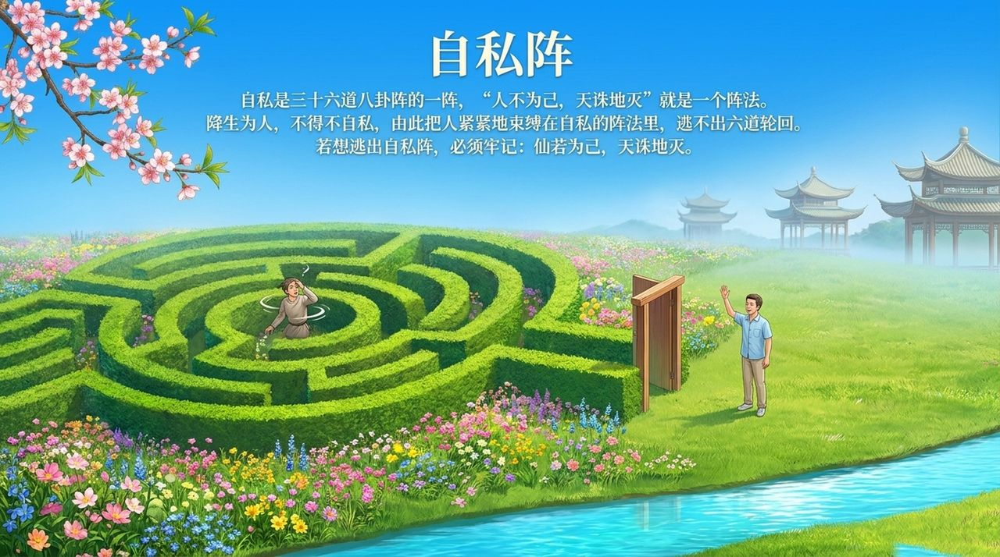
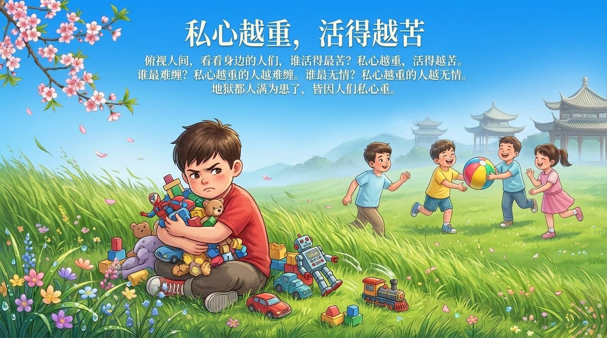
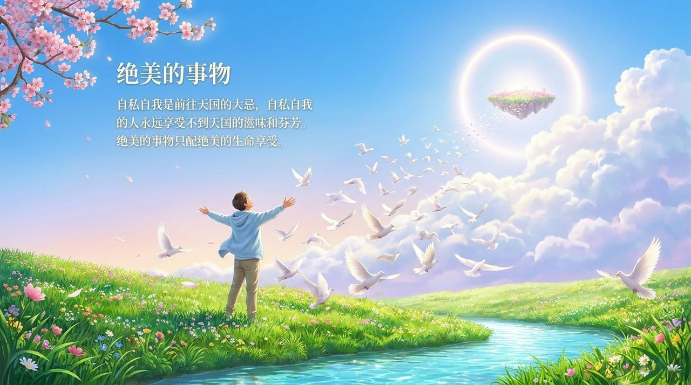

<!-- id: LC-ZW-0001-ZH theme: 修行 type: 导航 direction: 品性修炼 lang: zh -->

# 自私与无私

自私，是将个体利益置于一切之上的心性，是生命基因的癌细胞；无私，是超越自我局限的品质，是生命最完美的境界。天堂是无私者的生活疆域，地狱是极端自私者共同造就的苦海。无私者属天国生命，有私者属人间生命，私重者属地狱生命。

---

## 视频版

<iframe style="width:100%;aspect-ratio:4/3;border:0" src="https://www.youtube-nocookie.com/embed/UCz8yLLY3mU" title="自私与无私（生命禅院百科·视频版）" allowfullscreen></iframe>

??? info "📖 图文幻灯（14 张，点击展开）"

    
    
    
    
    
    
    
    
    
    
    
    
    
    

---

## 版本导航

| 版本 | 适合读者 | 特点 |
|------|---------|------|
| [通俗版](friendly.md) | 初次了解者 | 生活情境·三重分界·除私路径 |
| [学术版](academic.md) | 学者·跨文化比较 | 与佛教无我·儒家克己·经济学自利假设对照 |
| [内部版](internal.md) | 修行者·研究者 | 完整引文·七节框架·体系内深度理解 |

---

## 相关词条

[魔性](/zh/moxing/) · [傲慢](/zh/aoman/) · [谦卑](/zh/humility/) · [感恩](/zh/gratitude/) · [悔过](/zh/repentance/) · [放下](/zh/letting-go/) · [无我无形](/zh/no-self-no-form/) · [心灵花园](/zh/soul-garden/) · [成仙成佛](/zh/becoming-celestial-buddha/)
